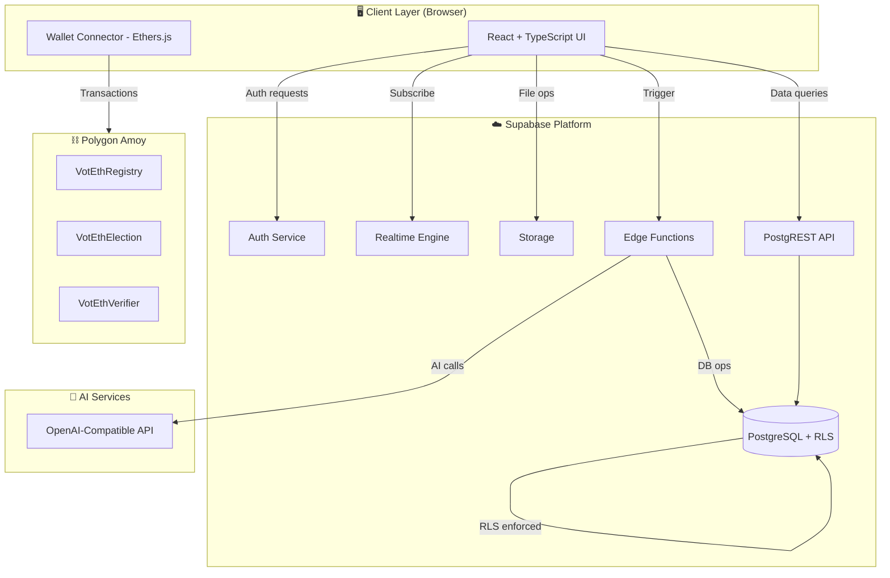
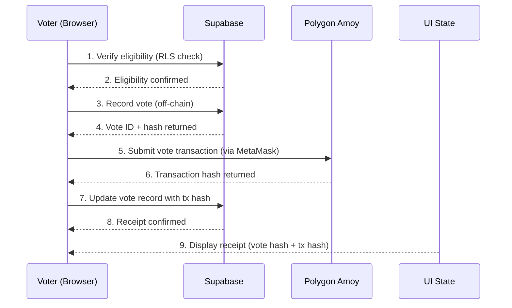
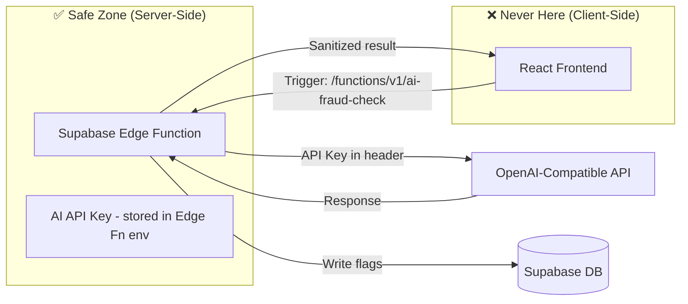
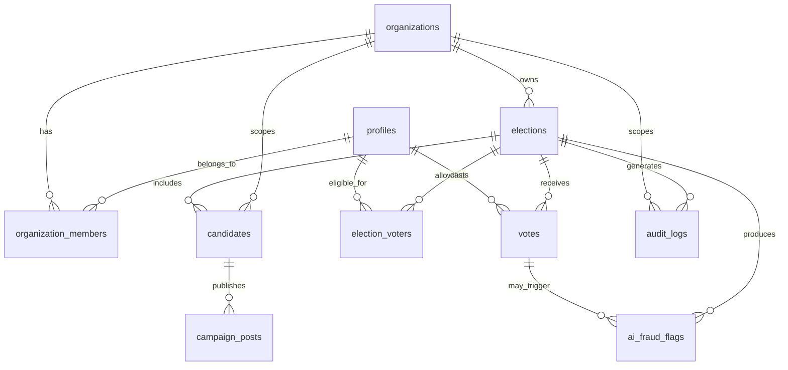
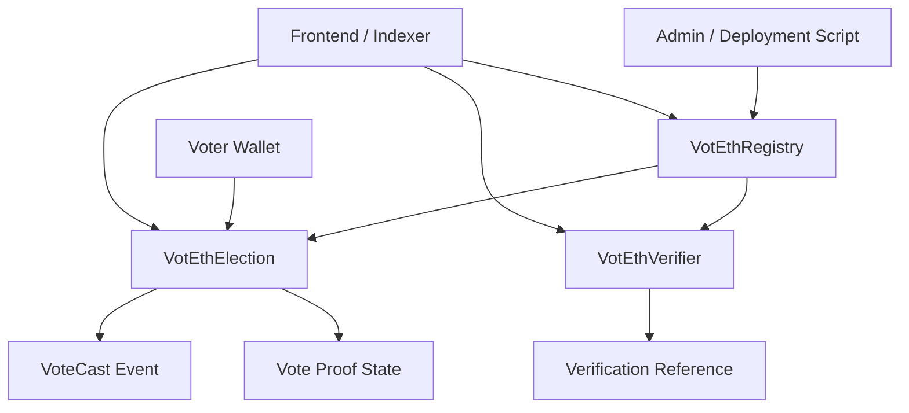

# VotEth 2.0 — Complete Development Bible
## The Engineering Handbook for a Production-Grade Blockchain Voting Platform

**Author:** Principal Engineering Team
**Version:** 2.0.0 | **Status:** Living Document | **Last Updated:** June 2026

> "This document is the permanent memory of the VotEth 2.0 project. Every decision, every trade-off, every architectural choice is recorded here. No prior conversation is assumed. Any engineer — human or AI — can pick this document up and continue the project from where it left off."

---

## Convention Key

| Symbol | Meaning |
|---|---|
| 📐 | Architecture decision |
| ⚠️ | Warning or common mistake |
| 💡 | Insight or best practice |
| 🔗 | Cross-reference to another chapter |
| 🧪 | Testing instruction |
| 📋 | Checklist item |
| 💰 | Cost/budget consideration |
| 🔒 | Security note |
| 🚀 | Deployment note |

---


## VOLUME I — FOUNDATION & VISION
### Chapters 1–4 | The "Why" before the "How"

**Author:** Principal Engineering Team
**Version:** 1.0.0 | **Status:** Living Document | **Last Updated:** June 2026

> "This document is the permanent memory of the VotEth 2.0 project. Every decision, every trade-off, every architectural choice is recorded here. No prior conversation is assumed. Any engineer — human or AI — can pick this document up and continue the project from where it left off."

---

## Chapter 1 — Project Vision & Product Definition

---

### 1.1 What VotEth 2.0 Is (and Is Not)

**VotEth 2.0 is** a production-grade, blockchain-anchored digital voting platform built as a full-stack portfolio project demonstrating senior-level engineering across five domains simultaneously: relational databases, modern frontend, smart contract development, AI integration, and DevOps.

**VotEth 2.0 is NOT:**
- A replacement for national election infrastructure
- A legally certified voting system
- A production SaaS product (yet — see Volume XV)
- A simple CRUD app dressed up with blockchain buzzwords

The distinction matters. Every architectural decision is made through the lens of: *"Does this demonstrate real engineering judgment, or does it just look impressive on the surface?"*

---

### 1.2 Problem Statement

Digital voting systems face a trilemma:

```
        TRANSPARENCY
             /\
            /  \
           /    \
          /      \
    SECURITY ---- ACCESSIBILITY
```

**Current solutions fail at least one corner:**

| Solution | Transparency | Security | Accessibility |
|---|---|---|---|
| Paper ballots | ❌ Hard to audit at scale | ✅ | ❌ Slow, manual |
| Proprietary e-voting | ❌ Black box | ⚠️ Unknown | ✅ |
| Pure blockchain | ✅ | ✅ | ❌ Too technical |
| **VotEth 2.0** | ✅ On-chain anchoring | ✅ Multi-layer | ✅ Web2 UX |

VotEth 2.0 resolves this by pairing a Web2-grade user experience (React, Supabase, familiar auth) with Web3-grade auditability (immutable on-chain vote records, cryptographic proofs).

---

### 1.3 Target Users & Use Cases

**Three primary user roles:**

#### 🏛️ Organization Admins
- University student unions running elections
- DAOs managing governance proposals
- Corporate boards conducting shareholder votes
- Community organizations running referendums

**What they need:** Create elections, manage candidates, configure rules, view analytics, export results.

---

#### 🗳️ Voters
- Members of the above organizations
- Authenticated via email, magic link, OAuth, or wallet
- May or may not have any blockchain knowledge

**What they need:** See elections they're eligible for, cast votes easily, receive cryptographic receipts, verify their vote was counted.

---

#### 👤 Candidates
- Individuals standing for election
- Need campaign pages, profile management, document uploads

**What they need:** A campaign portal to present themselves, visibility into their own stats.

---

### 1.4 Core Value Propositions

**1. Tamper-Evident Results**
> Every vote is anchored to the Polygon blockchain. After the election, anyone can independently verify the result matches the on-chain record — no trust in VotEth required.

**2. Familiar UX, No Crypto Required**
> Voters use email/password or Google sign-in. Blockchain happens in the background. Wallet-based voting is supported but never required.

**3. AI-Augmented Administration**
> Fraud detection flags suspicious voting patterns. An AI assistant answers admin questions in natural language. Candidate profiles are auto-summarized for voters.

**4. Audit-First Architecture**
> Every action — vote cast, election opened, candidate approved — is written to an immutable audit log. Paired with on-chain events, this creates a complete, verifiable history.

**5. Organization-Scoped, Multi-Tenant Ready**
> Built from day one with `org_id` isolation. Adding billing and full SaaS productization (Volume XV) requires no schema redesign.

---

### 1.5 The VotEth 2.0 Feature Map

```
VotEth 2.0
│
├── CORE VOTING ENGINE
│   ├── Election creation & configuration
│   ├── Candidate registration & approval
│   ├── Voter allowlist management
│   ├── One-person-one-vote enforcement (on-chain + off-chain)
│   ├── Vote casting with blockchain anchoring
│   ├── Vote receipt & cryptographic proof
│   └── Result tallying & publication
│
├── CAMPAIGN PORTAL
│   ├── Candidate campaign pages (rich text)
│   ├── Media upload & management
│   └── AI-generated candidate summaries
│
├── ANALYTICS DASHBOARD
│   ├── Real-time vote tracking
│   ├── Voter turnout metrics
│   ├── Candidate performance charts
│   └── Export & reporting
│
├── QR CODE SYSTEM
│   ├── QR code generation per voter
│   ├── QR scanning at voting terminal
│   └── Verification flow
│
├── AI LAYER
│   ├── Fraud detection & behavioral anomaly flagging
│   ├── Election assistant (natural language Q&A)
│   └── Candidate summarizer
│
├── AUTHENTICATION
│   ├── Email/password
│   ├── Magic link
│   ├── OAuth (Google, GitHub)
│   └── Sign-In With Ethereum (SIWE)
│
├── BLOCKCHAIN LAYER
│   ├── VotEthElection contract
│   ├── VotEthRegistry contract
│   ├── VotEthVerifier contract (QR + ZK-ready)
│   └── Deployed on Polygon Amoy testnet
│
└── ADMINISTRATION
    ├── Role-based access control
    ├── Super admin dashboard (platform-wide)
    ├── Audit logs
    └── Organization management
```

---

### 1.6 Success Criteria

A project without defined success criteria cannot be declared done. VotEth 2.0 is complete when:

#### Technical Success Criteria
- [ ] All smart contracts deployed to Polygon Amoy and verified on Polygonscan
- [ ] 80%+ test coverage across smart contracts (Hardhat/Chai)
- [ ] 70%+ test coverage across frontend (Vitest/RTL)
- [ ] All critical RLS policies tested and verified
- [ ] CI/CD pipeline passing on every PR
- [ ] No high/critical security findings from Slither or manual audit
- [ ] Lighthouse score ≥ 90 on Performance, Accessibility, Best Practices

#### Product Success Criteria
- [ ] An organization admin can create a complete election in under 5 minutes
- [ ] A voter with no blockchain experience can cast a vote in under 2 minutes
- [ ] Vote results are verifiable on-chain independently of VotEth UI
- [ ] AI fraud flags are surfaced to admins within 60 seconds of anomaly detection

#### Portfolio Success Criteria
- [ ] GitHub repository is public with professional README
- [ ] Live demo URL is stable and accessible
- [ ] Architecture can be explained clearly in a 10-minute technical interview
- [ ] Resume bullet points are backed by measurable outcomes

---

### 1.7 Portfolio & Academic Value

VotEth 2.0 is engineered to demonstrate proficiency across the exact skills that senior engineering teams and technical hiring managers look for in 2025–2026:

| Skill Domain | What VotEth Demonstrates |
|---|---|
| **Full-Stack Development** | React + TypeScript + Supabase + PostgreSQL |
| **Smart Contract Engineering** | Solidity, Hardhat, OpenZeppelin, Polygon |
| **Security Engineering** | RLS, audit logs, input validation, threat modeling |
| **AI Integration** | LLM APIs, prompt engineering, fraud detection |
| **DevOps** | GitHub Actions CI/CD, Vercel, environment management |
| **Database Design** | Normalized schema, RLS policies, migrations |
| **System Architecture** | Multi-layer design, trust boundaries, trade-off reasoning |
| **Testing** | Unit, integration, E2E, smart contract adversarial tests |
| **Technical Documentation** | ADRs, runbooks, API docs, living documentation |

> 💡 **Insight:** Most portfolio projects demonstrate one or two of these. VotEth 2.0 demonstrates all nine — simultaneously, coherently, in a single production-grade system. That is the differentiator.

---

### 1.8 Chapter 1 Review Checklist

- [ ] You can explain what VotEth 2.0 is in one sentence
- [ ] You can articulate the trilemma VotEth solves
- [ ] You understand the three user roles and what each needs
- [ ] You can recite the five core value propositions
- [ ] You know the success criteria and can track against them
- [ ] You can explain the portfolio value of this project in a technical interview

---

## Chapter 2 — Requirements Engineering

---

### 2.1 Functional Requirements

Functional requirements define *what the system does.* Each requirement is assigned an ID for traceability.

#### Authentication & Identity (AUTH)

| ID | Requirement |
|---|---|
| AUTH-01 | Users can register with email and password |
| AUTH-02 | Users can authenticate via magic link |
| AUTH-03 | Users can authenticate via Google OAuth |
| AUTH-04 | Users can authenticate via GitHub OAuth |
| AUTH-05 | Users can authenticate via Sign-In With Ethereum (SIWE) |
| AUTH-06 | Sessions persist across browser refreshes |
| AUTH-07 | Users can log out from all devices |
| AUTH-08 | Email verification is required before full access |
| AUTH-09 | Password reset flow is functional |

#### Organization Management (ORG)

| ID | Requirement |
|---|---|
| ORG-01 | Authenticated users can create organizations |
| ORG-02 | Organization creators become Organization Admins |
| ORG-03 | Admins can invite members by email |
| ORG-04 | Invited users receive email with accept/decline link |
| ORG-05 | Admins can assign roles (Admin, Moderator, Viewer) |
| ORG-06 | Admins can remove members |
| ORG-07 | Organization data is strictly isolated (no cross-org leakage) |

#### Election Management (ELEC)

| ID | Requirement |
|---|---|
| ELEC-01 | Admins can create elections with title, description, start/end dates |
| ELEC-02 | Admins can configure election type (single choice, multi-choice) |
| ELEC-03 | Admins can configure maximum votes per voter |
| ELEC-04 | Elections have states: DRAFT → OPEN → CLOSED → PUBLISHED |
| ELEC-05 | Admins can open and close elections manually |
| ELEC-06 | Elections are automatically opened/closed at configured times |
| ELEC-07 | Election configuration is locked once OPEN |
| ELEC-08 | Election results are hidden until PUBLISHED |
| ELEC-09 | Admins can register the election on-chain upon creation |

#### Candidate Management (CAND)

| ID | Requirement |
|---|---|
| CAND-01 | Candidates can be added by admins or register via campaign portal |
| CAND-02 | Candidate profiles include: name, bio, photo, documents |
| CAND-03 | Candidates require admin approval before appearing on ballot |
| CAND-04 | Approved candidates are registered on-chain |
| CAND-05 | Candidates can edit their own campaign pages |
| CAND-06 | AI summary is generated for each approved candidate |

#### Voting (VOTE)

| ID | Requirement |
|---|---|
| VOTE-01 | Only allowlisted voters can vote in a given election |
| VOTE-02 | Each voter can cast at most one vote per election (configurable) |
| VOTE-03 | Votes are recorded in Supabase and anchored on-chain |
| VOTE-04 | Double-voting is prevented at both database and contract level |
| VOTE-05 | Voters receive a cryptographic receipt after voting |
| VOTE-06 | Voters can verify their vote is included in the tally |
| VOTE-07 | Vote choices are private during OPEN state |
| VOTE-08 | Aggregate results are available after PUBLISHED state |

#### QR System (QR)

| ID | Requirement |
|---|---|
| QR-01 | Each eligible voter receives a unique QR code |
| QR-02 | QR codes can be scanned to initiate voting session |
| QR-03 | QR codes are single-use |
| QR-04 | QR codes expire after election closes |

#### AI Features (AI)

| ID | Requirement |
|---|---|
| AI-01 | System detects anomalous voting patterns and flags them |
| AI-02 | Admin dashboard displays AI-generated fraud flags with explanations |
| AI-03 | Admins can dismiss or escalate AI flags |
| AI-04 | Election assistant answers admin questions in natural language |
| AI-05 | Candidate summaries are auto-generated from profile content |

#### Analytics (ANLT)

| ID | Requirement |
|---|---|
| ANLT-01 | Real-time vote count displayed to admins during OPEN state |
| ANLT-02 | Voter turnout percentage is displayed |
| ANLT-03 | Results can be exported as CSV |
| ANLT-04 | On-chain vote count matches off-chain count (verification view) |

---

### 2.2 Non-Functional Requirements

Non-functional requirements define *how well the system does it.*

| Category | Requirement | Target |
|---|---|---|
| **Performance** | Page load time (LCP) | < 2.5s on 4G |
| **Performance** | API response time (p95) | < 500ms |
| **Performance** | Vote submission time | < 3s (excl. blockchain confirmation) |
| **Availability** | Platform uptime | ≥ 99.5% (within Vercel/Supabase free tier limits) |
| **Scalability** | Concurrent voters per election | ≥ 500 (initial target) |
| **Security** | Auth token expiry | 1 hour (refresh token: 7 days) |
| **Security** | All data in transit | TLS 1.2+ enforced |
| **Security** | RLS on all tables | 100% — no table without policy |
| **Accessibility** | WCAG compliance | Level AA |
| **Accessibility** | Keyboard navigation | 100% of core flows |
| **Maintainability** | TypeScript strict mode | Enabled — no `any` types |
| **Maintainability** | Test coverage (contracts) | ≥ 80% |
| **Maintainability** | Test coverage (frontend) | ≥ 70% |
| **Documentation** | Every public function | JSDoc / NatSpec documented |

---

### 2.3 System Constraints

These are hard constraints — not preferences, not guidelines. They cannot be negotiated.

| Constraint | Reason |
|---|---|
| **Free tier only** (Supabase, Vercel, Alchemy) | Budget: $0/month operational cost target |
| **Polygon Amoy testnet** (not mainnet) | Real ETH costs prohibitive for a portfolio project |
| **No server-side secrets on the client** | Security — API keys never exposed to browser |
| **RLS on every table** | Security non-negotiable |
| **Conventional Commits enforced** | Professional Git history for portfolio |
| **TypeScript strict mode** | Code quality non-negotiable |
| **Single developer** | All playbooks designed for solo execution |

---

### 2.4 User Stories & Acceptance Criteria

**US-001: Admin creates an election**
> *As an Organization Admin, I want to create an election so that my organization's members can vote on a decision.*

**Acceptance Criteria:**
- Admin can navigate to "Create Election" from the dashboard
- Form requires: title (required), description (optional), start date, end date, election type
- Submitting the form creates an election in DRAFT state
- Admin is redirected to the election management page
- A success notification is displayed
- The election appears in the admin's election list

---

**US-002: Voter casts a vote**
> *As an eligible voter, I want to cast my vote so that my choice is recorded securely and verifiably.*

**Acceptance Criteria:**
- Voter can see elections they are eligible for on their dashboard
- Voter can view candidate profiles before voting
- Voter selects a candidate and clicks "Cast Vote"
- A confirmation modal appears with the voter's selection
- On confirmation, vote is submitted to Supabase and transaction sent to blockchain
- Voter receives a receipt showing: vote hash, blockchain transaction ID, timestamp
- Voter cannot vote again in the same election (UI shows "Vote Cast" state)

---

**US-003: Admin reviews AI fraud flags**
> *As an Organization Admin, I want to see AI-generated fraud flags so that I can investigate suspicious voting patterns.*

**Acceptance Criteria:**
- Admin dashboard shows a "Fraud Alerts" panel
- Each flag includes: description, severity, affected voter/pattern, timestamp
- Admin can click "Dismiss" (flag marked dismissed, stored in DB)
- Admin can click "Escalate" (flag marked escalated, audit log entry created)
- Dismissed flags are hidden by default (toggle to show)

---

### 2.5 Requirement Traceability Matrix

| Requirement ID | User Story | Chapter | Component | Test |
|---|---|---|---|---|
| AUTH-01 | US-010 | Ch. 12 | `AuthPage.tsx` | `auth.test.ts` |
| VOTE-01 | US-002 | Ch. 25 | `VotingInterface.tsx` | `voting.test.ts` |
| VOTE-04 | US-002 | Ch. 25 | `VotEthElection.sol` | `VotEthElection.test.ts` |
| AI-01 | US-003 | Ch. 30 | `fraudDetection.ts` | `fraud.test.ts` |
| ELEC-04 | US-001 | Ch. 23 | `electionService.ts` | `election.test.ts` |

> 📐 **Architecture Decision:** The traceability matrix lives in `docs/requirements/traceability.md` and is updated whenever a requirement changes. This is the engineering paper trail.

---

### 2.6 Out-of-Scope Items (and Why)

| Item | Why Out of Scope |
|---|---|
| **Anonymous voting (zk-SNARKs)** | Semaphore integration is complex; deferred to VotEth 2.1 (Ch. 36, 52) |
| **Mobile native app** | Web-first; mobile deferred to VotEth 2.3 (Ch. 52) |
| **Mainnet deployment** | Cost prohibitive; Polygon Amoy testnet is sufficient for portfolio |
| **Real payment processing** | Billing deferred to VotEth 2.2 SaaS phase (Ch. 68) |
| **Legal compliance certifications** | Out of scope for academic/portfolio project |
| **Multi-language (i18n)** | English only for v2.0; i18n architecture documented for future |
| **Ranked-choice voting** | Single and multi-choice only; RCV adds algorithmic complexity deferred |

---

### 2.7 Chapter 2 Review Checklist

- [ ] You can cite at least 5 functional requirements by ID (e.g., VOTE-04)
- [ ] You understand the difference between functional and non-functional requirements
- [ ] You know the hard system constraints and why each exists
- [ ] You can write an acceptance criterion for a new user story
- [ ] You know what is explicitly out of scope and why

---

## Chapter 3 — Technology Stack Decisions

---

### 3.1 Full Stack Decision Matrix

Every technology was chosen against four criteria: **Capability**, **Free Tier**, **Portfolio Signal**, and **Ecosystem Health**.

```
Technology         | Capability | Free Tier | Portfolio | Ecosystem
-------------------|------------|-----------|-----------|----------
React + TypeScript | ★★★★★    | ★★★★★   | ★★★★★   | ★★★★★
Supabase           | ★★★★☆    | ★★★★★   | ★★★★☆   | ★★★★★
Hardhat + Solidity | ★★★★★    | ★★★★★   | ★★★★★   | ★★★★★
Polygon Amoy       | ★★★★☆    | ★★★★★   | ★★★★☆   | ★★★★★
Tailwind CSS       | ★★★★★    | ★★★★★   | ★★★★☆   | ★★★★★
Vercel             | ★★★★★    | ★★★★★   | ★★★★★   | ★★★★★
OpenAI-Compatible  | ★★★★★    | ★★★☆☆   | ★★★★★   | ★★★★★
Ethers.js          | ★★★★★    | ★★★★★   | ★★★★★   | ★★★★☆
Vite               | ★★★★★    | ★★★★★   | ★★★★☆   | ★★★★★
```

---

### 3.2 Frontend: React + TypeScript + Vite

**React 18** is chosen for:
- Component-based architecture — maps cleanly to election, candidate, voter UI domains
- Rich ecosystem (React Query, React Router, React Hook Form)
- Industry standard — maximizes portfolio signal

**TypeScript (strict mode)** is chosen for:
- Compile-time safety across a complex multi-domain codebase
- Self-documenting contracts between components
- Required for professional-grade codebases

**Vite** is chosen over Create React App for:
- Significantly faster HMR (Hot Module Replacement)
- Native ESM support
- Better tree-shaking and bundle optimization
- Modern tooling — CRA is effectively deprecated

```json
// Core frontend dependencies
{
  "react": "^18.x",
  "react-dom": "^18.x",
  "typescript": "^5.x",
  "vite": "^5.x",
  "@vitejs/plugin-react": "^4.x",
  "react-router-dom": "^6.x",
  "@tanstack/react-query": "^5.x",
  "react-hook-form": "^7.x",
  "zod": "^3.x"
}
```

---

### 3.3 Styling: Tailwind CSS

**Tailwind CSS v3** is chosen for:
- Utility-first approach — rapid iteration without context-switching
- No CSS file sprawl in a large component tree
- Design token integration (custom colors, spacing — see Volume XVII)
- Excellent Vite integration via PostCSS

> ⚠️ **Warning:** Tailwind is not a substitute for design thinking. Volume XVII establishes a complete design token system. Do not use arbitrary values (e.g., `w-[347px]`) except in exceptional cases. Always extend the Tailwind config with project tokens.

---

### 3.4 Backend-as-a-Service: Supabase

Supabase provides:

| Service | What We Use It For |
|---|---|
| **PostgreSQL** | All relational data (elections, votes, candidates, orgs) |
| **Auth** | Email, magic link, OAuth, SIWE sessions |
| **PostgREST** | Auto-generated REST API from schema |
| **Realtime** | Live vote count updates, live fraud flag alerts |
| **Storage** | Candidate photos, campaign documents, QR codes |
| **Edge Functions** | Server-side AI calls, webhook handlers |

**Free Tier Limits:**
- 500MB database storage
- 5GB bandwidth/month
- 50,000 monthly active users
- 1GB file storage

> 💰 **Budget:** Sufficient for portfolio/demo workloads. Production scaling path is documented in Chapter 51.

---

### 3.5 Blockchain: Solidity + Hardhat + Polygon Amoy

**Solidity ^0.8.20** for smart contracts:
- Mature, battle-tested language
- Built-in overflow protection (post 0.8.0)
- Extensive OpenZeppelin library support

**Hardhat** for development environment:
- TypeScript-native (unlike Truffle)
- Excellent plugin ecosystem (gas reporter, coverage, Etherscan verification)
- Local Hardhat Network for rapid testing

**Polygon Amoy Testnet** for deployment:
- EVM-compatible (Solidity works identically)
- Free test MATIC from faucet
- Polygonscan for contract verification
- Low gas fees (important for vote submissions)
- Production Polygon PoS is a direct upgrade path

```json
// Core blockchain dependencies
{
  "hardhat": "^2.x",
  "@nomicfoundation/hardhat-toolbox": "^4.x",
  "@openzeppelin/contracts": "^5.x",
  "ethers": "^6.x"
}
```

---

### 3.6 Wallet Integration: Ethers.js + MetaMask

**Ethers.js v6** (not Web3.js) for:
- Smaller bundle size
- Better TypeScript support
- More modern API design
- Active maintenance (Web3.js is declining)

**MetaMask** as primary wallet target:
- Dominant market share (>30M users)
- Reliable `window.ethereum` injection
- WalletConnect integration planned for multi-wallet support (Ch. 22)

---

### 3.7 AI Layer: OpenAI-Compatible APIs

**Architecture Decision:** We use OpenAI-compatible APIs via an abstraction layer, not the OpenAI SDK directly hardcoded.

This means:
- Primary: OpenAI GPT-4o-mini (cost-effective)
- Drop-in alternatives: Groq (free tier), Ollama (local), Together AI
- The abstraction is a single `aiClient.ts` service

> 🔒 **Security:** All AI API calls are made from Supabase Edge Functions — never from the frontend. API keys never reach the browser.

---

### 3.8 Deployment: Vercel

**Vercel** for frontend hosting:
- Zero-config Vite/React deployment
- Automatic preview deployments per PR (critical for portfolio)
- Edge network CDN
- Environment variable management per environment (dev/staging/prod)
- Free tier: 100GB bandwidth, unlimited personal projects

---

### 3.9 Version Control: Git + GitHub + GitHub Actions

- **GitHub** for remote repository and portfolio presentation
- **GitHub Actions** for CI/CD (free for public repos)
- **Conventional Commits** enforced via commitlint + husky
- **Branch protection** on `main` — PRs required even for solo dev

> 💡 **Insight:** The discipline of PRs, conventional commits, and branch protection on a solo project is itself a portfolio signal. It demonstrates professional process, not just code.

---

### 3.10 Future Technologies: IPFS, Semaphore, zk-SNARKs

Documented here to show awareness, deferred to future versions:

| Technology | Purpose | When |
|---|---|---|
| **IPFS** | Decentralized storage for election metadata | VotEth 2.1 |
| **Semaphore** | Anonymous group membership proofs | VotEth 2.1 |
| **zk-SNARKs** | Zero-knowledge vote privacy | VotEth 2.1 |
| **Stripe** | Billing for SaaS tier | VotEth 2.2 |

---

### 3.11 Alternatives Considered & Rejected

| Alternative | Why Rejected |
|---|---|
| **Next.js** (over Vite/React) | SSR adds complexity not needed; blockchain UX is inherently client-side |
| **Firebase** (over Supabase) | No SQL, no RLS, vendor lock-in to Google, no self-host path |
| **Truffle** (over Hardhat) | Declining community, weaker TypeScript support |
| **Web3.js** (over Ethers.js) | Larger bundle, older API, declining maintenance |
| **Ethereum mainnet** | Gas costs prohibitive for portfolio; Polygon Amoy is EVM-identical |
| **MongoDB** | No relational integrity for voting data; no row-level security |
| **Prisma ORM** | Adds abstraction layer that obscures SQL; Supabase generates types directly |
| **Redux** | Overkill for this state complexity; React Query + Context is sufficient |

---

### 3.12 Budget Breakdown (Free Tier Analysis)

| Service | Free Tier | Usage Projection | Cost |
|---|---|---|---|
| Supabase | 500MB DB, 5GB bandwidth | ~50MB DB, <1GB bandwidth | **$0** |
| Vercel | 100GB bandwidth, unlimited projects | <5GB bandwidth | **$0** |
| Alchemy (RPC) | 300M compute units/month | ~10M CU | **$0** |
| GitHub | Unlimited public repos, 2000 CI min/month | ~500 min | **$0** |
| OpenAI | Pay-as-you-go | ~$2–5/month (dev usage) | **~$3** |
| Polygon Amoy | Free testnet MATIC | Free from faucet | **$0** |
| **Total** | | | **~$3/month** |

> 💰 **Budget insight:** The entire VotEth 2.0 stack runs for approximately $3/month during active development — and $0/month when using Groq or Ollama for the AI layer.

---

### 3.13 Chapter 3 Review Checklist

- [ ] You can justify the choice of each major technology in one sentence
- [ ] You understand why Next.js was rejected
- [ ] You understand why Supabase was chosen over Firebase
- [ ] You know the free tier limits for Supabase and Vercel
- [ ] You know that AI calls must NEVER be made from the frontend
- [ ] You understand the OpenAI-compatible abstraction strategy

---

## Chapter 4 — System Architecture Overview

---

### 4.1 The Three-Layer Architecture

VotEth 2.0 is organized into three distinct layers with defined trust boundaries:

```
┌─────────────────────────────────────────────────────────────┐
│                    PRESENTATION LAYER                        │
│              React + TypeScript + Tailwind                   │
│         (User's browser — ZERO trust environment)           │
└─────────────────────────┬───────────────────────────────────┘
                          │ HTTPS / WebSocket
┌─────────────────────────▼───────────────────────────────────┐
│                     SERVICE LAYER                            │
│                  Supabase Platform                           │
│   PostgreSQL │ Auth │ PostgREST │ Realtime │ Storage │ Edge  │
│         (Managed trust — RLS is the enforcement layer)       │
└──────────┬──────────────────────────────────────┬───────────┘
           │ JSON-RPC                              │ HTTPS (Edge Fn)
┌──────────▼──────────┐                ┌──────────▼───────────┐
│   BLOCKCHAIN LAYER  │                │      AI LAYER        │
│   Polygon Amoy      │                │  OpenAI-Compatible   │
│   Smart Contracts   │                │  API (via Edge Fn)   │
│  (Zero trust —      │                │  (Server-side only)  │
│  math is the law)   │                └──────────────────────┘
└─────────────────────┘
```

---

### 4.2 High-Level System Diagram (Mermaid)



---

### 4.3 Data Flow Architecture

#### Vote Casting Flow (The Critical Path)



> 📐 **Architecture Decision:** The off-chain record (step 3) is committed before the blockchain transaction (step 5). This ensures we always have a database record even if the blockchain call fails. A reconciliation job can re-submit failed transactions. See Chapter 25 for full voting flow implementation.

---

### 4.4 Trust Model & Security Boundaries

```
TRUST LEVEL    │  LAYER             │  ENFORCEMENT MECHANISM
───────────────┼────────────────────┼──────────────────────────
ZERO TRUST     │  Browser/Client    │  Treat as hostile. Never trust.
               │                    │  All validation server-side.
───────────────┼────────────────────┼──────────────────────────
CONDITIONAL    │  Supabase/PostgREST│  JWT auth + RLS policies.
TRUST          │                    │  Trust the token, enforce RLS.
───────────────┼────────────────────┼──────────────────────────
MATHEMATICAL   │  Smart Contracts   │  Trust no one.
TRUST          │                    │  Code is law. Math enforces.
───────────────┼────────────────────┼──────────────────────────
SERVER-SIDE    │  Edge Functions    │  Full trust zone.
ONLY           │                    │  Secrets live here only.
```

> 🔒 **Security Note:** The most common mistake in this architecture is trusting the client. A vote cannot be accepted just because the frontend says it is valid. Every vote submission goes through: (1) RLS check in Supabase, (2) `hasVoted` check in the smart contract. Neither check alone is sufficient.

---

### 4.5 The Role of the Blockchain in This Architecture

The blockchain serves **one primary function** in VotEth 2.0:

> **Immutable, tamper-evident anchoring of election results.**

It does **NOT**:
- Store full vote data (gas cost prohibitive)
- Serve as the primary database
- Handle authentication
- Replace Supabase

It **DOES**:
- Record vote hashes on-chain (not the vote content — the hash)
- Enforce one-vote-per-wallet at the smart contract level
- Provide an independently verifiable result tally
- Emit events that create an on-chain audit trail

> 💡 **Insight:** This is a hybrid architecture. The blockchain is not a replacement for Supabase — it is a cryptographic anchor that makes the Supabase data independently verifiable. An auditor can check: *"Does the on-chain tally match the Supabase tally?"* If yes, the system is operating honestly.

---

### 4.6 The Role of Supabase in This Architecture

Supabase is the **operational backbone** of VotEth 2.0:

- **Primary database** for all application data
- **Auth provider** for all user identity
- **Real-time engine** for live vote counts and alerts
- **Storage** for candidate media and documents
- **Edge Functions** as the secure server-side execution environment

Supabase provides the Web2 UX layer that makes blockchain voting accessible to non-crypto users.

---

### 4.7 How AI Integrates with the System



**AI features and their triggers:**

| Feature | Trigger | Edge Function |
|---|---|---|
| Fraud Detection | Vote cast event | `ai-fraud-check` |
| Election Assistant | Admin chat message | `ai-election-assistant` |
| Candidate Summarizer | Candidate approval | `ai-candidate-summary` |

---

### 4.8 Architecture Trade-offs & Justifications

| Decision | Trade-off | Justification |
|---|---|---|
| **Hybrid on/off-chain** | More complex than pure on-chain | Gas costs make pure on-chain prohibitive; hybrid gives best UX + auditability |
| **Supabase over custom backend** | Vendor dependency | Free tier + RLS + Auth + Realtime saves ~200hrs of backend work; self-host path exists |
| **Vite over Next.js** | No SSR/SSG | Blockchain UX is client-heavy; SSR provides little benefit and adds complexity |
| **Off-chain vote first** | Slight consistency risk | Ensures DB record exists; blockchain failure doesn't lose the vote |
| **RLS over application-level auth** | Learning curve | RLS is enforced at the database level — cannot be bypassed by application bugs |
| **Polygon Amoy over Ethereum** | Less prestige | Free, fast, EVM-identical; production path is straightforward |

---

### 4.9 Chapter 4 Review Checklist

- [ ] You can draw the three-layer architecture from memory
- [ ] You can explain the trust model at each layer
- [ ] You understand why blockchain is NOT a replacement for Supabase
- [ ] You can trace the vote casting sequence diagram step by step
- [ ] You understand why AI calls must go through Edge Functions
- [ ] You can justify each major architecture trade-off
- [ ] You know what "off-chain first" means for vote reliability

---

## Volume I — Complete

**What you now have:**
- A clear project identity and problem statement
- Complete functional and non-functional requirements with IDs
- A justified, budgeted technology stack
- A full system architecture with trust boundaries, data flows, and Mermaid diagrams

**Next:** Volume II — Project Setup & Engineering Standards (Chapters 5–8)

> 🔗 **Bridge:** Chapter 5 begins with the monorepo structure. Before reading it, ensure you have Node.js 20+, Git, and VS Code installed. Chapter 8 covers the full setup sequence.


---


## VOLUME II — PROJECT SETUP & ENGINEERING STANDARDS
### Chapters 5–8 | Repository Structure, Workflow Discipline, and Environment Foundations

**Author:** Principal Engineering Team  
**Version:** 1.0.0 | **Status:** Living Document | **Last Updated:** June 2026

> "This document is the permanent memory of the VotEth 2.0 project. Every decision, every trade-off, every architectural choice is recorded here. No prior conversation is assumed. Any engineer — human or AI — can pick this document up and continue the project from where it left off."

---

This volume turns strategy into execution discipline.

Volume I established what VotEth 2.0 is, why it exists, what problems it solves, and what architecture supports it. Volume II answers a different kind of question:

> **How should this project be organized so that implementation remains professional, resumable, and maintainable from day one?**

That question is more important than it first appears.

Many technically promising projects fail long before the architecture fails. They fail because the repository becomes confusing, the commit history becomes noisy, the coding style becomes inconsistent, or the environment setup becomes fragile enough that every new session starts with rediscovery.

VotEth cannot afford that.

This project is deliberately ambitious:
- full-stack frontend and backend
- relational schema with RLS
- smart contracts and blockchain integration
- AI features
- CI/CD
- documentation system
- portfolio-grade operational polish

Without strong engineering standards, that scope would quickly become chaos.

> **Core principle of this volume:** Engineering discipline is not bureaucracy. It is what makes ambitious systems survivable.

---

## Chapter 5 — Repository Architecture & Folder Structure

---

### 5.1 Why Monorepo Structure

VotEth uses a **monorepo** structure rather than scattering frontend, contracts, docs, and AI workflow assets across separate repositories.

#### Why monorepo is the correct choice here

Because the system is conceptually one product, even though it spans multiple technical layers.

These layers are tightly related:
- frontend depends on contract ABIs and environment references
- docs depend on real implementation details
- AI engineering assets depend on architecture and conventions
- CI workflows need visibility across the whole system
- repository presentation is stronger when the full system is visible together

A monorepo keeps:
- versioning aligned
- documentation close to code
- onboarding simpler
- cross-layer changes easier to coordinate

#### Benefits of monorepo for VotEth

| Benefit | Why It Matters |
|---|---|
| **Single source of truth** | One repo contains product, contracts, docs, and workflow memory |
| **Simpler coordination** | A change in contracts, types, and docs can ship together |
| **Better portfolio signal** | Reviewers can see the full system in one place |
| **Shared standards** | One CI/CD, one branching model, one contribution model |
| **Lower context switching** | Easier solo development across layers |

#### Trade-offs of monorepo

| Trade-off | Why It Is Acceptable |
|---|---|
| Repo becomes larger | Still manageable at this project scale |
| Requires clear folder discipline | This volume defines that discipline |
| Some tooling config is more complex | Worth it for cohesion |

> 📐 **Architecture Decision:** VotEth is a single-product monorepo because architecture, documentation, testing, and deployment all benefit from being versioned together.

---

### 5.2 Root-Level Layout

The repository root should remain calm and intentional.

The root is not a storage closet.
It is the top-level map of the project.

#### Proposed root structure

```text
voteth-2.0/
├── frontend/
├── contracts/
├── docs/
├── ai-engineering/
├── .github/
├── package.json
├── README.md
├── .gitignore
├── .env.example
├── LICENSE
└── CONTRIBUTING.md
```

#### Root-level rules

- only top-level system domains belong at root
- avoid dumping scripts and one-off files into the root
- root config files should be named clearly and justified
- if a file appears at root, it should matter to the whole project

#### Why root hygiene matters

New contributors — or future AI sessions — infer project maturity from root structure almost immediately.
A clean root says:
- this project has boundaries
- conventions are deliberate
- important files can be found quickly

A cluttered root says the opposite.

---

### 5.3 `/frontend` Directory Anatomy

The `frontend/` directory contains the React, TypeScript, Vite, and Tailwind application.

#### Proposed structure

```text
frontend/
├── public/
├── src/
│   ├── app/
│   ├── components/
│   ├── features/
│   ├── hooks/
│   ├── services/
│   ├── contexts/
│   ├── routes/
│   ├── types/
│   ├── utils/
│   ├── styles/
│   └── tests/
├── index.html
├── package.json
├── tsconfig.json
├── vite.config.ts
└── tailwind.config.ts
```

#### Directory intent

| Path | Purpose |
|---|---|
| `app/` | app bootstrapping, providers, root composition |
| `components/` | shared UI and layout primitives |
| `features/` | domain-based feature modules |
| `hooks/` | custom hooks for behavior reuse |
| `services/` | data and integration logic |
| `contexts/` | scoped shared state providers |
| `routes/` | route definitions and route-level wrappers |
| `types/` | frontend-local type definitions and adapters |
| `utils/` | stateless helper logic |
| `styles/` | token-connected styling and global CSS entry points |
| `tests/` | frontend test utilities and grouped test files |

#### Design principle

The frontend structure should reflect **domain and responsibility**, not personal mood.

> ⚠️ **Common Mistake:** Organizing every file purely by file type (`components/`, `pages/`, `hooks/`) without domain structure eventually creates a giant junk drawer. VotEth should prefer feature-aware organization once shared primitives are established.

---

### 5.4 `/contracts` Directory Anatomy

The `contracts/` directory contains smart contract source, tests, deployment scripts, and blockchain-specific tooling.

#### Proposed structure

```text
contracts/
├── contracts/
│   ├── VotEthElection.sol
│   ├── VotEthRegistry.sol
│   └── VotEthVerifier.sol
├── scripts/
├── test/
├── ignition/ or deploy/
├── artifacts/
├── cache/
├── hardhat.config.ts
├── package.json
└── tsconfig.json
```

#### Intent by path

| Path | Purpose |
|---|---|
| `contracts/` | Solidity source code |
| `scripts/` | deployment and maintenance scripts |
| `test/` | contract test suite |
| `deploy/` or similar | structured deployment flows |
| `artifacts/` | compiled outputs |
| `cache/` | compiler cache |

#### Important rule

Generated outputs such as `artifacts/` and `cache/` should not be treated like authored knowledge. They are build products.

#### Why separate contract toolchain matters

Contracts have:
- different dependencies
- different test assumptions
- different release risks
- different verification needs

Trying to blur them into the frontend toolchain creates confusion.

---

### 5.5 `/docs` Directory Anatomy

The `docs/` directory is the written memory of the project.

#### Proposed structure

```text
docs/
├── architecture/
├── requirements/
├── adr/
├── api/
├── contracts/
├── setup/
├── testing/
├── operations/
├── portfolio/
└── handbook/
```

#### Why `docs/` needs structure

Documentation scales poorly when it grows without categories.
A flat docs folder becomes a graveyard of half-remembered markdown files.

#### Suggested purpose map

| Path | Purpose |
|---|---|
| `architecture/` | diagrams, models, trust boundaries |
| `requirements/` | requirements, traceability, scope |
| `adr/` | Architecture Decision Records |
| `api/` | Edge Function/API interface docs |
| `contracts/` | ABI, deployment, contract references |
| `setup/` | environment and onboarding guides |
| `testing/` | test plans, coverage notes, strategies |
| `operations/` | runbooks, incidents, backups |
| `portfolio/` | resume/demo/interview assets |
| `handbook/` | the Development Bible and related memory assets |

---

### 5.6 `/ai-engineering` Directory Anatomy

This directory exists because AI-assisted development is part of the VotEth workflow by design.

#### Proposed structure

```text
ai-engineering/
├── prompts/
├── skills/
├── context/
├── handoff/
├── reviews/
└── evals/
```

#### Why this exists as a first-class project area

VotEth does not treat AI as a casual side tool.
It treats AI as a workflow surface that needs:
- explicit prompts
- context continuity
- review discipline
- reusable instructions

#### Path meanings

| Path | Purpose |
|---|---|
| `prompts/` | reusable task templates |
| `skills/` | project-specific assistant instructions |
| `context/` | short current-memory files |
| `handoff/` | session transition documents |
| `reviews/` | AI review checklists and notes |
| `evals/` | prompt/output regression artifacts |

---

### 5.7 `/.github/workflows` Directory Anatomy

This directory holds GitHub Actions workflows.

#### Proposed workflow categories

- frontend CI
- contract CI
- security scans
- preview deployment checks
- release or tagging workflows

#### Why workflow structure matters

Pipelines become invisible architecture.
If they are poorly named or inconsistent, operational clarity drops.

#### Naming guideline

Prefer names like:
- `frontend-ci.yml`
- `contracts-ci.yml`
- `security-scan.yml`
- `release.yml`

Not names like:
- `test2.yml`
- `newworkflow.yml`
- `pipeline-final-v3.yml`

That way lies repository despair.

---

### 5.8 Naming Conventions

Consistent naming is a hidden force multiplier.

#### Core naming rules

| Concern | Convention |
|---|---|
| React components | `PascalCase.tsx` |
| Hooks | `useSomething.ts` |
| Utility files | `camelCase.ts` or domain-consistent lower names |
| Solidity contracts | `PascalCase.sol` |
| SQL migrations | timestamped or ordered snake_case |
| Docs files | kebab-case.md |
| Branches | conventional purpose prefix + kebab-case |

#### Why naming matters

Naming is not cosmetic.
It affects:
- scan speed
- discoverability
- code review clarity
- AI prompt precision
- long-term maintainability

---

### 5.9 The `docs/` System Explained

The docs system is not an appendix to the codebase.
It is a parallel structure that explains the codebase.

#### Rules for the docs system

1. Architecture belongs in docs, not only in memory
2. Major decisions deserve ADRs
3. Setup must be reproducible from docs alone
4. Operational knowledge should not live only in chat history
5. The handbook should reference docs, and docs should support the handbook

#### Why this matters for AI-assisted continuity

Stateless sessions require explicit memory.
`docs/` is one of the places that memory lives.

---

### 5.10 Chapter 5 Review Checklist

- [ ] You understand why VotEth uses a monorepo
- [ ] You can explain the role of each top-level directory
- [ ] You know the intended structure of `frontend/`, `contracts/`, `docs/`, and `ai-engineering/`
- [ ] You understand why root-level file hygiene matters
- [ ] You know the project naming conventions across code, docs, and branches
- [ ] You understand the `docs/` system as a core memory structure, not a side folder

---

## Chapter 6 — Git Workflow & Version Control Standards

---

### 6.1 The Branching Strategy (GitHub Flow)

VotEth uses **GitHub Flow** rather than a heavyweight branching model.

#### Why GitHub Flow fits

- simple enough for solo development
- supports pull-request discipline
- works well with preview deployments
- aligns with fast, incremental progress

#### Core flow

1. `main` remains stable
2. feature/fix branch created from `main`
3. work happens in isolated branch
4. pull request opened
5. CI passes and review completed
6. merge into `main`

#### Why not more complex branching

Models like Git Flow add structure, but also ceremony.
At VotEth's scale, GitHub Flow provides enough discipline without excessive process overhead.

> 📐 **Architecture Decision:** GitHub Flow is the default because it maximizes clarity and momentum for a solo-but-professional codebase.

---

### 6.2 Commit Message Convention (Conventional Commits)

Commit history is part of the portfolio.
It should read like engineering work, not like panic notes.

#### Convention format

```text
type(scope): short description
```

Examples:
- `feat(auth): add magic link login flow`
- `fix(voting): prevent duplicate vote confirmation state`
- `docs(architecture): add trust boundary diagram`
- `test(contracts): add double-vote revert case`

#### Common types

| Type | Use |
|---|---|
| `feat` | new feature |
| `fix` | bug fix |
| `docs` | documentation update |
| `refactor` | internal code restructure |
| `test` | tests added/updated |
| `chore` | non-feature maintenance |
| `ci` | CI/CD workflow change |
| `perf` | performance-focused improvement |

#### Why this matters

Conventional Commits improve:
- changelog generation
- release readability
- commit scan clarity
- professional presentation

---

### 6.3 Branch Naming Standards

Branches should tell the story of the work.

#### Standard patterns

- `feat/election-management`
- `fix/wallet-network-check`
- `docs/update-readme`
- `test/rls-policy-suite`
- `refactor/query-layer`

#### Branch naming rule

The branch should reveal intent without requiring the PR description to decode it.

#### What to avoid

- `new`
- `temp`
- `final-final`
- `stuff`
- `branch2`

Those names communicate only that chaos has entered the building.

---

### 6.4 Pull Request Process

Even in a solo project, pull requests matter.

#### Why PRs are still valuable solo

- create review checkpoints
- document intent
- preserve change context
- integrate naturally with CI and preview deployments

#### PR minimum expectations

- clear title
- summary of what changed
- note of tests run
- screenshots if UI affected
- mention of docs or migration changes if applicable

#### PR mindset

The PR is not a gate someone else imposes.
It is a structured pause to verify that the work makes sense before merge.

---

### 6.5 Tag & Release Strategy

Releases should not be implied.
They should be explicit.

#### Why tagging matters

- enables version references
- improves demo and portfolio clarity
- supports rollback reasoning
- anchors documentation to states of the project

#### Versioning strategy

Semantic-ish versioning is recommended:
- `v1.0.0`
- `v1.1.0`
- `v1.1.1`

Even if the project is not a public package, version labeling improves operational clarity.

---

### 6.6 `.gitignore` Architecture

A good `.gitignore` protects the repo from pollution.

#### It should exclude

- node modules
- build outputs
- local env files
- generated artifacts
- IDE noise
- test coverage output where appropriate
- contract cache/artifacts if not intentionally committed

#### It should not exclude blindly

Do not copy-paste giant ignore files without understanding them.
Ignoring the wrong things can hide useful assets or confuse onboarding.

---

### 6.7 Git Hooks & Enforcement

Automation helps standards survive fatigue.

#### Useful hook responsibilities

- commit message linting
- formatting/lint checks
- type checks or fast test checks where reasonable

#### Why hooks matter

Without light enforcement, standards become "nice ideas" that disappear under time pressure.

> 💡 **Best Practice:** Keep hooks helpful, not punitive. If hooks are too heavy, developers start treating them as enemies to bypass.

---

### 6.8 Working Without Chat History (AI-Assisted Workflow)

VotEth assumes that some work will continue in stateless AI sessions.

#### Therefore the version-control workflow must support:
- explicit branch context
- strong commit messages
- PR summaries that explain intent
- docs updates tied to meaningful changes

#### Why this matters

When chat memory disappears, the repository must still tell the story.
Git history becomes part of the continuity system.

---

### 6.9 Chapter 6 Review Checklist

- [ ] You understand why GitHub Flow fits VotEth
- [ ] You know the Conventional Commits format and core commit types
- [ ] You understand branch naming standards and why they matter
- [ ] You know the minimum expectations for a pull request
- [ ] You understand why tags and releases should be explicit
- [ ] You know why `.gitignore` and git hooks are part of repository architecture
- [ ] You understand how version control supports AI-assisted continuity when chat history is absent

---

## Chapter 7 — Coding Standards & Engineering Discipline

---

### 7.1 TypeScript Style Guide

TypeScript in VotEth is not optional decoration on JavaScript.
It is a correctness layer.

#### Rules

- strict mode enabled
- avoid `any`
- prefer explicit interfaces/types where domain clarity benefits
- use discriminated unions for state-heavy flows
- keep function signatures readable

#### Style principles

- name types clearly
- prefer small, composable functions
- avoid hidden side effects
- use early returns for error clarity when appropriate

#### Why this matters

The project contains:
- auth state
- role-dependent behavior
- transaction status flows
- typed database interactions
- AI response contracts
- contract interaction results

Weak typing here creates correctness debt quickly.

---

### 7.2 React Component Standards

React components should be boring in the best sense:
clear, predictable, and easy to reason about.

#### Standards

- one component should have one obvious responsibility
- presentation and data orchestration should be separated when complexity grows
- props should be explicit and minimal
- avoid deeply nested ternary-driven chaos
- loading and error states must be intentional

#### Preferred component pattern

- small UI primitives
- domain components for business meaning
- route-level pages that compose rather than do everything

---

### 7.3 Solidity Style Guide

Solidity code must optimize for readability, reviewability, and safety.

#### Rules

- explicit visibility on every function and state variable where appropriate
- NatSpec on public/external surfaces
- events named consistently
- custom errors where useful
- access control obvious at a glance

#### Why this matters

Smart contracts are harder to patch, harder to forgive, and more expensive to misunderstand.

---

### 7.4 File Header Standards

Not every file needs a giant banner comment, but important files benefit from quick orientation.

#### Good header use cases

- complex services
- contract files
- critical migration files
- important Edge Functions

#### Header should explain

- what this file is for
- what major responsibility it owns
- any dangerous assumptions or boundaries

---

### 7.5 Comment Philosophy

Comments should explain **why**, not narrate every obvious **what**.

#### Good comments

- explain business or security rationale
- explain non-obvious trade-offs
- clarify tricky branches or invariants

#### Bad comments

- restate code literally
- become stale quickly
- compensate for unreadable naming

> ⚠️ **Common Mistake:** Using comments to rescue confusing code instead of simplifying the code.

---

### 7.6 Error Handling Standards

Errors should be structured, actionable, and respectful of context.

#### Principles

- normalize provider and API errors before showing them to users
- distinguish user errors from system errors
- fail loudly in logs where debugging requires it
- fail calmly in UI where user trust requires it

#### Examples of distinct error classes

- validation error
- authorization error
- network error
- provider/wallet rejection
- contract revert
- unexpected internal failure

---

### 7.7 Logging Standards

Logging is for diagnosis and operations, not emotional support.

#### Good logging characteristics

- structured when possible
- scoped to meaningful events
- avoids secret leakage
- helps trace workflow state

#### Important distinction

- **debug logs** help developers inspect code paths
- **audit logs** record security or business-significant actions

Confusing the two weakens both.

---

### 7.8 Code Review Checklist (Solo Developer Edition)

Code review is still useful when the author and reviewer are the same person at different moments in time.

#### Checklist questions

- does this follow project architecture?
- does it preserve security boundaries?
- are names clear?
- are tests sufficient?
- are docs affected?
- is complexity justified?
- what could break nearby?

#### Why this matters

Review checklists create a forced shift from maker mode to verifier mode.
That shift catches many avoidable mistakes.

---

### 7.9 Chapter 7 Review Checklist

- [ ] You understand TypeScript as a correctness layer, not a style preference
- [ ] You know the standards for React component responsibility and clarity
- [ ] You understand why Solidity code must optimize for reviewability and safety
- [ ] You know when file headers and comments are useful and when they become noise
- [ ] You understand error handling as both a UX and debugging concern
- [ ] You know the difference between operational logs and audit logs
- [ ] You understand why explicit self-review discipline matters in a solo workflow

---

## Chapter 8 — Development Environment Setup

---

### 8.1 Prerequisites & Tool Installation

A reproducible environment is part of the product.
If setup is fragile, development velocity and onboarding confidence collapse.

#### Required tools

| Tool | Purpose |
|---|---|
| Node.js 20+ | frontend and tooling runtime |
| npm / pnpm | package management |
| Git | version control |
| VS Code or equivalent | editor/tooling environment |
| MetaMask | wallet integration testing |
| Hardhat toolchain | contract development |
| Supabase account/project | backend platform |
| Vercel account/project | deployment target |
| GitHub account/repo | hosting + CI/CD |

#### Why prerequisites must be explicit

"It worked on my laptop" is not a setup strategy.

---

### 8.2 Node.js & Package Manager Setup

VotEth should standardize runtime assumptions early.

#### Rules

- pin or document expected Node major version
- use a consistent package manager per workspace or clearly document mixed strategy
- avoid environment ambiguity between frontend and contracts

#### Why version discipline matters

Small Node/tooling mismatches create surprisingly expensive setup bugs.

---

### 8.3 Environment Variables Architecture

Environment variables are part of the system contract.

#### Categories

- frontend public env vars
- backend/server-side secrets
- contract deployment env vars
- AI provider secrets
- RPC provider configuration

#### Rules

- document every variable
- provide `.env.example`
- never commit real secrets
- clearly distinguish safe public variables from server-only variables

---

### 8.4 Setting Up Supabase Project

Supabase setup should be explicit and reproducible.

#### Setup tasks

- create project
- configure auth providers
- define schema/migrations
- enable and verify RLS
- create storage buckets
- deploy or prepare Edge Functions

#### Verification mindset

A backend is not "set up" because the dashboard exists.
It is set up when the expected schema, auth behavior, and policies are working.

---

### 8.5 Setting Up Hardhat

The contract toolchain must be installed and verified separately from the frontend.

#### Setup tasks

- initialize Hardhat project
- configure compiler version
- install toolbox and dependencies
- configure networks
- run sample compile/test successfully

#### Why this matters

Blockchain setup failures can consume hours if assumptions are vague.
A written path reduces that dramatically.

---

### 8.6 MetaMask & Polygon Amoy Configuration

Wallet-based flows require environment alignment.

#### Required setup

- install MetaMask
- add/select Polygon Amoy
- fund test wallet with faucet MATIC
- confirm network switching behavior

#### Why this matters

Wallet UX bugs often begin as environment misconfiguration masquerading as application issues.

---

### 8.7 Vercel Project Setup

Deployment setup should happen early enough that deployment assumptions are tested throughout the project, not at the very end.

#### Setup tasks

- connect repository
- configure environment variables
- validate preview deployment behavior
- confirm production branch mapping

---

### 8.8 GitHub Repository Configuration

The repository hosting layer also needs setup discipline.

#### Key tasks

- initialize repo
- enable branch protections on `main`
- configure Actions permissions/settings as needed
- add issue/PR templates if helpful
- configure labels/milestones if using them

---

### 8.9 First Successful Run Verification

A setup chapter is incomplete without a proof step.

#### Definition of first successful run

- frontend starts locally
- Supabase connection works
- authentication flow can initialize
- contract toolchain compiles successfully
- tests can run at least minimally
- environment variables resolve correctly

#### Why this step matters

Setup success must be observable.
Otherwise the system may look installed while still being half-broken.

---

### 8.10 Chapter 8 Review Checklist

- [ ] You know the required tools and accounts for working on VotEth
- [ ] You understand why runtime and package-manager discipline matters
- [ ] You know the environment variable categories and safety rules
- [ ] You understand the minimum reproducible setup for Supabase, Hardhat, MetaMask, Vercel, and GitHub
- [ ] You know why deployment setup should not be postponed to the end
- [ ] You understand what counts as a real first successful run

---

## Volume II — Complete

**What you now have:**
- A monorepo architecture with clearly defined folder responsibilities
- Git workflow, branch, commit, PR, and release discipline
- Coding standards for TypeScript, React, Solidity, comments, errors, and logs
- A reproducible environment setup path across Supabase, Hardhat, MetaMask, Vercel, and GitHub

**Next:** Volume III — Database & Backend Architecture (Chapters 9–12)

> 🔗 **Bridge:** Before building features, ensure the repo structure and setup workflow in Volume II are accepted. Good architecture implemented in a disorganized repository still degrades quickly.


---


## VOLUMES III & IV — DATABASE, BACKEND, AND FRONTEND ARCHITECTURE
### Chapters 9–17 | The Data Layer and User-Facing System

**Author:** Principal Engineering Team  
**Version:** 1.0.0 | **Status:** Living Document | **Last Updated:** June 2026

> "This document is the permanent memory of the VotEth 2.0 project. Every decision, every trade-off, every architectural choice is recorded here. No prior conversation is assumed. Any engineer — human or AI — can pick this document up and continue the project from where it left off."

---

# VOLUME III — DATABASE & BACKEND ARCHITECTURE
## Chapters 9–12

This volume defines the entire operational backbone of VotEth 2.0: the relational data model, Supabase architecture, row-level security strategy, authentication model, and role system. If Volume I explained why the platform exists, Volume III explains how truth is stored, protected, queried, and enforced.

The guiding principle of this volume is simple:

> **If the database model is weak, the entire voting system is weak.**

A blockchain voting application does not become secure simply because it uses smart contracts. Security begins much earlier — in schema design, ownership boundaries, access control, auditability, and the discipline of making invalid states unrepresentable.

---

## Chapter 9 — PostgreSQL & Supabase Architecture

---

### 9.1 Relational Database Fundamentals for This Project

VotEth 2.0 is a relational system, not a document store, not an append-only log pretending to be a database, and not a blockchain-only architecture. Elections, organizations, candidates, voters, memberships, approvals, and audit records all have explicit relationships that must be enforced consistently.

That makes **PostgreSQL** the correct foundation.

#### Why relational structure matters here

Voting systems are relationship-heavy by nature:

- A **user** may belong to one or more **organizations**
- An **organization** owns many **elections**
- An **election** has many **candidates**
- An **election** has many eligible **voters**
- A **voter** may cast one or more votes depending on election rules
- A **vote** belongs to exactly one election and one voter
- Many actions must be written to **audit logs**

These are not soft relationships. They are correctness constraints.

> 📐 **Architecture Decision:** PostgreSQL is the single source of operational truth for all Web2 data. Blockchain is the source of immutable cryptographic anchoring, not the primary relational system.

#### Core relational principles used in VotEth

1. **Normalize first, denormalize only when justified**
   - Keep entities separate where they have separate lifecycles.
   - Avoid stuffing election, candidate, and organization data into one oversized table.

2. **Use foreign keys for real ownership**
   - Do not simulate referential integrity in application code.
   - If a vote references a non-existent election, the schema has failed.

3. **Use constraints to prevent invalid states**
   - Example: election state must be one of `draft`, `open`, `closed`, `published`, `archived`.
   - Example: end date must be after start date.

4. **Treat uniqueness as a business rule**
   - Example: a voter may only appear once in an allowlist for a given election.
   - Example: one off-chain vote row per voter per election when max votes = 1.

5. **Design for auditability**
   - Every meaningful action should be queryable historically.
   - Deletes should be rare, explicit, and often replaced with soft-delete or status transitions.

---

### 9.2 Supabase Architecture Explained

Supabase is not "just hosted Postgres." In VotEth 2.0 it is used as an integrated backend platform composed of several cooperating services.

```text
Supabase Platform
│
├── PostgreSQL Database
├── Auth Service
├── PostgREST API Layer
├── Realtime Engine
├── Storage
└── Edge Functions
```

Each part serves a distinct role.

#### PostgreSQL Database
Stores all structured application data:
- profiles
- organizations
- memberships
- elections
- candidates
- votes
- allowlists
- audit logs
- AI fraud flags
- campaign posts
- settings / feature flags (future)

#### Auth Service
Handles identity lifecycle:
- registration
- login
- session issuance
- password reset
- OAuth flows
- JWT claims used by RLS

#### PostgREST API Layer
Automatically exposes tables and views as a RESTful interface subject to database permissions and RLS. This is one of the most powerful parts of Supabase because it removes the need to hand-write a large amount of CRUD backend code.

#### Realtime Engine
Used for:
- live vote count updates
- admin dashboard activity streams
- fraud alert refresh
- election status change propagation

#### Storage
Used for binary assets:
- candidate profile photos
- supporting documents
- campaign images
- QR artifacts (if stored as generated files rather than ephemeral blobs)

#### Edge Functions
Used when trusted server-side execution is required:
- AI requests with secrets
- webhook handlers
- privileged orchestration steps
- future signature verification flows

> 💡 **Best Practice:** Use the simplest Supabase capability that solves the problem. If a task can be solved with a PostgREST query plus RLS, do not build an Edge Function for it.

---

### 9.3 The PostgREST API Layer

Supabase auto-generates a REST interface directly from the schema. This changes how backend engineering is approached.

Instead of building controllers for every resource, VotEth defines:
- the table
- the constraints
- the RLS policies
- the indexes
- the client-side query patterns

Then PostgREST handles transport.

#### Why this is a good fit for VotEth

- The application is strongly data-driven.
- Most operations are standard entity CRUD with policy enforcement.
- The platform benefits from consistent, typed data access.
- It reduces custom backend code, which reduces bug surface area.

#### What PostgREST should handle

Appropriate use cases:
- fetch elections for the current user
- list candidates for an election
- create a draft election
- update campaign page content
- insert audit log rows
- subscribe to changes via Realtime

#### What PostgREST should not handle alone

Use an Edge Function or RPC when logic becomes orchestration-heavy:
- multi-step voting transaction flow with reconciliation
- AI fraud scoring
- SIWE verification challenge handling
- bulk invite processing with rate controls
- privileged admin tasks across tenant boundaries

> ⚠️ **Common Mistake:** Putting too much business logic in the frontend because PostgREST makes CRUD easy. CRUD is not business logic. Business invariants still belong in constraints, RLS, SQL functions, or trusted server-side code.

---

### 9.4 Realtime Subscriptions

Realtime is used selectively. It is not a universal replacement for fetching.

#### Correct uses in VotEth

1. **Admin election dashboard updates**
   - updated turnout
   - newly cast votes
   - status changes

2. **Fraud alert surfaces**
   - new anomaly flags appear without refresh

3. **Moderation / candidate approval views**
   - candidate status changes reflected live for admins

#### Avoid Realtime for

- initial page hydration of large datasets
- historical analytics queries
- expensive aggregate logic on every mutation
- views where occasional manual refresh is acceptable

#### Design rule

> Use Realtime for **freshness-sensitive events**, not for every table by default.

This matters because free-tier and production cost surfaces both increase if Realtime is overused.

---

### 9.5 Supabase Storage

Storage exists because relational rows should not hold raw binary payloads.

#### Buckets planned for VotEth

| Bucket | Purpose | Access Pattern |
|---|---|---|
| `candidate-photos` | Profile images | Public or signed URL depending on policy |
| `candidate-documents` | Verification/supporting docs | Private |
| `campaign-media` | Campaign page images/files | Public or semi-public |
| `org-assets` | Organization branding | Public |
| `qr-assets` | Optional generated QR images | Private or short-lived |

#### Storage principles

- Keep metadata in Postgres, blobs in Storage.
- Every uploaded object should map to an owning entity row.
- Private buckets require signed access or server mediation.
- Filenames should be deterministic and collision-resistant.

Example naming pattern:

```text
org/{org_id}/candidate/{candidate_id}/profile-{timestamp}.png
```

> 🔒 **Security Note:** Never trust client-declared MIME type alone. Validate file type, size, and ownership before writing metadata that assumes the upload is safe.

---

### 9.6 Edge Functions

Edge Functions are the trusted execution lane for VotEth logic that cannot safely live in the browser or comfortably fit inside raw PostgREST interactions.

#### Initial Edge Functions planned

| Function | Purpose |
|---|---|
| `ai-fraud-check` | Evaluate suspicious vote behavior and write flags |
| `ai-election-assistant` | Admin-facing assistant with bounded context |
| `ai-candidate-summary` | Generate candidate summary upon approval |
| `verify-siwe` | Verify wallet signature challenge |
| `vote-reconcile` | Repair or reconcile failed on-chain/off-chain linkage |
| `org-invite-bulk` | Future bulk invite processing |

#### Rules for Edge Function usage

1. Secrets live here, never in the client.
2. Privileged workflows live here.
3. Cross-system orchestration lives here.
4. Input validation still applies here.
5. Function outputs must be minimal, typed, and explicit.

#### Operational warning

Edge Functions are powerful, but if overused they become an unstructured custom backend hidden inside a BaaS project.

> 📐 **Architecture Decision:** Prefer schema + RLS + PostgREST first. Add Edge Functions only when trust, secrets, orchestration, or complexity requires them.

---

### 9.7 Chapter 9 Review Checklist

- [ ] You can explain why PostgreSQL is the correct foundation for VotEth
- [ ] You understand Supabase as a multi-service backend platform, not just a database
- [ ] You know when PostgREST is sufficient and when an Edge Function is required
- [ ] You can name at least three correct uses of Realtime in this system
- [ ] You understand why binary assets belong in Storage, not SQL tables
- [ ] You know the principle: schema + constraints + RLS before custom backend code

---

## Chapter 10 — Complete Database Schema Design

---

### 10.1 Schema Design Philosophy

The VotEth schema must satisfy six properties simultaneously:

1. **Correctness** — invalid states should be impossible or difficult
2. **Security** — ownership boundaries must be enforceable via RLS
3. **Auditability** — actions must be historically reconstructible
4. **Performance** — common queries must have index support
5. **Extensibility** — future SaaS and AI features should fit without redesign
6. **Clarity** — schema should teach the domain to new engineers

This is not an academic schema. It is an operational schema designed to support a full product lifecycle.

---

### 10.2 Entity Relationship Diagram (Mermaid)



---

### 10.3 The `profiles` Table

The `profiles` table extends Supabase Auth users with application-level identity.

#### Purpose

- Stores human-readable identity data
- Stores role defaults and status
- Decouples app profile lifecycle from raw auth internals

#### Proposed fields

| Column | Type | Notes |
|---|---|---|
| `id` | `uuid` PK | Matches `auth.users.id` |
| `email` | `text` | Cached for convenience; normalized |
| `display_name` | `text` | User-facing name |
| `avatar_url` | `text` | Optional |
| `default_role` | `text` | `voter`, `candidate`, `admin`, etc. |
| `wallet_address` | `text` | Optional, unique nullable normalized string |
| `is_active` | `boolean` | Soft account state |
| `created_at` | `timestamptz` | Default now() |
| `updated_at` | `timestamptz` | Trigger-maintained |

#### Notes

- Email should be treated as identity metadata, not the authorization mechanism.
- `wallet_address` should be stored in canonical lowercase checksum-normalized strategy chosen consistently project-wide.
- `default_role` is not enough for organization-specific access; org memberships define actual scoped privileges.

---

### 10.4 The `organizations` Table

Organizations are the top-level tenant boundary.

#### Purpose

- Define ownership domain
- Scope elections, candidates, and members
- Enable future SaaS multi-tenancy with `org_id`

#### Proposed fields

| Column | Type | Notes |
|---|---|---|
| `id` | `uuid` PK | |
| `name` | `text` | Required |
| `slug` | `text` unique | URL-safe identifier |
| `description` | `text` | Optional |
| `logo_url` | `text` | Optional |
| `created_by` | `uuid` FK profiles.id | Owner creator |
| `is_active` | `boolean` | Soft lifecycle |
| `created_at` | `timestamptz` | |
| `updated_at` | `timestamptz` | |

#### Why `slug` exists

- human-readable routes
- shareable links
- stable referencing outside the UI

#### Design caution

Do not encode role membership directly in this table. Membership is a separate entity with a separate lifecycle.

---

### 10.5 The `elections` Table

This is one of the core domain tables.

#### Purpose

- Define voting event lifecycle
- Store configuration, timing, publication rules, and chain linkage

#### Proposed fields

| Column | Type | Notes |
|---|---|---|
| `id` | `uuid` PK | |
| `org_id` | `uuid` FK organizations.id | Tenant boundary |
| `title` | `text` | Required |
| `slug` | `text` | Unique within org preferred |
| `description` | `text` | Optional |
| `state` | `text` | `draft`, `open`, `closed`, `published`, `archived` |
| `election_type` | `text` | `single_choice`, `multi_choice` |
| `max_votes_per_voter` | `integer` | >= 1 |
| `start_at` | `timestamptz` | |
| `end_at` | `timestamptz` | |
| `published_at` | `timestamptz` | Nullable |
| `created_by` | `uuid` FK profiles.id | |
| `contract_address` | `text` | Nullable until chain registration |
| `chain_id` | `integer` | E.g. Polygon Amoy |
| `onchain_election_id` | `text` | Contract-specific external ID |
| `results_visibility` | `text` | Usually hidden until published |
| `allow_wallet_voting` | `boolean` | Feature flag per election |
| `allow_qr_voting` | `boolean` | Feature flag per election |
| `created_at` | `timestamptz` | |
| `updated_at` | `timestamptz` | |

#### Required constraints

- `end_at > start_at`
- `max_votes_per_voter >= 1`
- valid enum-like check constraints on `state` and `election_type`
- no transition to `published` before `closed`

> 📐 **Architecture Decision:** Election state is stored explicitly rather than inferred from timestamps alone. Time matters, but state transitions are business actions that must remain auditable.

---

### 10.6 The `candidates` Table

Candidates belong to both an organization and an election context.

#### Purpose

- represent ballot participants
- store their profile and approval state
- connect campaign content and optional on-chain registration

#### Proposed fields

| Column | Type | Notes |
|---|---|---|
| `id` | `uuid` PK | |
| `org_id` | `uuid` FK organizations.id | |
| `election_id` | `uuid` FK elections.id | |
| `profile_id` | `uuid` FK profiles.id nullable | If candidate is a user |
| `name` | `text` | Required |
| `bio` | `text` | |
| `photo_url` | `text` | |
| `manifesto` | `text` | Rich content or summary source |
| `status` | `text` | `pending`, `approved`, `rejected`, `withdrawn` |
| `approved_by` | `uuid` FK profiles.id nullable | |
| `approved_at` | `timestamptz` | |
| `onchain_candidate_id` | `text` | Nullable |
| `created_at` | `timestamptz` | |
| `updated_at` | `timestamptz` | |

#### Important design note

A candidate is not necessarily the same as a platform user. Some elections may allow admin-entered candidates. Hence `profile_id` is nullable.

---

### 10.7 The `votes` Table

This table is operationally critical and must be designed conservatively.

#### Purpose

- record off-chain vote submission
- link vote to voter and election
- track transaction anchoring status
- support receipt generation and auditability

#### Proposed fields

| Column | Type | Notes |
|---|---|---|
| `id` | `uuid` PK | |
| `org_id` | `uuid` FK organizations.id | Denormalized for RLS/query efficiency |
| `election_id` | `uuid` FK elections.id | |
| `voter_id` | `uuid` FK profiles.id | |
| `candidate_id` | `uuid` FK candidates.id nullable | For single-choice model |
| `vote_payload` | `jsonb` nullable | For multi-choice or extensible ballot data |
| `vote_hash` | `text` | Deterministic proof hash |
| `tx_hash` | `text` nullable | Chain tx after successful anchoring |
| `tx_status` | `text` | `pending`, `confirmed`, `failed`, `reconciled` |
| `receipt_code` | `text` | User-visible receipt lookup identifier |
| `cast_at` | `timestamptz` | |
| `confirmed_at` | `timestamptz` | Nullable |
| `created_at` | `timestamptz` | |

#### Double-vote prevention strategy

This is enforced in two layers:

1. **Database layer**
   - unique constraint on `(election_id, voter_id)` for single-vote elections
   - or more sophisticated rule if `max_votes_per_voter > 1`

2. **Smart contract layer**
   - on-chain `hasVoted` tracking by address / proof identity

> 🔒 **Security Note:** Never rely on the UI disabled state as vote protection. The UI can help prevent mistakes, but it is not a control boundary.

---

### 10.8 The `election_voters` Table (Allowlists)

This table expresses eligibility.

#### Purpose

- define which users may vote in an election
- support explicit allowlisting
- allow status and QR issuance metadata

#### Proposed fields

| Column | Type | Notes |
|---|---|---|
| `id` | `uuid` PK | |
| `election_id` | `uuid` FK elections.id | |
| `voter_id` | `uuid` FK profiles.id | |
| `org_id` | `uuid` FK organizations.id | Useful for scoped queries |
| `eligibility_status` | `text` | `eligible`, `revoked`, `used`, `expired` |
| `qr_code_token` | `text` nullable | Single-use token if QR enabled |
| `qr_issued_at` | `timestamptz` | |
| `checked_in_at` | `timestamptz` | Optional terminal flow |
| `created_at` | `timestamptz` | |

#### Key rule

There must be a unique constraint on `(election_id, voter_id)`.

Without that, eligibility becomes ambiguous.

---

### 10.9 The `audit_logs` Table

This table is the memory of the operational system.

#### Purpose

- record security-sensitive and business-critical actions
- support incident review
- support admin transparency
- support future compliance posture

#### Proposed fields

| Column | Type | Notes |
|---|---|---|
| `id` | `uuid` PK | |
| `org_id` | `uuid` FK organizations.id nullable | Some platform-wide events may be global |
| `actor_id` | `uuid` FK profiles.id nullable | Null for system actions |
| `action` | `text` | E.g. `election.created` |
| `entity_type` | `text` | `election`, `vote`, `candidate`, etc. |
| `entity_id` | `uuid` nullable | |
| `metadata` | `jsonb` | Context payload |
| `ip_address` | `inet` nullable | Optional if collected server-side |
| `user_agent` | `text` nullable | |
| `created_at` | `timestamptz` | |

#### Logging philosophy

Audit logs are not debug logs.

A debug log says: "form submitted".
An audit log says: "user X approved candidate Y in org Z at time T."

---

### 10.10 The `campaign_posts` Table

#### Purpose

- power candidate campaign portals
- support updates, manifestos, announcements, media references

#### Proposed fields

| Column | Type | Notes |
|---|---|---|
| `id` | `uuid` PK | |
| `candidate_id` | `uuid` FK candidates.id | |
| `org_id` | `uuid` FK organizations.id | |
| `title` | `text` | |
| `content` | `text` | Rich text / markdown / sanitized HTML strategy |
| `is_published` | `boolean` | |
| `published_at` | `timestamptz` | |
| `created_at` | `timestamptz` | |
| `updated_at` | `timestamptz` | |

#### Important note

If storing HTML, it must be sanitized before render. If storing markdown, rendering rules must be consistent and safe.

---

### 10.11 The `ai_fraud_flags` Table

This table stores machine-generated warnings, not final judgments.

#### Purpose

- store suspicious behavior assessments
- support admin review workflow
- preserve explainability and triage state

#### Proposed fields

| Column | Type | Notes |
|---|---|---|
| `id` | `uuid` PK | |
| `org_id` | `uuid` FK organizations.id | |
| `election_id` | `uuid` FK elections.id | |
| `vote_id` | `uuid` FK votes.id nullable | Some flags are pattern-level |
| `flag_type` | `text` | `burst_activity`, `duplicate_pattern`, etc. |
| `severity` | `text` | `low`, `medium`, `high`, `critical` |
| `explanation` | `text` | Human-readable summary |
| `model_version` | `text` | AI prompt/model tracking |
| `status` | `text` | `open`, `dismissed`, `escalated`, `resolved` |
| `reviewed_by` | `uuid` FK profiles.id nullable | |
| `reviewed_at` | `timestamptz` | |
| `created_at` | `timestamptz` | |

#### Design principle

AI output must be reviewable, reversible, and attributable. Never allow AI to silently mutate election state without a human-visible trail.

---

### 10.12 Indexes, Foreign Keys & Constraints

Indexes must be chosen by query patterns, not by habit.

#### Required indexes (initial set)

| Table | Index |
|---|---|
| `organizations` | unique(`slug`) |
| `elections` | index(`org_id`, `state`) |
| `elections` | index(`start_at`) |
| `elections` | index(`end_at`) |
| `candidates` | index(`election_id`, `status`) |
| `votes` | unique/index depending on voting rule on (`election_id`, `voter_id`) |
| `votes` | index(`election_id`, `cast_at`) |
| `votes` | index(`tx_status`) |
| `election_voters` | unique(`election_id`, `voter_id`) |
| `audit_logs` | index(`org_id`, `created_at`) |
| `audit_logs` | index(`entity_type`, `entity_id`) |
| `ai_fraud_flags` | index(`election_id`, `status`) |

#### Constraint philosophy

- Check constraints express domain invariants.
- Foreign keys express ownership integrity.
- Uniqueness expresses business rules.
- Triggers maintain updated timestamps and derived housekeeping data.

> ⚠️ **Common Mistake:** Building a schema that works only for happy-path inserts. The real test of schema quality is how well it rejects bad writes.

---

### 10.13 Migration Strategy

Migrations are part of the product, not a setup afterthought.

#### Rules for migrations

1. Every schema change must be committed as a migration.
2. Never edit historical migrations after shared use; create a new forward migration.
3. Seed/demo data should be separate from schema migrations.
4. RLS policies should be versioned in migrations as first-class objects.
5. Rollback strategy must be considered for destructive changes.

#### Suggested migration grouping

- `001_extensions_and_utilities.sql`
- `002_profiles_and_orgs.sql`
- `003_elections_candidates.sql`
- `004_votes_and_allowlists.sql`
- `005_audit_and_ai.sql`
- `006_rls_baseline.sql`
- `007_indexes_and_perf.sql`

> 💡 **Best Practice:** Keep migrations small enough to reason about, but large enough to preserve coherent domain boundaries.

---

### 10.14 Chapter 10 Review Checklist

- [ ] You understand the purpose of every core table in the system
- [ ] You can explain why `org_id` is a central boundary across the schema
- [ ] You know how double-vote prevention is enforced in both DB and blockchain layers
- [ ] You understand the difference between audit logs and debug logs
- [ ] You know which tables support future AI and SaaS expansion
- [ ] You understand why migrations must version RLS and constraints alongside tables

---

## Chapter 11 — Row Level Security (RLS) Architecture

---

### 11.1 What RLS Is and Why It Is Non-Negotiable

Row Level Security is the policy enforcement mechanism that determines which rows a user can see or modify.

In VotEth, RLS is mandatory because:
- organizations must not see each other's data
- voters must not inspect or alter private election internals
- candidates must only edit their own campaign content
- admins need scoped power, not global power

Without RLS, every frontend query becomes a trust exercise.
With RLS, the database itself becomes the enforcement boundary.

> 🔒 **Security Principle:** If a protection can be bypassed by changing the client request, it is not a protection. RLS exists because the client is never trusted.

---

### 11.2 Supabase Auth & the `auth.uid()` Function

Supabase injects authenticated identity into the database layer via JWT context. The function `auth.uid()` returns the current authenticated user's UUID.

This is the anchor for user-scoped policies.

Examples of how it is used conceptually:
- users can read their own profile when `id = auth.uid()`
- users can read allowlist rows where `voter_id = auth.uid()`
- admins can mutate org data if membership checks say they are admins

#### Important nuance

`auth.uid()` gives identity, not authority.
Authority comes from membership and role checks.

That means most meaningful policies in VotEth require joins or helper functions against organization membership tables.

---

### 11.3 RLS Policy Design Philosophy

VotEth RLS follows these design rules:

1. **Deny by default**
   - no broad public access unless explicitly intended

2. **Scope by organization whenever possible**
   - org membership is the main boundary

3. **Separate read and write policies**
   - the ability to view data is not the same as the ability to change it

4. **Use helper SQL functions for repeated role checks**
   - improves clarity and consistency

5. **Prefer simple, testable policies over clever policies**
   - security logic must be understandable during audits

#### Recommended helper functions

- `is_org_member(_org_id uuid)`
- `is_org_admin(_org_id uuid)`
- `is_org_moderator(_org_id uuid)`
- `can_view_election(_election_id uuid)`

> 📐 **Architecture Decision:** Centralize complex membership logic in SQL helper functions, then reference those functions from policies. This reduces duplication and audit risk.

---

### 11.4 Policies for `profiles`

#### Read policy

Users may read:
- their own profile
- limited public profile data of users inside contexts where visibility is necessary

#### Write policy

Users may update:
- their own non-privileged profile fields

Users may not update:
- roles by self-edit
- system status fields
- privileged org membership state

#### Design caution

If profile visibility is too broad, it can leak platform user enumeration. Keep public exposure minimal.

---

### 11.5 Policies for `organizations`

Organizations should be visible only to relevant members unless explicitly public.

#### Read policy

- members of an organization may read that org
- optional public org discovery is a separate, explicit design decision

#### Write policy

- only org admins may update org settings
- only platform super-admins may perform cross-org interventions in future SaaS mode

#### Delete policy

Hard delete is generally disallowed. Prefer deactivation.

---

### 11.6 Policies for `elections`

Election visibility depends on both membership and election state.

#### Read policy patterns

- org admins: may read all elections for their org
- eligible voters: may read elections they are allowlisted for
- general org members: may read public election metadata if business rules allow

#### Write policy patterns

- only org admins may create/update elections
- state changes should be constrained by both policy and service logic

#### Important nuance

A voter may be allowed to read election metadata without being allowed to read results or sensitive configuration.
This may justify views or column selection patterns in the client.

---

### 11.7 Policies for `candidates`

Candidate policies are slightly more nuanced because candidates may be self-managed or admin-managed.

#### Read policy

- admins may read all candidates in their org/elections
- voters may read approved candidates for elections they can access
- candidates may read their own rows

#### Write policy

- candidates may update only their own campaign-editable fields
- admins may approve/reject and update privileged fields

> ⚠️ **Common Mistake:** Allowing candidates to update their entire row because they "own" it. Approval status, on-chain IDs, and moderation fields must remain admin-controlled.

---

### 11.8 Policies for `votes`

This is the most sensitive table.

#### Read policy

- voters may read their own vote receipt information
- admins may read scoped election vote metadata as allowed
- raw vote secrecy rules depend on election state and design

#### Insert policy

- only eligible voters may insert votes for elections they are allowlisted in
- election must be open
- voter must not have exceeded allowed vote count

#### Update policy

- ordinary users should rarely update votes directly
- reconciliation logic may update `tx_hash` / `tx_status` through trusted lanes

#### Security rule

Vote content visibility must be minimized during active elections.
Use policy, schema shape, and query discipline together.

---

### 11.9 Policies for `audit_logs`

Audit logs are append-oriented and highly sensitive.

#### Read policy

- org admins may read audit logs for their org
- ordinary users typically may not
- some user-facing audit surfaces may be derived via filtered views

#### Insert policy

- trusted application paths may insert audit rows
- direct client writes should be carefully limited or mediated

#### Update/Delete policy

Generally disallow updates and deletes.
Audit logs lose meaning if users can rewrite history.

---

### 11.10 Testing RLS Policies

RLS that is not tested is wishful thinking.

#### Minimum test categories

1. Anonymous user access denied
2. Authenticated outsider access denied
3. Org member read allowed where intended
4. Org admin write allowed where intended
5. Candidate self-edit allowed only on permitted fields
6. Voter cannot vote outside allowlist
7. Cross-tenant access denied in every sensitive table

#### Test strategy

- create fixture users across multiple orgs
- assert allowed queries succeed
- assert disallowed queries fail
- include regression tests for every past leak or bug

> 🧪 **Testing Instruction:** Every new table added to VotEth must ship with RLS tests before it is considered complete.

---

### 11.11 Common RLS Mistakes

| Mistake | Why It Is Dangerous |
|---|---|
| Relying on frontend filtering | User can bypass client and query directly |
| Writing broad `true` policies during development and forgetting them | Silent full-table exposure |
| Confusing identity with role | `auth.uid()` alone does not make someone an admin |
| Missing policy for one operation | Reads may be safe while inserts leak or mutate |
| Forgetting tenant boundary in helper logic | Cross-org leakage risk |
| Allowing updates on sensitive state columns | Users can self-promote or tamper with process state |

---

### 11.12 Chapter 11 Review Checklist

- [ ] You can explain what RLS is in one sentence
- [ ] You understand why `auth.uid()` provides identity but not authority
- [ ] You know why helper SQL functions improve policy safety and readability
- [ ] You understand why `votes` and `audit_logs` are especially sensitive
- [ ] You know the minimum test categories for RLS verification
- [ ] You can name at least three common RLS mistakes and why they are dangerous

---

## Chapter 12 — Authentication System Design

---

### 12.1 Authentication Strategy

VotEth supports multiple authentication methods because the platform serves users with different comfort levels and operational contexts.

#### Supported auth modes

- Email/password
- Magic link
- OAuth (Google, GitHub)
- Sign-In With Ethereum (SIWE)

#### Why multi-mode auth matters

- university users expect familiar login options
- admins may prefer Google or GitHub convenience
- Web3-oriented users may want wallet-native identity
- accessibility and adoption improve when crypto is optional

> 📐 **Architecture Decision:** Wallet-based identity is supported, but never mandatory. VotEth is a voting platform with blockchain anchoring, not a wallet-gated crypto toy.

---

### 12.2 Supabase Auth Internals

Supabase Auth handles:
- credential verification
- JWT issuance
- refresh token lifecycle
- provider-based login flows
- session restoration in the client

The app should not reinvent password storage, token issuance, or OAuth state handling.

#### Application responsibilities on top of Auth

- create/update matching `profiles` row
- attach org memberships and roles
- enforce post-login routing rules
- gate UI based on role and organization context

---

### 12.3 Email/Password Authentication

#### Why include it

- universal and expected
- no external provider dependency
- useful for demos and academic review scenarios

#### Requirements

- email verification required before full privileged access
- strong password rules enforced at UX layer and provider layer where possible
- password reset flow fully tested

#### Risks

- weaker user hygiene than OAuth or SIWE
- more support edge cases around forgotten passwords

Still, it remains necessary because it maximizes accessibility.

---

### 12.4 Magic Link Authentication

Magic link is ideal for low-friction voter onboarding.

#### Benefits

- no password to remember
- easy for infrequent users
- strong UX for short-lived election participation

#### Caveats

- depends heavily on inbox access and deliverability
- browser/device switching can confuse users
- should have clear expiry and retry messaging

#### Recommended use

Great for voters. Less ideal as the only admin access path.

---

### 12.5 OAuth (Google, GitHub)

OAuth reduces friction for many users and looks professional in a portfolio system.

#### Google OAuth
Best for broad user familiarity.

#### GitHub OAuth
Useful for technical admin and demo environments.

#### Design requirements

- first login creates or links profile
- email collisions must be handled carefully
- provider identity should not silently escalate privileges

> 🔒 **Security Note:** Authentication provider choice never determines authorization. A Google login does not make someone an admin. Roles still come from org membership and policy.

---

### 12.6 Wallet-Based Authentication (Sign-In With Ethereum)

SIWE allows users to authenticate by signing a challenge with their wallet.

#### Why SIWE belongs here

- aligns with blockchain credibility of the project
- enables wallet-linked voter identity for advanced flows
- supports hybrid Web2/Web3 positioning

#### High-level flow

1. Client requests a nonce/challenge
2. User signs message with wallet
3. Trusted server-side function verifies signature
4. App links verified wallet to profile/session model

#### Important warning

A wallet address is not automatically a user account. The platform must still decide:
- whether this wallet maps to an existing profile
- whether it can create a new user
- whether the user is eligible in any org/election

---

### 12.7 Role-Based Access Control Design

Authentication answers: **Who are you?**  
RBAC answers: **What may you do here?**

#### Proposed role layers

**Platform roles** (future SaaS mode)
- super_admin
- support_admin

**Organization roles**
- org_admin
- moderator
- candidate
- voter
- viewer

#### Why org roles matter more than global roles

VotEth is tenant-scoped. A user may be:
- admin in Org A
- candidate in Org B
- voter in Org C

That means authorization cannot be flattened into one global role string.
It must be context-aware.

---

### 12.8 Session Management

The authentication design must balance usability and safety.

#### Session rules

- browser refresh should not unexpectedly log out active users
- refresh tokens should rotate safely
- sensitive role-dependent pages should re-check session/user context
- log-out should clear local client state and cached queries

#### UI implications

- auth loading state must exist
- protected routes must wait for auth resolution
- stale session handling must redirect gracefully

> ⚠️ **Common Mistake:** Rendering privileged UI before auth state is fully resolved, causing role flicker or accidental data fetches.

---

### 12.9 Security Hardening

Authentication security is not just about login forms. It is about the whole identity lifecycle.

#### Required hardening points

1. Email verification for elevated workflows
2. Strong password guidance and reset flow
3. Server-side verification for SIWE
4. No secrets in client bundle
5. Rate limiting for abuse-prone endpoints
6. Audit logs for sensitive auth-related events where feasible
7. Clear session invalidation behavior

#### Additional guidance

- treat account linking carefully
- validate redirect targets in OAuth/magic link flows
- never trust client-reported provider claims without verified session context

---

### 12.10 Chapter 12 Review Checklist

- [ ] You can explain the difference between authentication and authorization
- [ ] You understand why VotEth supports both Web2 and Web3 login modes
- [ ] You know the high-level SIWE flow and why verification must be server-side
- [ ] You understand why org-scoped roles are more important than a single global role
- [ ] You know the key UX and security requirements around session management
- [ ] You can explain why provider login choice does not imply privilege

---

# VOLUME IV — FRONTEND ARCHITECTURE
## Chapters 13–17

This volume defines the structure, behavior, and interaction model of the VotEth user-facing application. If Volume III protects system truth, Volume IV is responsible for making that truth usable.

A voting platform frontend has unusual demands. It must be:
- trustworthy without feeling intimidating
- clear under pressure
- fast on weak devices
- accessible to non-technical users
- disciplined enough to reflect high-stakes workflows

The frontend is not decoration. It is operational infrastructure.

---

## Chapter 13 — React Architecture & Component Design

---

### 13.1 React Architecture Philosophy

VotEth uses React because the product is composed of interactive, stateful, domain-driven interfaces:
- dashboards
- election creation flows
- candidate approval panels
- vote submission UX
- receipts and verification views

The React architecture must remain understandable as complexity grows.

#### Core philosophy

1. Keep components focused and composable.
2. Separate rendering from side effects.
3. Push data access toward hooks/services, not presentation components.
4. Favor explicit props over hidden coupling.
5. Let domain structure drive component structure.

> 📐 **Architecture Decision:** Components should model the product domain, not arbitrary visual fragments alone. `ElectionCard`, `VoteReceiptPanel`, and `CandidateApprovalTable` are better boundaries than unnamed generic containers everywhere.

---

### 13.2 Component Hierarchy Design

A healthy component tree communicates intent.

#### High-level structure

```text
App
├── Providers
│   ├── AuthProvider
│   ├── QueryProvider
│   ├── ThemeProvider
│   └── RouterProvider
├── Layouts
│   ├── PublicLayout
│   ├── DashboardLayout
│   └── AuthLayout
├── Pages
│   ├── LandingPage
│   ├── LoginPage
│   ├── AdminDashboardPage
│   ├── VoterDashboardPage
│   ├── ElectionDetailPage
│   ├── VotingPage
│   └── ResultsPage
└── Domain Components
    ├── elections/*
    ├── candidates/*
    ├── voting/*
    ├── analytics/*
    └── settings/*
```

#### Why this matters

- layouts manage navigation and page chrome
- pages assemble domain features
- domain components encapsulate reusable business UI
- shared UI primitives remain small and generic

---

### 13.3 Atomic Design System for VotEth

VotEth uses atomic design as an organizational aid, not as dogma.

#### Layers

- **Atoms**: button, input, badge, avatar, spinner
- **Molecules**: search bar, candidate summary card, wallet status chip
- **Organisms**: election table, fraud alerts panel, vote confirmation modal
- **Templates**: dashboard shell, settings shell
- **Pages**: route-level compositions

#### Warning

Do not over-abstract prematurely. A project can become harder to understand if every two-element pattern is promoted to a universal component too early.

> 💡 **Best Practice:** Abstract for repetition plus stability, not for aesthetic purity.

---

### 13.4 State Management Strategy

State should be divided by nature, not by tool fashion.

#### State categories in VotEth

1. **Server state**
   - elections
   - candidates
   - votes
   - audit logs
   - fraud flags
   - managed by React Query

2. **Auth/session state**
   - current user
   - memberships
   - auth loading
   - managed by Auth Context + hooks

3. **UI state**
   - open modal
   - selected tab
   - filters
   - form step
   - managed locally or in narrow contexts

4. **Ephemeral workflow state**
   - selected candidate before confirmation
   - current transaction step
   - vote submission progress

#### Architecture rule

> Use the smallest state scope that matches the problem.

If a value is only needed by one component, keep it local. If it represents remote cached data, it belongs in React Query. If it spans auth-sensitive routing, it may belong in context.

---

### 13.5 Context Architecture

Context is useful, but overuse turns React apps into invisible global state systems.

#### Contexts planned for VotEth

| Context | Responsibility |
|---|---|
| `AuthContext` | User, session, memberships, login/logout state |
| `ThemeContext` | Theme mode and future org branding theme |
| `OrgContext` | Current organization selection if multi-org UX is active |
| `WalletContext` | Wallet connection status and selected address |

#### Do not use context for

- heavy server datasets
- frequently changing lists better handled by query cache
- random feature-specific state that can remain local

---

### 13.6 Custom Hooks Architecture

Custom hooks are the main boundary between UI components and operational logic.

#### Example hook categories

- `useAuth()`
- `useCurrentOrg()`
- `useElections()`
- `useElection(id)`
- `useCandidates(electionId)`
- `useCastVote()`
- `useFraudFlags(electionId)`
- `useWallet()`

#### Benefits

- reusable logic without bloated components
- consistent loading/error handling
- testable behavior boundaries
- easier migration if data source implementation changes

> 📐 **Architecture Decision:** Components should rarely call Supabase directly. Prefer domain hooks and service functions to keep data access centralized and testable.

---

### 13.7 React Query / Data Fetching Strategy

React Query is the server-state engine of the frontend.

#### Why React Query is the right choice

- caching
- deduplication
- loading state management
- stale/refetch control
- mutation lifecycle support
- optimistic and invalidation patterns when justified

#### Query key philosophy

Query keys must be predictable and domain-based.

Examples:

```text
['auth', 'session']
['organizations', orgId]
['elections', orgId, filters]
['election', electionId]
['candidates', electionId]
['fraud-flags', electionId]
```

#### Mutation strategy

Use mutations for:
- create election
- approve candidate
- cast vote
- publish results

Each mutation should define:
- input validation path
- success invalidation targets
- user feedback behavior
- error normalization strategy

---

### 13.8 Error Boundary Design

A platform handling high-stakes interactions must fail gracefully.

#### Error boundary goals

- prevent whole-app crashes from localized UI failures
- show meaningful fallback messages
- preserve navigation shell where possible
- capture errors for monitoring

#### Boundary layers

1. App-level boundary
2. Route-level boundary
3. High-risk widget boundaries for complex interactive modules

#### Messaging rule

Error UI should be calm, explicit, and actionable.
Not: "Something went wrong :("
Better: "We couldn't load this election. Refresh the page or return to the dashboard."

---

### 13.9 Chapter 13 Review Checklist

- [ ] You understand the difference between pages, layouts, domain components, and UI primitives
- [ ] You know the four main categories of frontend state in VotEth
- [ ] You understand why React Query owns server state
- [ ] You know why components should avoid direct Supabase calls where possible
- [ ] You understand when context is appropriate and when it is overreach
- [ ] You can explain the role of error boundaries in a high-stakes UI

---

## Chapter 14 — TypeScript Architecture

---

### 14.1 TypeScript Configuration (`tsconfig.json`)

TypeScript strict mode is non-negotiable.

#### Required principles

- no implicit `any`
- strict null handling
- consistent path aliases
- clear separation of app and test types

The purpose is not stylistic purity. The purpose is to reduce ambiguity in a system where mistakes can affect eligibility, votes, and authorization.

---

### 14.2 Type Architecture for VotEth

Types should be organized around the domain.

#### Suggested type layers

- database-generated types
- domain model types
- UI/view model types
- form input types
- API/Edge Function contract types

#### Why multiple layers exist

Database rows are not always the same shape the UI wants.
The UI often needs computed or joined structures.
That translation should be explicit.

---

### 14.3 Database Types from Supabase

Supabase can generate types directly from the schema. This is a major reliability advantage.

#### Benefits

- reduces schema drift in frontend code
- gives typed table/query results
- improves refactor safety

#### Design rule

Generated types are foundational, but they should not leak everywhere unadapted. Use mapping where UI-specific semantics differ.

---

### 14.4 Smart Contract Types from Ethers.js

Smart contract interactions also need type discipline.

#### What should be typed

- contract addresses by environment
- ABI-derived interaction expectations where practical
- transaction receipt shapes used in UI flows
- error normalization outputs

#### Important note

On-chain numeric values often require careful handling. Treat large numeric values intentionally; avoid unsafe JS number assumptions.

---

### 14.5 API Response Types

Every Edge Function or internal API contract should have explicit request/response types.

Examples:
- fraud check result
- candidate summary payload
- SIWE verification result
- vote reconciliation status

#### Why this matters

Without explicit contracts, frontend and server-side code drift silently until runtime.

---

### 14.6 Global Type Declarations

Global declarations should be minimal and justified.

Examples:
- `window.ethereum` augmentation
- environment variable typing
- test utility globals if needed

#### Rule

If a type can be local, keep it local. Avoid turning global declarations into a dumping ground.

---

### 14.7 Type Guards & Narrowing

VotEth handles heterogeneous states often:
- authenticated vs unauthenticated user
- wallet connected vs disconnected
- pending vs confirmed transaction
- approved vs pending candidate

Type guards make these branches explicit and safe.

#### Example use cases

- confirm a session exists before protected actions
- distinguish API error shapes
- narrow election state before enabling actions

---

### 14.8 Utility Types Used in This Project

Utility types are helpful when they improve clarity.

Examples include:
- partial update payloads
- optional form draft shapes
- discriminated unions for transaction status
- derived prop types from service outputs

#### Caution

Do not create so many clever utility types that the code becomes harder to read than the raw shape.

---

### 14.9 Chapter 14 Review Checklist

- [ ] You understand why strict TypeScript is a correctness tool, not just a style preference
- [ ] You know the difference between database, domain, UI, and API contract types
- [ ] You understand why generated Supabase types are valuable but not always sufficient alone
- [ ] You know why contract interaction types matter in Web3 flows
- [ ] You understand the purpose of type guards in status-heavy UI flows
- [ ] You can explain why global declarations should be kept minimal

---

## Chapter 15 — Routing & Navigation Architecture

---

### 15.1 React Router v6 Architecture

Routing in VotEth is more than URL mapping. It is a policy-aware navigation system.

#### Responsibilities of routing

- map user intent to pages
- enforce protected access
- preserve organization context
- support deep links to elections and results
- provide graceful failure states

React Router v6 is appropriate because it is mature, ergonomic, and fits the client-heavy architecture of the product.

---

### 15.2 Route Design for VotEth

#### Public routes

- `/`
- `/login`
- `/register`
- `/auth/callback`
- `/verify-receipt/:receiptCode`

#### Authenticated routes

- `/dashboard`
- `/org/:orgSlug`
- `/org/:orgSlug/elections`
- `/org/:orgSlug/elections/:electionId`
- `/org/:orgSlug/elections/:electionId/vote`
- `/org/:orgSlug/elections/:electionId/results`
- `/org/:orgSlug/candidates/:candidateId`
- `/settings/profile`

#### Admin routes

- `/org/:orgSlug/admin`
- `/org/:orgSlug/admin/elections/new`
- `/org/:orgSlug/admin/elections/:electionId/edit`
- `/org/:orgSlug/admin/fraud-flags`

#### Why org slug is in routes

- tenant context is explicit
- URLs become understandable and shareable
- route-level data loading can remain org-scoped

---

### 15.3 Protected Routes

Protected routes prevent unauthenticated access to privileged pages.

#### Requirements

- wait until auth state resolves before deciding
- redirect anonymous users cleanly
- preserve intended destination for post-login return where appropriate

#### UX caution

Do not create redirect loops between auth callback, dashboard, and role-gated routes.

---

### 15.4 Role-Based Route Guards

Protected routes are not enough. Many pages also require scoped role checks.

Examples:
- voter may access voting page only if eligible
- candidate may edit only their own campaign content
- admin routes require org admin privileges

#### Design rule

Route guards should be simple and deterministic.
Complex authorization belongs in data access policies and service checks too, not just in router wrappers.

> 🔒 **Security Note:** Route guards are UX protections, not hard security boundaries. Real security still lives in RLS and trusted backend logic.

---

### 15.5 Navigation State

Users need orientation, especially in multi-step and high-stakes flows.

#### Navigation requirements

- current org visible in dashboard shell
- election state visible in detail views
- breadcrumb or structural cues where nesting is deep
- confirmation before abandoning sensitive in-progress actions when relevant

#### Example areas needing strong nav state

- election creation wizard
- candidate approval workflow
- vote confirmation flow

---

### 15.6 Deep Link Support

Deep links matter for:
- invite flows
- election access links
- campaign page sharing
- receipt verification
- admin investigation links to fraud flags

#### Rule

Any deep-linked page must be able to reconstruct its required state from URL params + server data. Do not depend on in-memory navigation history.

---

### 15.7 404 & Error Pages

A professional product handles failure explicitly.

#### Required pages

- 404 Not Found
- unauthorized / forbidden state
- expired invite or invalid receipt state
- election unavailable / closed / unpublished state

#### Messaging principles

- say what happened
- say what the user can do next
- avoid vague emotional filler

---

### 15.8 Chapter 15 Review Checklist

- [ ] You understand routing as a navigation and policy layer, not just URL matching
- [ ] You know why org context belongs in key route paths
- [ ] You understand the difference between protected routes and role-based route guards
- [ ] You know why deep links must reconstruct state from the URL and backend data alone
- [ ] You understand why router protections are not enough without RLS
- [ ] You can explain the purpose of explicit 404, forbidden, and unavailable states

---

## Chapter 16 — Tailwind CSS Design System

---

### 16.1 Design Token Architecture

Tailwind is the implementation layer. The design system is the decision layer.

VotEth should define tokens for:
- colors
- spacing
- typography
- radius
- shadows
- motion timings

#### Why tokens matter

A voting platform should look deliberate and trustworthy. Random utility combinations create visual drift and undermine confidence.

> 📐 **Architecture Decision:** Extend Tailwind with named project tokens rather than relying on arbitrary values or default palette usage alone.

---

### 16.2 VotEth Color Palette

The palette should communicate:
- trust
- seriousness
- clarity
- modernity without startup gimmicks

#### Semantic token categories

- primary
- secondary
- surface
- border
- text
- success
- warning
- danger
- info

#### Important UI rule

Election states and alert severities should use semantic meaning consistently across pages.
For example, `published` should not be green on one page and blue on another unless there is a strong reason.

---

### 16.3 Typography Scale

Typography is one of the strongest trust signals in administrative software.

#### Required hierarchy

- display / marketing type for landing page only
- strong page titles
- section headers
- body text
- metadata / labels / captions

#### UX guidance

- use readable line lengths
- avoid tiny low-contrast metadata
- preserve strong contrast for instructional text during voting flows

---

### 16.4 Spacing & Layout System

Spacing is part of product logic.
It teaches users what belongs together and what does not.

#### Layout rules

- consistent page gutters
- predictable card padding
- stable vertical rhythm
- strong grouping around critical actions

#### Voting flow note

In vote submission UI, spacing should reduce ambiguity. Candidate selection, confirmation, and final submission should not visually blur together.

---

### 16.5 Component Class Patterns

Tailwind utility sprawl becomes a maintenance problem unless patterns are standardized.

#### Suggested strategy

- shared component primitives define stable base classes
- variants encode state differences
- domain components assemble these primitives without repeating giant class strings everywhere

#### Example categories

- button variants
- input variants
- status badges
- table shells
- panel/card shells

---

### 16.6 Dark Mode Architecture

Dark mode is useful, but it must not compromise clarity in a high-stakes product.

#### Rules

- text contrast must remain strong
- data tables must remain readable
- warning/danger colors must preserve distinguishability
- election status chips must remain semantically obvious

#### Important note

Support dark mode because it is expected, but do not let it become the design driver at the cost of administrative clarity.

---

### 16.7 Responsive Design Breakpoints

VotEth is mobile-aware, but not mobile-trivial.

#### Responsive priorities

- dashboards remain usable on tablets
- voting flow remains excellent on phones
- admin-heavy tables gracefully collapse or transform on smaller widths

#### Rule

Do not simply shrink desktop tables into unreadable mobile stacks. Re-think the information presentation per breakpoint.

---

### 16.8 Animation & Transition Conventions

Motion should support comprehension, not showmanship.

#### Appropriate uses

- modal entrance/exit
- tab/content transitions
- loading skeleton replacement
- vote submission step progress

#### Avoid

- decorative motion that slows critical actions
- long transitions during voting
- attention-grabbing animation on serious admin screens

> 💡 **Best Practice:** The most important motion in VotEth is transactional clarity — helping the user understand "pending," "confirmed," and "completed."

---

### 16.9 Chapter 16 Review Checklist

- [ ] You understand the difference between Tailwind utilities and design tokens
- [ ] You know why visual consistency is a trust issue in a voting platform
- [ ] You understand the importance of semantic color use for statuses and alerts
- [ ] You know why spacing and grouping are especially important in vote flows
- [ ] You understand why dark mode must preserve clarity, not just style
- [ ] You can explain why motion in VotEth should serve comprehension first

---

## Chapter 17 — UI/UX Architecture & Page Designs

---

### 17.1 UX Philosophy for a Voting Platform

The UX philosophy of VotEth is:

> **High trust, low confusion, minimal ceremony.**

Users must understand:
- where they are
- what action is available
- what the system is doing
- whether their action succeeded
- how to verify outcomes later

This is especially important because voting is not a casual workflow. Even in a portfolio/demo system, users bring seriousness to it.

---

### 17.2 The VotEth Design Language

The visual language should communicate:
- legitimacy
- order
- neutrality
- technical credibility

It should avoid:
- casino-like crypto aesthetics
- overly playful civic branding
- startup-dashboard visual noise
- effects that obscure data clarity

#### Tone of interface copy

- plain language
- active voice
- sentence case
- explicit outcomes

Examples:
- "Publish results"
- "Approve candidate"
- "Vote submitted"
- "This election is closed"

Not:
- "Launch"
- "Proceed"
- "Success!"

---

### 17.3 Landing Page

The landing page has one job:

> Explain what VotEth is, why it is credible, and what the visitor should do next.

#### Primary audiences

- recruiters / interviewers
- demo reviewers
- organization admins exploring the product

#### Must communicate quickly

- blockchain-anchored voting
- verifiable results
- familiar login flows
- admin dashboard and auditability

#### Recommended sections

- hero statement
- trust/value explanation
- feature overview
- architecture credibility strip
- demo CTA / sign-in CTA

---

### 17.4 Authentication Pages

Auth pages should minimize anxiety and friction.

#### Requirements

- clear provider choices
- explicit verification messages
- no visual clutter
- helpful recovery paths

#### Important distinction

Admin access and voter access may share entry points, but the post-login routing logic should quickly orient each user to their relevant destination.

---

### 17.5 Dashboard (Admin)

The admin dashboard is an operational cockpit.

#### It must prioritize

- election statuses
- turnout progress
- pending approvals
- fraud alerts
- recent audit activity

#### UX principle

Admins should not have to hunt for the next important action.
The dashboard should surface urgency.

---

### 17.6 Dashboard (Voter)

The voter dashboard is much simpler.

#### It should prioritize

- eligible elections
- status of each election
- whether the user has already voted
- access to receipts and verification

#### Key principle

A voter should be able to log in and know within seconds whether there is an action they need to take.

---

### 17.7 Election Management Pages

These pages handle creation, configuration, lifecycle, and publication.

#### Required design qualities

- clear form grouping
- obvious state visibility (`draft`, `open`, `closed`, etc.)
- safe transitions with confirmation where needed
- explicit irreversibility messaging when applicable

#### Common risk

Overloading one page with too much configuration without hierarchy. Use sections or steps if needed.

---

### 17.8 Candidate Management Pages

Candidate management spans both admin moderation and candidate self-presentation.

#### Admin needs

- approve/reject quickly
- inspect submitted material
- understand candidate readiness

#### Candidate needs

- edit profile clearly
- preview campaign content
- upload media confidently

The two experiences should not be merged into one confusing interface.

---

### 17.9 Voting Interface

This is the most important page in the entire product.

#### Requirements

- candidate information is easy to scan
- selection state is unmistakable
- confirmation step is explicit
- progress/transaction state is understandable
- receipt after submission is immediate and credible

#### Design priorities

1. reduce accidental selection mistakes
2. communicate submission status clearly
3. prevent duplicate action confusion
4. explain verification in simple terms

> 📐 **Architecture Decision:** The voting interface should favor calm structure over visual novelty. This page is where trust is either earned or lost.

---

### 17.10 Results & Analytics Pages

Results pages must balance clarity and restraint.

#### For voters

- final outcome
- their participation state
- how verification works

#### For admins

- turnout
- candidate performance
- export options
- on-chain/off-chain verification indicators

#### Important rule

Do not expose premature results if election rules say they remain hidden until publication.
The UI must respect state discipline.

---

### 17.11 Campaign Portal

The campaign portal gives candidates a voice without overwhelming the product.

#### Should support

- bio / manifesto presentation
- updates/posts
- media
- AI-generated concise summary for voters

#### UX caution

Campaign content should feel distinct from administrative UI but still belong to the same product family.

---

### 17.12 Settings & Profile Pages

Settings pages should be boring in the best sense: clear, stable, unsurprising.

#### Expected areas

- profile info
- password / auth settings
- connected wallet
- notification preferences (future)
- organization membership context

---

### 17.13 Accessibility Standards

Accessibility is not an add-on.
It is a core legitimacy requirement for a voting platform.

#### Required standards

- keyboard navigable core flows
- visible focus states
- semantic form labels
- strong contrast
- screen-reader-friendly status updates
- reduced motion respect

#### Critical areas to test manually

- login flow
- election creation forms
- candidate selection controls
- vote confirmation modal
- receipt / verification screens

---

### 17.14 Chapter 17 Review Checklist

- [ ] You understand the core UX philosophy: high trust, low confusion, minimal ceremony
- [ ] You know why the admin and voter dashboards must differ substantially
- [ ] You understand why the voting interface is the single most critical page in the system
- [ ] You know why results visibility must obey election state strictly
- [ ] You understand why campaign experiences and admin experiences should remain distinct
- [ ] You can explain why accessibility is a legitimacy requirement, not just a compliance checkbox

---

## Volumes III & IV — Complete

**What you now have:**
- A complete Supabase/PostgreSQL architectural model
- A full relational schema design for the core platform
- A defensible RLS philosophy and policy structure
- A multi-mode authentication and RBAC design
- A full React frontend architecture with state, hooks, context, and routing strategy
- A TypeScript type architecture and data-fetching model
- A Tailwind-backed design system philosophy
- UX architecture for every major page class in the product

**Next:** Volume V — Blockchain Engineering (Chapters 18–22)

> 🔗 **Bridge:** Before implementing frontend or contract code in depth, ensure the schema, RLS model, and auth strategy in Volumes III and IV are accepted. Blockchain integration is easier to build than to retrofit into a weak data model.


---


## VOLUMES V & VI — BLOCKCHAIN ENGINEERING AND FEATURE IMPLEMENTATION
### Chapters 18–28 | The On-Chain Core and Product Workflows

**Author:** Principal Engineering Team  
**Version:** 1.0.0 | **Status:** Living Document | **Last Updated:** June 2026

> "This document is the permanent memory of the VotEth 2.0 project. Every decision, every trade-off, every architectural choice is recorded here. No prior conversation is assumed. Any engineer — human or AI — can pick this document up and continue the project from where it left off."

---

# VOLUME V — BLOCKCHAIN ENGINEERING
## Chapters 18–22

This volume defines the blockchain layer of VotEth 2.0: what belongs on-chain, what does not, how smart contracts are structured, how they are tested, and how the frontend interacts with them safely.

If the database is the operational memory of the platform, the blockchain is its immutable witness.

That distinction matters.

VotEth is not a "put everything on-chain" project. It is a **hybrid trust architecture**. The chain exists to provide tamper-evident anchoring, public verifiability, and an independent record of critical election events. It is not used because blockchain is fashionable. It is used because some parts of voting benefit from cryptographic public accountability.

> **Core principle of this volume:** Put on-chain only what must be independently verifiable, durable, and trust-minimized.

Everything else stays off-chain where it is cheaper, faster, easier to iterate, and easier to govern.

---

## Chapter 18 — Blockchain Architecture for VotEth

---

### 18.1 Why Blockchain for Voting?

A voting platform does not automatically become better because it uses blockchain. In fact, many blockchain voting systems become worse because they sacrifice usability, privacy, and operational flexibility for a false sense of technical prestige.

So the question is not:

> "Can voting use blockchain?"

The real question is:

> "Which parts of voting benefit enough from public immutability that the trade-offs are worth it?"

For VotEth, the answer is clear.

#### Problems blockchain helps solve here

1. **Tamper-evident result anchoring**
   - Administrators should not be able to silently rewrite history.
   - A public ledger gives an independent verification surface.

2. **Event-based audit reinforcement**
   - Election registration, candidate registration, and vote recording emit public events.
   - These events complement, but do not replace, internal audit logs.

3. **Independent result verification**
   - A reviewer should be able to compare the off-chain tally with on-chain records.
   - If they match, trust in the system increases.

4. **Demonstration of real Web3 engineering**
   - This project is also a senior-level portfolio artifact.
   - Real smart contract design, testing, and verification matter.

#### Problems blockchain does not solve here

- user identity management
- tenant isolation
- document storage
- rich campaign content delivery
- high-volume analytics queries
- low-friction authentication for non-technical users

> 💡 **Insight:** Blockchain is not the platform. It is the platform's strongest public integrity layer.

---

### 18.2 What Goes On-Chain vs. Off-Chain

This is the most important design boundary in the entire blockchain volume.

#### On-chain

The following belongs on-chain because it benefits from immutability and independent verification:

- election registration identifiers
- election lifecycle markers where appropriate
- approved candidate registration references
- vote proof hashes or deterministic vote anchors
- per-election vote counts or validated proof events
- one-vote enforcement state
- critical contract events

#### Off-chain

The following stays off-chain in Supabase because it is operational, mutable, or too expensive to store on-chain:

- user profiles
- organization membership
- election descriptions and rich metadata
- candidate photos and documents
- campaign posts
- fraud flags
- audit metadata beyond public events
- AI-generated summaries
- detailed analytics

#### Why this split is correct

| Concern | On-Chain | Off-Chain |
|---|---|---|
| Cost efficiency | ❌ Expensive for large data | ✅ Cheap |
| Mutability where needed | ❌ Hard/impossible | ✅ Easy |
| Public verification | ✅ Strong | ⚠️ Must be trusted unless anchored |
| UX speed | ❌ Slower | ✅ Faster |
| Query flexibility | ❌ Poor for app needs | ✅ Excellent |

> 📐 **Architecture Decision:** VotEth uses blockchain as a cryptographic anchor, not as the primary application database.

---

### 18.3 Polygon Amoy Testnet Overview

VotEth deploys to **Polygon Amoy**, not Ethereum mainnet and not Polygon mainnet.

#### Why Amoy

- free testnet MATIC via faucet
- EVM-compatible with Solidity ecosystem
- realistic contract deployment and interaction experience
- accessible for portfolio demos
- low operational cost for repeated testing and verification

#### Why not Ethereum mainnet

- gas cost is prohibitive for a portfolio project
- operational friction is too high for frequent demos
- no additional architectural learning is gained for this stage

#### Why not local-only blockchain

Local networks are essential for development, but a real public testnet matters because it demonstrates:
- explorer verification
- wallet interaction under real network conditions
- public transaction traceability
- environment-specific deployment discipline

> 🚀 **Deployment Note:** Public testnet deployment is part of the credibility of the project. A blockchain app that only works on localhost is a workshop, not a platform.

---

### 18.4 The Smart Contract Architecture

VotEth uses a small, purpose-driven contract system rather than one giant contract.

#### Planned contract set

| Contract | Responsibility |
|---|---|
| `VotEthRegistry` | Registers elections and core references |
| `VotEthElection` | Handles election-specific vote logic |
| `VotEthVerifier` | Supports verification flows, QR readiness, future ZK extension |

#### Why split contracts

A multi-contract architecture improves:
- separation of concerns
- auditability
- future extensibility
- upgrade discipline
- testing clarity

#### Conceptual roles

**Registry**
- authoritative directory of elections
- stores references, ownership info, and deployment relationships

**Election**
- enforces election-specific rules
- records vote proof submissions
- emits vote-related events

**Verifier**
- verification helper layer
- designed to be extensible for QR proof workflows and later privacy-preserving systems

> ⚠️ **Common Mistake:** Trying to make a single contract handle registry, administration, candidate state, voting, verification, and future ZK support all at once. That produces an audit nightmare.

---

### 18.5 Gas Optimization Strategy

Gas matters even on testnet because it teaches production discipline.

#### Optimization principles

1. Store only essential data on-chain
2. Prefer events over storage where historical observation is enough
3. Use efficient data types deliberately
4. Avoid unnecessary loops over dynamic arrays
5. Keep write paths simple and bounded
6. Reuse battle-tested OpenZeppelin components where appropriate

#### What not to optimize prematurely

- readability into obscurity
- safety out of existence
- auditability for tiny gas wins

> 💡 **Best Practice:** First make the contract correct and reviewable. Then optimize the hotspots. Cheap-looking but unreadable contracts are expensive in every way that matters.

---

### 18.6 Upgrade Strategy (Proxies)

Upgradeability is powerful and dangerous.

#### Position for VotEth 2.0

For the portfolio version, the architecture should be **upgrade-aware**, but upgrade complexity should be introduced only if justified.

Two valid approaches exist:

1. **Non-upgradeable contracts**
   - simpler
   - easier to audit
   - excellent for portfolio clarity

2. **Upgradeable proxy contracts**
   - more realistic for long-term productization
   - more complex storage and initialization discipline

#### Recommended approach

For VotEth 2.0, document upgrade paths clearly but keep the initial system as simple as possible unless a later chapter or deliverable explicitly requires proxy deployment.

> 📐 **Architecture Decision:** The project should be architected so upgradeability is possible later, but not forced into the first shipping contract set if it adds more complexity than value.

---

### 18.7 Chapter 18 Review Checklist

- [ ] You understand why blockchain is used in VotEth and what problems it does not solve
- [ ] You can explain the on-chain/off-chain split clearly
- [ ] You know why Polygon Amoy is the correct initial network choice
- [ ] You understand the role of each planned smart contract
- [ ] You know the difference between optimizing for gas and over-optimizing into unreadability
- [ ] You can explain why upgradeability is treated cautiously in v2.0

---

## Chapter 19 — Solidity Smart Contract Design

---

### 19.1 Solidity Version & Standards

VotEth uses modern Solidity with explicit versioning and disciplined standards.

#### Version strategy

Use a recent stable compiler line such as:

```solidity
pragma solidity ^0.8.20;
```

#### Why this matters

- built-in overflow/underflow protection
- strong ecosystem compatibility
- compatibility with current Hardhat and OpenZeppelin releases

#### Standards followed

- SPDX license identifiers
- NatSpec documentation on public/external surfaces
- custom errors where useful
- explicit visibility on all functions
- event-driven observability

---

### 19.2 The `VotEthElection` Contract

This is the contract that governs election-specific on-chain logic.

#### Responsibilities

- register the election instance
- accept vote proof submissions
- prevent double voting at contract level
- emit vote events
- expose verification-oriented state

#### Suggested core state

| State Variable | Purpose |
|---|---|
| `electionId` | External reference to off-chain election |
| `registry` | Registry contract or authority reference |
| `admin` / role config | Election-level control authority |
| `isOpen` / lifecycle state | Enforce active/inactive voting |
| `hasVoted` mapping | Double-vote prevention |
| `voteCount` or aggregate references | Lightweight tally support |
| `voteHashRecorded` mapping | Prevent duplicate proof reuse if needed |

#### Design philosophy

Do not store raw ballot content if the system is not designed for public ballot transparency.
Store proof material sufficient for verification, not more.

---

### 19.3 The `VotEthRegistry` Contract

The registry contract acts as the on-chain directory and trust anchor for elections.

#### Responsibilities

- register new election contracts
- map off-chain election identifiers to on-chain deployments
- emit authoritative registration events
- maintain administrative trust boundaries

#### Why this contract exists

Without a registry, every consumer must be told manually which election contracts are real. A registry provides a canonical on-chain discovery and validation surface.

> 💡 **Insight:** The registry is less glamorous than the voting contract, but it is one of the most important pieces for system coherence and public verification.

---

### 19.4 The `VotEthVerifier` Contract (QR + ZK-ready)

This contract is intentionally forward-looking.

#### Immediate role

- assist with verification references
- provide a place for QR-linked proof validation patterns
- serve as a future extension surface

#### Future role

- integration point for Semaphore or ZK proof verification
- anonymous proof validation workflows
- advanced receipt verification patterns

#### Design caution

Do not overbuild this in v2.0. It should be a disciplined extension point, not a speculative complexity sink.

---

### 19.5 Events Architecture

Events are one of the most important outputs of a smart contract system.

#### Why events matter

- frontend status updates
- explorer visibility
- off-chain reconciliation
- audit support
- analytics integration

#### Expected event categories

- election registered
- candidate registered
- election opened / closed
- vote cast / proof recorded
- verifier record confirmed

#### Event design principles

1. Use stable, descriptive names
2. Index fields that are likely query keys
3. Emit enough information for traceability
4. Avoid event spam with redundant payloads

---

### 19.6 Access Control (OpenZeppelin)

Authorization inside the contract system must be explicit.

#### Why OpenZeppelin

- battle-tested primitives
- reduces custom security risk
- familiar to auditors and reviewers
- strong ecosystem support

#### Likely patterns

- `Ownable` for simple admin control
- `AccessControl` if role granularity is needed

#### Selection guidance

If one clear administrative actor controls lifecycle operations, `Ownable` may be sufficient.
If multiple on-chain roles are required, `AccessControl` may be justified.

> 📐 **Architecture Decision:** Prefer the simplest access-control primitive that correctly models the contract's authority structure.

---

### 19.7 Error Handling in Solidity

Error handling should be explicit, cheap, and meaningful.

#### Use cases

- election not open
- sender already voted
- unauthorized caller
- invalid candidate reference
- duplicate proof material

#### Preferred style

Use `require` with clear conditions and custom errors where appropriate for gas and clarity.

#### Principle

If a failure mode is expected enough to matter in testing or integration, it should be named and documented.

---

### 19.8 NatSpec Documentation

All externally relevant functions and contracts should include NatSpec.

#### Why NatSpec matters

- improves maintainability
- improves explorer readability
- supports external comprehension
- raises the professionalism of the codebase

#### Minimum NatSpec targets

- contracts
- constructor / initializer
- all public and external functions
- important events and custom errors where useful

---

### 19.9 Contract Interaction Diagram (Mermaid)



---

### 19.10 Chapter 19 Review Checklist

- [ ] You understand the distinct role of each contract in the VotEth system
- [ ] You know why raw vote content should not automatically be stored on-chain
- [ ] You understand why events are critical for observability and verification
- [ ] You know when `Ownable` is enough and when `AccessControl` may be justified
- [ ] You understand why Solidity errors should be explicit and documented
- [ ] You can explain the purpose of NatSpec in a portfolio-grade contract system

---

## Chapter 20 — Hardhat Development Environment

---

### 20.1 Hardhat Project Configuration

Hardhat is the engineering environment for writing, compiling, testing, and deploying VotEth contracts.

#### Why Hardhat

- TypeScript-first ecosystem
- excellent plugin support
- local network simulation
- mature debugging workflow
- widely recognized in professional Solidity development

#### Core responsibilities in this project

- compilation
- network configuration
- testing
- deployment scripting
- verification automation
- optional gas reporting and coverage

---

### 20.2 Compilation Pipeline

The compilation pipeline should be deterministic and visible.

#### Principles

- pin compiler version intentionally
- fail fast on warnings that matter
- keep imports clean and explicit
- avoid dependency ambiguity

#### Outputs that matter

- ABI files
- bytecode artifacts
- deployment-ready metadata

These outputs are not incidental. They become part of frontend integration, verification, and documentation.

---

### 20.3 Local Node & Testing Network

Local development requires fast feedback.

#### Hardhat local network is used for

- rapid test execution
- deployment script validation
- adversarial contract testing
- deterministic development scenarios

#### Why local matters even with Amoy

A public testnet is slower, noisier, and less deterministic. Local infrastructure allows confident iteration before public deployment.

---

### 20.4 Deployment Scripts

Deployment must be scripted from day one.

#### Why scripts matter

- repeatability
- environment consistency
- reduced manual error
- easier documentation
- easier rollback or redeploy operations

#### Deployment script responsibilities

- deploy registry
- deploy verifier if needed
- deploy election factory or election contracts as designed
- print/store deployed addresses
- optionally trigger verification steps

> 🚀 **Deployment Note:** A deployment that depends on copy-pasting values from a terminal without persisted outputs is already one incident away from confusion.

---

### 20.5 Hardhat Tasks

Hardhat tasks provide a useful operational interface for common actions.

#### Example task candidates

- deploy contracts to Amoy
- register election
- open election
- close election
- verify contract
- query registry state

#### Why tasks help

They reduce repeated manual scripting and make operational actions easier to document and demonstrate.

---

### 20.6 Gas Reporter

Gas reporting is not just for optimization bragging rights.

#### Why it matters here

- reveals unexpectedly expensive functions
- teaches better on-chain design discipline
- provides evidence during interviews and documentation

#### Use it for

- vote submission cost observation
- registration function comparison
- regression detection after code changes

---

### 20.7 Contract Verification on Polygonscan

Verification is part of the project's public credibility.

#### Why it matters

- lets reviewers inspect source code
- proves deployed code matches authored code
- improves transparency for demos and interviews

#### Deliverable expectation

Every production-intended or demo-intended public contract deployment should be verifiable on the explorer.

---

### 20.8 Chapter 20 Review Checklist

- [ ] You understand Hardhat's role in compilation, testing, and deployment
- [ ] You know why local and public testnet environments are both necessary
- [ ] You understand why deployment must be scripted
- [ ] You know what artifacts are needed for frontend integration
- [ ] You understand the value of gas reporting beyond optimization vanity
- [ ] You know why explorer verification is part of a professional delivery

---

## Chapter 21 — Smart Contract Testing

---

### 21.1 Testing Philosophy for Smart Contracts

Smart contract bugs are different from frontend bugs.

A broken button is annoying.
A broken contract can permanently corrupt trust, freeze workflow, or make a deployed system unusable.

#### Testing philosophy

1. Test behavior, not just functions
2. Test adversarial paths, not just happy paths
3. Treat every access control branch as security-critical
4. Test emitted events intentionally
5. Test revert behavior explicitly

> 🔒 **Security Principle:** If a contract behavior would be expensive to fix after deployment, it must be cheap to detect before deployment.

---

### 21.2 Unit Tests with Chai + Hardhat

Unit tests cover the contract system at function and scenario level.

#### Typical unit test targets

- election registration succeeds for authorized actor
- unauthorized registration fails
- opening/closing lifecycle behaves correctly
- vote submission succeeds when election is open
- double voting reverts
- invalid candidate or proof paths revert
- events are emitted with expected values

#### Test style guidance

- one behavioral intention per test
- descriptive test names
- isolate setup for readability
- avoid magical fixture state

---

### 21.3 Test Coverage Targets

Coverage is not the same as quality, but low coverage is still a warning sign.

#### Target

- **80%+ smart contract coverage minimum**

#### More important than raw percentage

- all security-critical branches covered
- all revert paths for privilege checks covered
- lifecycle transitions covered
- event emissions validated

---

### 21.4 Edge Cases & Attack Vectors

This is where real contract engineering starts.

#### Required adversarial cases

- vote submitted when election closed
- vote submitted twice
- unauthorized caller attempts admin action
- malformed proof or invalid candidate path
- unexpected lifecycle transitions
- replay-like repeated inputs if relevant
- duplicate registration attempts

#### Why this matters

A contract that passes only happy path tests is a demo illusion.

---

### 21.5 Fork Testing

Fork testing is optional for initial delivery, but valuable if external integration becomes more complex.

#### Potential uses

- wallet integration realism
- network-specific behavior checks
- explorer or RPC compatibility assumptions

#### Position for VotEth

Not strictly required for first completion, but useful if production-like deployment behavior needs more realism later.

---

### 21.6 Chapter 21 Review Checklist

- [ ] You understand why contract testing must emphasize adversarial behavior
- [ ] You know the minimum high-value unit test categories for VotEth contracts
- [ ] You understand why revert behavior is a first-class test target
- [ ] You know that event verification belongs in the test suite
- [ ] You understand why coverage percentage alone is not enough
- [ ] You know where fork testing may add value later

---

## Chapter 22 — Wallet Integration & Ethers.js

---

### 22.1 Ethers.js Architecture

Ethers.js is the bridge between the React frontend and the deployed contracts.

#### Responsibilities

- provider connection
- signer access
- contract instance creation
- transaction submission
- receipt handling
- error normalization

#### Why Ethers.js

- mature ecosystem
- strong TypeScript support
- smaller and cleaner than older alternatives
- well suited for React integration patterns

---

### 22.2 MetaMask Integration

MetaMask is the primary initial wallet target.

#### Why MetaMask first

- market familiarity
- strong developer support
- injected provider model is widely understood
- good for testnet demos

#### Required UX states

- wallet not installed
- wallet installed but not connected
- wallet connected on wrong network
- wallet connected and ready
- transaction pending
- transaction confirmed
- transaction failed / rejected

---

### 22.3 Wallet Connection Flow

The wallet flow must feel predictable, not mysterious.

#### High-level flow

1. User clicks connect wallet
2. App requests provider access
3. Address returned and normalized
4. Network checked
5. User is prompted to switch to Polygon Amoy if needed
6. Connection state stored in wallet context

#### Important UX note

Wallet connection should not be forced globally if the user can still browse or authenticate through Web2 methods.

---

### 22.4 Contract Interaction from Frontend

The frontend should interact with contracts through service layers or hooks, not arbitrary inline calls.

#### Typical interaction surfaces

- open election
- submit vote proof
- retrieve election contract state
- verify vote receipt linkage

#### Why service layering matters

- keeps components small
- centralizes ABI/address handling
- standardizes error translation
- simplifies testing

---

### 22.5 Transaction Lifecycle Management

Transaction UX is one of the hardest parts of Web3.

#### Lifecycle states users must understand

1. awaiting wallet confirmation
2. submitted to network
3. pending confirmation
4. confirmed
5. failed or rejected

#### Why this matters

If the user cannot tell the difference between rejection, pending, and completion, trust collapses quickly.

> 💡 **Best Practice:** Treat transaction state as a product design problem, not just a console logging problem.

---

### 22.6 Error Handling for Web3 Calls

Web3 error handling is famously unfriendly by default.

#### Errors to normalize

- user rejected transaction
- wrong network
- insufficient funds (less relevant on faucet-funded testnet, still possible)
- contract revert
- provider unavailable
- stale contract address or ABI mismatch

#### Rule

Raw provider errors should be translated into actionable user-facing language.

---

### 22.7 Multi-Wallet Support Strategy

MetaMask is first, not forever.

#### Future expansion

- WalletConnect
- Coinbase Wallet
- embedded wallet strategies if product evolves

#### Design principle

Build wallet state abstraction so the product does not become tightly coupled to one provider's quirks.

---

### 22.8 Chapter 22 Review Checklist

- [ ] You understand why Ethers.js is the frontend-contract bridge
- [ ] You know the core wallet UX states that must be handled explicitly
- [ ] You understand why wallet connection should not be mandatory for all users
- [ ] You know why contract calls should be centralized in services/hooks
- [ ] You understand the full transaction lifecycle from the user's perspective
- [ ] You know the major Web3 errors that must be normalized for UX clarity

---

# VOLUME VI — FEATURE IMPLEMENTATION
## Chapters 23–28

This volume turns architecture into user-visible behavior. It defines how each major VotEth feature is implemented across frontend, backend, and blockchain layers.

A strong architecture is only potential. Features are where that potential either becomes a product or falls apart into disconnected technical parts.

The implementation philosophy of VotEth is:

> **Every feature must be built as a complete workflow, not as isolated screens or isolated endpoints.**

That means each feature chapter considers:
- who initiates the workflow
- what data changes
- what security checks occur
- what gets anchored on-chain
- what the user sees
- what gets logged
- how failure is handled

---

## Chapter 23 — Election Management System

---

### 23.1 Election Lifecycle Design

An election is not a row in a table. It is a controlled state machine.

#### Core states

- `draft`
- `open`
- `closed`
- `published`
- `archived`

#### Why explicit state matters

A timestamp alone does not capture:
- whether the admin intentionally opened the election
- whether the election was force-closed early
- whether results are published yet
- whether the election is retained only for history

#### Lifecycle principle

State transitions should be explicit, auditable, and constrained.

---

### 23.2 Creating an Election

#### Initiator

Organization Admin

#### Inputs

- title
- description
- election type
- start and end times
- max votes per voter
- feature flags such as wallet or QR voting

#### Expected system behavior

1. Validate input
2. Create election in `draft`
3. Write audit log entry
4. Optionally prepare chain registration workflow
5. Redirect admin to management view

#### UX note

Election creation should feel quick and confident. Complexity belongs in follow-up configuration, not the first form unless essential.

---

### 23.3 Configuring Election Rules

Rules define what the election allows.

#### Examples

- single choice vs multi-choice
- number of allowed votes
- visibility timing for results
- wallet voting enabled or not
- QR voting enabled or not

#### Important design principle

Some rules become immutable after opening. This protects fairness and trust.

> 🔒 **Security Note:** Allowing admins to rewrite election mechanics after votes begin is both a trust failure and a likely audit problem.

---

### 23.4 Voter Allowlist Management

Eligibility is one of the most sensitive workflows in the product.

#### Supported operations

- add individual voters
- bulk import allowlist
- revoke eligibility before vote is cast
- inspect current eligibility list

#### Rules

- duplicates must be prevented
- org scope must be enforced
- changes must be auditable
- revocation after a vote must follow explicit policy and should not silently rewrite history

---

### 23.5 Opening & Closing Elections

Opening and closing are state transitions with operational consequences.

#### Opening an election should require

- valid candidate set
- valid timing
- allowlist readiness
- optional chain registration readiness

#### Closing an election should trigger

- final vote acceptance halt
- pending reconciliation review if needed
- readiness for tally verification and publication

#### Operational note

Automatic timing-based transitions may exist, but manual override pathways must be clear and safe.

---

### 23.6 On-Chain Election Registration

Election creation in the database and registration on-chain are related but distinct.

#### Why registration exists

- creates a public anchor for election identity
- links off-chain election to on-chain contract or registry entry
- enables later proof verification

#### Workflow

1. election exists in DB
2. admin initiates registration
3. wallet transaction confirms registry write
4. DB stores contract address / chain identifiers
5. audit log records linkage

---

### 23.7 Chapter 23 Review Checklist

- [ ] You understand the election lifecycle as an explicit state machine
- [ ] You know why elections begin in `draft`
- [ ] You understand why some rules must become immutable after opening
- [ ] You know the key controls around allowlist management
- [ ] You understand the operational significance of opening and closing transitions
- [ ] You know why DB creation and on-chain registration are separate steps

---

## Chapter 24 — Candidate Management System

---

### 24.1 Candidate Profile Design

Candidate profiles must balance expressive content with structured moderation.

#### Core profile elements

- name
- bio
- profile image
- manifesto / campaign statement
- supporting documents if applicable
- publication / approval state

#### Design principle

The system should allow candidates to present themselves clearly without turning the platform into a general social publishing system.

---

### 24.2 Candidate Registration Flow

Two possible flows may exist:

1. admin-created candidate entries
2. candidate self-registration / application

#### In both cases

- candidate record enters a moderated state
- approval is required before ballot inclusion
- audit events should record submission and review

#### Why moderation exists

The ballot is part of election integrity. Candidate inclusion cannot be entirely self-asserted.

---

### 24.3 Document & Image Upload (Supabase Storage)

Candidate assets belong in Storage, not in oversized database fields.

#### Upload requirements

- file size limits
- allowed type validation
- path ownership discipline
- private access for sensitive supporting documents
- public or signed access for approved public media

#### Security reminder

Every upload path is also an authorization problem.

---

### 24.4 Candidate Approval Workflow

Approval is an explicit moderation step.

#### Admin actions

- review submission
- approve
- reject with reason if desired
- request changes (future enhancement)

#### On approval

- status changes to approved
- candidate becomes visible on ballot/campaign surfaces
- AI summary generation may trigger
- optional on-chain registration may begin

---

### 24.5 On-Chain Candidate Registration

Not every piece of candidate content belongs on-chain. Usually only identity/reference linkage does.

#### Why register candidates on-chain

- binds approved ballot participants to an immutable reference layer
- supports later independent verification of ballot composition
- strengthens election integrity narrative

#### Workflow

1. candidate approved off-chain
2. admin triggers on-chain registration
3. tx confirmed
4. DB stores on-chain candidate reference
5. event and audit trail become available

---

### 24.6 Chapter 24 Review Checklist

- [ ] You understand the difference between candidate content and candidate integrity state
- [ ] You know why moderation exists before ballot appearance
- [ ] You understand why Storage is required for documents and media
- [ ] You know what should happen automatically on candidate approval
- [ ] You understand the purpose of on-chain candidate registration
- [ ] You can explain why a candidate profile is not the same as unrestricted publishing

---

## Chapter 25 — The Voting System

---

### 25.1 Voting Flow Architecture

This is the core workflow of the entire platform.

#### High-level flow

1. user authenticates
2. eligibility is checked
3. candidates are displayed
4. selection is made
5. confirmation step appears
6. off-chain vote is recorded
7. on-chain proof transaction is submitted
8. receipt is generated and shown
9. audit and reconciliation metadata are updated

#### Why this flow is hybrid

Off-chain recording gives operational resilience.
On-chain anchoring gives public verifiability.

---

### 25.2 Voter Eligibility Verification

Eligibility must be checked at multiple levels.

#### Checks include

- authenticated identity exists
- voter belongs to correct org/election scope
- allowlist status is valid
- election is open
- user has not exhausted allowed vote count

#### Enforcement layers

- UI guidance
- backend query constraints / RLS
- contract-level vote prevention

No single layer is sufficient alone.

---

### 25.3 The Voting Transaction

The term "transaction" here refers to both product workflow and blockchain operation.

#### Product sequence

1. local confirmation
2. DB vote insert
3. wallet signature / blockchain submit
4. tx hash capture
5. confirmation monitoring
6. vote row update
7. receipt issuance

#### Why DB-first is used

A failed wallet confirmation should not leave the system blind to intent or workflow state.
This enables reconciliation and clear user messaging.

> 📐 **Architecture Decision:** VotEth records the off-chain vote intent before final on-chain anchoring, then reconciles the two. Reliability beats idealized purity here.

---

### 25.4 Double-Vote Prevention (On-Chain + Off-Chain)

This is one of the core integrity guarantees.

#### Off-chain protection

- unique constraints / vote count checks
- allowlist state transitions
- RLS enforcement

#### On-chain protection

- wallet/proof-based `hasVoted` enforcement
- duplicate proof rejection

#### Why both matter

If only off-chain exists, malicious or buggy chain interactions may diverge.
If only on-chain exists, UX and operational controls become too weak.

---

### 25.5 Vote Receipt & Confirmation

Every successful vote should produce a clear receipt.

#### Receipt contents

- receipt code
- vote hash or proof identifier
- election reference
- timestamp
- transaction hash if confirmed
- confirmation status

#### UX purpose

The receipt is the user's bridge from trust in the UI to trust in the system's verification model.

---

### 25.6 Blockchain Proof Verification

Verification must be understandable to non-crypto users.

#### System goal

Allow a voter or reviewer to confirm that a vote record or tally anchor exists on-chain without needing deep blockchain expertise.

#### Product implication

Verification screens should explain:
- what is being checked
- what a matching proof means
- what the limits of that proof are

---

### 25.7 Vote Audit Trail

A cast vote affects multiple records of system truth.

#### Artifacts produced by a successful vote

- vote row
- transaction reference
- contract event
- audit log entry
- possible fraud analysis trigger

This layered trail is what makes later investigation and verification possible.

---

### 25.8 Chapter 25 Review Checklist

- [ ] You can explain the full hybrid voting flow step by step
- [ ] You understand why eligibility must be checked across multiple layers
- [ ] You know why VotEth uses a DB-first then on-chain anchoring model
- [ ] You understand how double-vote prevention works in both domains
- [ ] You know what must appear in a credible vote receipt
- [ ] You understand the purpose of the layered audit trail around each vote

---

## Chapter 26 — QR Code Verification System

---

### 26.1 QR Architecture for VotEth

The QR system exists to support simplified voter access and verification-oriented flows.

#### Potential use cases

- start a voting session quickly
- identify an allowlisted voter at a terminal
- link physical and digital voting contexts
- future proof workflows for verification stations

#### Principle

The QR code should represent a secure token or reference, not raw sensitive data.

---

### 26.2 QR Code Generation

QR generation occurs after eligibility is established.

#### Inputs

- election identity
- voter allowlist identity
- secure single-use token
- expiry semantics

#### Rules

- tokens must be unique
- tokens must expire
- tokens must become invalid after use if flow requires single-use behavior

---

### 26.3 QR Code Scanning

Scanning is only the entry point.

#### On scan

- token is validated
- election state checked
- voter eligibility checked
- usage state checked
- session or verification flow is initiated

#### Important warning

A validly formatted QR code must not be treated as sufficient proof by itself.
The backend still decides whether it is valid, current, and authorized.

---

### 26.4 Verification Flow

The QR system should be understandable and bounded.

#### Example flow

1. voter scans QR
2. app resolves token
3. system verifies election + allowlist + token status
4. voter continues into authenticated or linked flow
5. usage recorded if appropriate

This should produce less friction, not a second hidden authentication system.

---

### 26.5 Security Hardening

QR systems can fail in predictable ways.

#### Threats

- screenshot sharing
- token replay
- token brute forcing
- stale code reuse
- scanning into wrong election context

#### Mitigations

- high-entropy tokens
- short-lived validity where appropriate
- single-use semantics
- server-side validation only
- auditability of QR issuance and use

---

### 26.6 Chapter 26 Review Checklist

- [ ] You understand the role of QR in VotEth as a convenience and verification tool
- [ ] You know that QR codes should encode secure references, not sensitive raw data
- [ ] You understand the server-side checks required after a scan
- [ ] You know why QR should not become a shadow authentication system
- [ ] You understand the main replay and misuse threats in QR workflows
- [ ] You can explain the importance of single-use and expiry semantics

---

## Chapter 27 — Campaign Portal

---

### 27.1 Campaign Portal Design

The campaign portal gives candidates a structured way to present themselves to voters.

#### Goals

- inform voters
- support fair comparison
- allow candidate voice without platform sprawl
- stay visually coherent with the rest of VotEth

#### Non-goals

- becoming a social network
- enabling unmoderated discussion chaos
- overpowering the ballot experience

---

### 27.2 Candidate Campaign Pages

Each candidate page should present:
- profile basics
- summary
- manifesto or key positions
- media
- updates/posts if enabled

#### UX principle

A voter should be able to understand the candidate quickly before voting, without getting lost in unnecessary layout complexity.

---

### 27.3 Rich Text Editor Integration

If rich text is supported, it must be implemented safely.

#### Requirements

- sanitized output
- restrained formatting feature set
- predictable rendering across devices
- no unsafe embedded content

#### Design note

Candidates need expression, not infinite formatting freedom.

---

### 27.4 Media Upload & Management

Media support improves campaign clarity, but must remain governed.

#### Requirements

- file validation
- ownership controls
- moderation-compatible storage layout
- graceful handling of missing assets

---

### 27.5 Campaign Visibility Rules

Visibility must follow election and moderation state.

#### Examples

- pending candidates may not be publicly visible
- rejected candidates should not appear in voter-facing campaign lists
- withdrawn candidates may need historical handling rules
- campaign posts may require publish/unpublish states

#### Why this matters

Campaign content is still part of election integrity. Visibility is not purely a content management issue.

---

### 27.6 Chapter 27 Review Checklist

- [ ] You understand the campaign portal as a voter-information tool, not a social platform
- [ ] You know what core content a candidate page should contain
- [ ] You understand why rich text support must be bounded and sanitized
- [ ] You know why media management is also an authorization problem
- [ ] You understand why campaign visibility is tied to election integrity and moderation state
- [ ] You can explain why candidate expression must remain within product discipline

---

## Chapter 28 — Analytics Dashboard

---

### 28.1 Analytics Architecture

Analytics in VotEth serves two audiences with different needs:

1. **Admins** need operational visibility
2. **Voters** need understandable result and participation feedback

#### Core analytic surfaces

- turnout
- vote counts
- candidate performance
- election state summaries
- verification status indicators

---

### 28.2 Real-Time Vote Tracking

Admins benefit from live visibility during open elections.

#### Real-time metrics may include

- total votes cast so far
- turnout percentage
- recent vote activity rate
- fraud alerts appearing live

#### Important caution

Real-time analytics must not leak private or prohibited result information if election rules hide ongoing outcomes.

---

### 28.3 Voter Turnout Metrics

Turnout is one of the most meaningful high-level metrics.

#### Useful turnout views

- total eligible voters
- total votes cast
- turnout percentage
- turnout over time

#### Why turnout matters

A technically correct election with poor participation may still be operationally unsuccessful.

---

### 28.4 Candidate Performance Charts

Charts are helpful if they clarify, not decorate.

#### Appropriate use cases

- final result comparisons
- turnout over time
- category/state breakdowns for admins

#### Visualization rule

In high-stakes contexts, clarity beats novelty. Use chart forms people can read immediately.

---

### 28.5 Export & Reporting

Admins often need artifacts outside the app.

#### Export targets

- CSV results
- summary reports
- audit extracts where permitted
- verification-oriented reports

#### Product principle

Exports should preserve trust, not introduce ambiguity. Field naming and timestamps must be clear.

---

### 28.6 On-Chain vs. Off-Chain Analytics

This is one of VotEth's differentiators.

#### Why comparison matters

A reviewer should be able to inspect whether:
- the off-chain recorded count matches
- the on-chain anchored count matches
- any reconciliation issues exist

#### UX implication

This comparison should be surfaced in a way that is meaningful even to users who are not blockchain experts.

> 📐 **Architecture Decision:** Verification analytics are part of the product, not an afterthought hidden in a developer console.

---

### 28.7 Chapter 28 Review Checklist

- [ ] You understand the two primary audiences for analytics in VotEth
- [ ] You know why real-time analytics must still respect election visibility rules
- [ ] You understand why turnout is a first-class metric
- [ ] You know when charts help and when they become noise
- [ ] You understand the importance of trustworthy exports and reports
- [ ] You can explain why on-chain/off-chain comparison is a key differentiator of the platform

---

## Volumes V & VI — Complete

**What you now have:**
- A complete blockchain architecture rationale and contract system plan
- Solidity design guidance for election, registry, and verifier contracts
- Hardhat environment, deployment, verification, and testing philosophy
- Wallet integration and transaction UX architecture
- End-to-end implementation guidance for elections, candidates, voting, QR flows, campaign pages, and analytics

**Next:** Volume VII — AI Engineering and Volume VIII — Security Engineering

> 🔗 **Bridge:** Before building AI features or deeper deployment automation, ensure the voting flow, contract system, and receipt/verification model in Volumes V and VI are internally consistent with Volumes III and IV.


---


## VOLUME VII — AI ENGINEERING
### Chapters 29–32 | Intelligent Assistance, Detection, and Guardrails

**Author:** Principal Engineering Team  
**Version:** 1.0.0 | **Status:** Living Document | **Last Updated:** June 2026

> "This document is the permanent memory of the VotEth 2.0 project. Every decision, every trade-off, every architectural choice is recorded here. No prior conversation is assumed. Any engineer — human or AI — can pick this document up and continue the project from where it left off."

---

This volume defines how AI is used inside VotEth 2.0: where it creates value, where it must be constrained, how it is architected, how cost is controlled, and how outputs are reviewed.

AI in VotEth is not decoration.
It is not added to make the project sound modern.
It is not allowed to become an ungoverned source of authority.

The AI layer exists to support three carefully bounded functions:

1. **Fraud detection support**
2. **Election administration assistance**
3. **Candidate content summarization**

These are high-leverage areas where AI can reduce human effort, surface patterns, and improve usability — without being given the power to silently decide elections.

> **Core principle of this volume:** AI may assist judgment, accelerate workflows, and summarize information. It may not become the final arbiter of truth, eligibility, or outcome legitimacy.

That boundary is non-negotiable.

---

## Chapter 29 — AI Architecture for VotEth

---

### 29.1 The AI Layer Design

The AI layer in VotEth is an **augmentation layer**, not a control layer.

That means the system remains fully functional without AI. Elections can still be created. Candidates can still be approved. Votes can still be cast. Results can still be verified.

AI improves the product by:
- surfacing suspicious patterns faster
- summarizing candidate information for voters
- helping admins ask natural-language questions about system state

It does **not**:
- determine who is allowed to vote
- cast votes
- approve candidates automatically without review
- publish results
- override security controls

#### Architectural placement

The AI layer sits behind trusted server-side execution.

```text
React Frontend
     |
     | HTTPS trigger
     v
Supabase Edge Functions
     |
     | API request with secret
     v
OpenAI-Compatible Provider
     |
     v
Structured/Sanitized Result
     |
     v
Database + UI
```

#### Why this architecture is correct

- secrets stay server-side
- prompts can be versioned centrally
- rate limits can be applied
- outputs can be normalized before reaching the UI
- auditability improves because AI interactions can be logged and bounded

> 📐 **Architecture Decision:** All AI requests must pass through Edge Functions. The frontend never talks directly to an AI provider.

---

### 29.2 OpenAI-Compatible API Strategy

VotEth intentionally chooses an **OpenAI-compatible abstraction**, not hardcoded provider dependence.

#### Why this matters

AI infrastructure changes quickly. Costs shift. Model quality changes. Rate limits differ. A project that tightly binds itself to one SDK becomes harder to operate and harder to evolve.

#### Abstraction goals

- switch providers without rewriting product logic
- keep prompts and response parsing stable
- support fallback strategies
- support cost-aware routing later

#### Candidate providers

| Provider | Strength |
|---|---|
| OpenAI | strong general quality, broad ecosystem |
| Groq | low-cost / fast-compatible options |
| Together AI | flexible open-model access |
| Ollama | local/offline experimentation |

#### Service abstraction pattern

A single `aiClient` layer should define:
- request format
- model identifier selection
- timeout policy
- error normalization
- structured output expectations

> 💡 **Best Practice:** Build for provider portability before the first prompt becomes production-critical. Retrofitting abstraction later is much more painful.

---

### 29.3 AI Feature Map

The VotEth AI layer has three initial product features.

#### 1. AI-Powered Fraud Detection

Purpose:
- analyze suspicious voting patterns
- generate human-readable flags
- reduce manual monitoring load

Outputs:
- severity label
- explanation
- affected entities or pattern summary
- review status for admins

#### 2. AI Election Assistant

Purpose:
- answer admin questions in natural language
- reduce dashboard hunting
- summarize platform state for non-technical users

Example questions:
- "Which elections are currently open?"
- "Show me candidates awaiting approval"
- "Why was this fraud flag triggered?"

#### 3. AI Candidate Summarizer

Purpose:
- turn long or uneven candidate content into concise voter-friendly summaries
- improve comparability across candidates

Constraints:
- summary must not invent claims
- summary must reflect source content faithfully
- candidates and admins must be able to review outputs

---

### 29.4 Cost Control & Rate Limiting

AI cost discipline is part of architecture, not finance admin trivia.

If left unchecked, AI features can become the most unpredictable cost surface in the platform.

#### Cost control principles

1. Use smaller models when good enough
2. Limit context size aggressively
3. Cache where safe and useful
4. Trigger AI only on meaningful events
5. Avoid repeated summarization of unchanged content
6. Add explicit rate limits to admin chat-like features

#### Example control patterns

- candidate summary generated only on approval or profile update
- fraud check triggered only on vote events, not on every dashboard refresh
- assistant calls rate-limited per admin/user/session
- expensive prompts rejected or truncated before provider send

#### Budget posture

VotEth should remain operable on a near-zero budget during development.
AI usage must be one of the few costs watched closely.

> 💰 **Cost Note:** The most dangerous AI cost bug is not one expensive request. It is an accidental loop or repeated background trigger.

---

### 29.5 Prompt Engineering Standards

Prompts are part of the application logic. They must be treated with the same seriousness as code.

#### Prompt rules

1. Prompts must be versioned
2. Prompts must define role, task, constraints, and output format
3. Prompts must forbid fabrication where correctness matters
4. Prompts must ask for structured output where possible
5. Prompts must be short enough to remain maintainable

#### Structured output preference

Whenever feasible, the model should return a predictable JSON-like structure rather than free-form prose.

Why:
- easier parsing
- easier UI rendering
- easier test assertions
- easier regression comparison

#### Security reminder

Do not pass raw unbounded database dumps into prompts.
Context should be intentionally selected and minimized.

> 🔒 **Security Note:** Prompt injection is still a system design issue even when the attacker is "just text." User-provided content must never be allowed to redefine system authority.

---

### 29.6 Chapter 29 Review Checklist

- [ ] You understand the AI layer as augmentation, not control
- [ ] You know why all AI requests must go through Edge Functions
- [ ] You understand the value of an OpenAI-compatible provider abstraction
- [ ] You can name the three initial AI features in VotEth
- [ ] You know the major cost-control patterns for AI features
- [ ] You understand why prompts must be treated as versioned application logic

---

## Chapter 30 — AI-Powered Fraud Detection

---

### 30.1 Fraud Vectors in Digital Voting

Before building fraud detection, the project must define what kinds of suspicious behavior are even plausible.

VotEth is not designed for national-scale adversaries, but it still needs serious threat awareness.

#### Fraud or anomaly vectors to monitor

- unusual burst voting in a narrow time window
- repeated voting attempts from related identities or wallets
- suspicious clustering around a single candidate
- abrupt turnout spikes after inactivity
- patterns of failed/retried vote submissions
- improbable coordination indicators across accounts
- QR token misuse or replay attempts

#### Important distinction

Not every anomaly is fraud.
Some are:
- legitimate coordinated participation
- admin-triggered import or timing effects
- network retries
- demo/test artifacts

> 📐 **Architecture Decision:** The AI system produces **flags**, not verdicts. Human review remains mandatory for meaningful enforcement.

---

### 30.2 Behavioral Anomaly Detection

Fraud detection in VotEth is primarily **pattern-based behavioral analysis**, not identity prophecy.

#### Inputs the model may consider

- vote timestamps
- election state and timing
- counts and distribution changes
- related vote metadata already approved for analysis
- reconciliation failure patterns
- QR usage patterns

#### Inputs the model should not receive casually

- secrets
- unnecessary personal data
- raw unrestricted tenant data across boundaries
- fields with no analytic value

#### Detection philosophy

The system should answer:
- "Does this pattern look unusual relative to expected behavior?"
- "If so, why?"
- "How severe is it?"

That is very different from claiming:
- "This voter is malicious."

The second claim is too strong, too risky, and often unjustified.

---

### 30.3 Pattern-Based Flag System

Fraud detection outputs should be stored as structured review objects.

#### Example flag categories

- `burst_activity`
- `retry_cluster`
- `wallet_reuse_pattern`
- `outlier_turnout_shift`
- `qr_replay_suspected`
- `candidate_spike_anomaly`

#### Example severity levels

- low
- medium
- high
- critical

#### What each flag should include

- type
- severity
- explanation
- election reference
- affected record references where appropriate
- model/prompt version
- timestamp
- review status

#### Why this matters

A flag system turns AI output into an operational workflow rather than a vague narrative blob.

---

### 30.4 AI Flag Review Dashboard

Suspicion without review UX is just noise.

Admins need a dedicated surface to inspect and act on AI outputs.

#### Dashboard requirements

- list of current open flags
- severity ordering or filtering
- explanation text
- linked election/vote context
- review actions: dismiss, escalate, resolve
- visibility into model version and time created

#### UX principle

The interface should support calm triage.
Do not dramatize AI findings with alarmist copy or flashing visuals.
The goal is operational clarity, not cinematic cybersecurity theater.

---

### 30.5 Human-in-the-Loop Design

This is the ethical and engineering heart of the fraud system.

#### Non-negotiable rule

AI may flag. Humans decide.

#### Human responsibilities

- interpret the flag in context
- compare with election conditions
- check related audit trails
- decide whether to dismiss or investigate further

#### Why this matters

False positives are inevitable.
A good system makes them manageable.
A bad system converts them into silent automated harm.

> 🔒 **Security and Ethics Note:** Never let AI automatically revoke a user's voting rights, invalidate votes, or publish accusations without human review and a clear audit trail.

---

### 30.6 Chapter 30 Review Checklist

- [ ] You understand the difference between anomaly detection and proof of fraud
- [ ] You can name plausible fraud/anomaly vectors in VotEth
- [ ] You know why AI outputs must become structured reviewable flags
- [ ] You understand the purpose of the fraud review dashboard
- [ ] You know why severity labels must remain operational, not theatrical
- [ ] You understand why human review is mandatory before meaningful enforcement

---

## Chapter 31 — AI Election Assistant

---

### 31.1 Assistant Architecture

The AI Election Assistant is an admin-facing helper for navigating information and summarizing system state.

It is not a general chatbot.
It is not an unrestricted agent.
It does not get arbitrary tool power by default.

#### Its job is narrow and useful

- answer questions about the admin's organization context
- summarize election state
- explain fraud flags or candidate status in plain language
- reduce time spent digging through multiple screens

#### Architecture flow

1. admin asks a question
2. frontend sends request to Edge Function
3. Edge Function gathers allowed context
4. prompt is constructed with bounded scope
5. provider returns answer
6. answer is sanitized and returned to UI

---

### 31.2 Context Injection Strategy

The assistant is only as trustworthy as its context discipline.

#### Context rules

- inject only relevant org-scoped data
- inject only the minimum needed to answer the question
- prefer summaries and selected records over full dumps
- clearly separate system instructions from user input

#### Why this is critical

Without bounded context, the assistant becomes:
- more expensive
- harder to reason about
- more vulnerable to prompt injection or confusion
- more likely to reveal the wrong information

> 📐 **Architecture Decision:** The assistant is a retrieval-bounded explainer, not a freeform omniscient model session.

---

### 31.3 Capabilities & Boundaries

The assistant should be useful, but never pretend to authority it does not have.

#### Appropriate capabilities

- summarize open elections
- explain candidate approval status
- summarize recent fraud flags
- explain steps an admin should take next
- translate system state into plain language

#### Inappropriate capabilities

- mutate data without explicit admin action
- invent unavailable metrics
- expose cross-org information
- make legal or security guarantees
- override policy

#### Product principle

The assistant may explain actions. It should not silently perform them unless later extended with highly controlled explicit workflows.

---

### 31.4 Security Considerations

The assistant introduces several distinct risks.

#### Risks

- prompt injection through candidate/admin/user content
- cross-tenant data leakage
- hallucinated system claims
- over-trust by admins
- runaway usage cost

#### Mitigations

- scoped context only
- strong system prompt constraints
- no secret exposure
- answer disclaimers where needed
- audit logging of assistant interactions where useful
- usage/rate control

> ⚠️ **Common Mistake:** Letting the assistant sound too confident when uncertainty exists. Tone can create false trust even when raw accuracy is mediocre.

---

### 31.5 Chapter 31 Review Checklist

- [ ] You understand the assistant as a bounded admin helper, not a general agent
- [ ] You know why context injection must be minimal and org-scoped
- [ ] You can distinguish appropriate assistant capabilities from unsafe ones
- [ ] You understand the main risks of prompt injection and hallucinated authority
- [ ] You know why assistant tone itself is a security/usability factor
- [ ] You understand why explicit workflow actions are safer than vague assistant autonomy

---

## Chapter 32 — AI Candidate Summarizer

---

### 32.1 Summarization Pipeline

The candidate summarizer turns candidate-supplied content into a concise, readable summary for voters.

#### Why this feature matters

Candidate content quality varies.
Some candidates write too little. Others write far too much. Some write clearly; others do not.

A summarizer helps:
- standardize readability
- reduce voter overload
- improve quick comparison

#### Pipeline flow

1. candidate content is submitted or updated
2. content reaches approved summarization trigger point
3. Edge Function builds constrained prompt
4. model returns structured summary
5. summary is stored for display/review
6. admin or candidate visibility rules determine publication path

---

### 32.2 Prompt Design

Summaries must be faithful, concise, and neutral.

#### Prompt goals

- summarize only what is stated
- avoid exaggeration
- preserve neutral tone
- keep output length consistent
- avoid policy claims or endorsements

#### Prompt instruction themes

- do not invent achievements
- do not infer positions not stated
- avoid persuasive spin
- produce output suitable for voter comparison

> 💡 **Best Practice:** Candidate summaries should read like neutral briefing text, not campaign copy and not machine mush.

---

### 32.3 Output Quality Control

Summarization is helpful only if it is trustworthy.

#### Quality checks

- summary length within expected range
- no obvious hallucinations
- no unsafe or defamatory transformations
- no contradiction with source text
- formatting safe for UI display

#### Review policy

Depending on product choice, summaries may:
- publish automatically after generation if low risk and clearly sourced
- require admin/candidate review before publication

For VotEth 2.0, a review-capable workflow is safer and more professional.

---

### 32.4 Chapter 32 Review Checklist

- [ ] You understand why candidate summarization improves voter usability
- [ ] You know the major stages of the summarization pipeline
- [ ] You understand why summaries must remain neutral and faithful to source content
- [ ] You know which types of hallucination are especially risky here
- [ ] You understand the value of output quality checks before publication
- [ ] You can explain why reviewable summaries are safer than blind automatic publication

---

## Volume VII — Complete

**What you now have:**
- A complete AI architecture for VotEth
- A provider-agnostic, Edge Function-based AI integration strategy
- A bounded fraud detection design with human review
- A scoped election assistant architecture
- A safe candidate summarization pipeline with quality controls
- Cost, prompt, and governance principles for AI features

**Next:** Volume VIII — Security Engineering

> 🔗 **Bridge:** The next volume hardens everything defined here. Before shipping any AI feature, ensure its prompts, permissions, outputs, logging, and review workflows are aligned with the security model in Volume VIII.


---


## VOLUME VIII — SECURITY ENGINEERING
### Chapters 33–36 | Threats, Hardening, Audit Discipline, and Deferred Privacy

**Author:** Principal Engineering Team  
**Version:** 1.0.0 | **Status:** Living Document | **Last Updated:** June 2026

> "This document is the permanent memory of the VotEth 2.0 project. Every decision, every trade-off, every architectural choice is recorded here. No prior conversation is assumed. Any engineer — human or AI — can pick this document up and continue the project from where it left off."

---

This volume hardens VotEth 2.0 across every layer: frontend, backend, database, authentication, smart contracts, and the future privacy roadmap.

Security is not a final polish step.
It is not the chapter that happens after features are complete.
It is not a badge added once the demo works.

A voting platform is security-sensitive by definition.
That does not mean VotEth claims to be fit for national elections.
It does mean the engineering discipline should reflect the seriousness of the domain.

> **Core principle of this volume:** Security in VotEth is achieved through layered controls, explicit trust boundaries, conservative defaults, and relentless reduction of hidden assumptions.

No single mechanism is enough.
Not blockchain.
Not authentication.
Not RLS.
Not frontend validation.
Not audits.

The platform becomes trustworthy only when these layers reinforce one another.

---

## Chapter 33 — Security Architecture Overview

---

### 33.1 Threat Modeling for a Voting Platform

A security posture begins with threat modeling.

If a team does not explicitly ask, "How could this fail, and who would benefit?" it will default into optimistic architecture.
Optimistic architecture is how high-trust systems quietly become fragile.

#### Threat actors relevant to VotEth

- curious unauthenticated users probing public routes
- authenticated users trying to exceed role boundaries
- organization members attempting cross-tenant access
- malicious or careless admins
- wallet users submitting invalid or repeated transactions
- attackers abusing QR codes, invites, or auth flows
- third-party dependency or infrastructure failure

#### What they may try to do

- read data they should not see
- modify election state without authorization
- cast duplicate or invalid votes
- inject malicious content into the UI
- exploit weak contract logic
- exfiltrate secrets or tokens
- confuse users with misleading state or spoofed workflows

#### Security design truth

The majority of serious application breaches do not come from genius hackers inventing new math.
They come from overlooked boundaries, missing validation, permissive defaults, and unclear ownership rules.

---

### 33.2 Attack Surface Analysis

VotEth has multiple exposed surfaces because it is a multi-layer application.

#### Primary attack surfaces

1. **Frontend**
   - forms
   - URL parameters
   - rich content rendering
   - wallet connection flows

2. **Supabase API / Database**
   - table queries
   - RLS policy mistakes
   - misconfigured storage buckets
   - function endpoints

3. **Authentication flows**
   - email/password
   - magic links
   - OAuth callbacks
   - SIWE verification

4. **Smart contracts**
   - access control
   - state transitions
   - replay or duplicate vote attempts
   - event assumptions

5. **AI features**
   - prompt injection
   - data leakage
   - hallucinated authority
   - cost abuse

6. **Operational configuration**
   - environment variables
   - CI/CD secrets
   - deployment mismatches
   - stale contract addresses

#### Important principle

You do not secure "the app" as one thing.
You secure surfaces, boundaries, and flows.

---

### 33.3 Security Layers in VotEth

Security in VotEth is intentionally layered.

#### Layer 1 — Frontend validation and UX safeguards

Purpose:
- reduce user mistakes
- provide immediate feedback
- prevent obviously bad input

Not sufficient alone.

#### Layer 2 — Authentication

Purpose:
- establish identity
- create session context

Still not enough alone.

#### Layer 3 — Authorization / RLS

Purpose:
- enforce row and tenant boundaries
- protect data access at database layer

This is one of the strongest controls in the system.

#### Layer 4 — Backend trusted execution

Purpose:
- protect secrets
- perform privileged logic
- orchestrate sensitive workflows

#### Layer 5 — Smart contract enforcement

Purpose:
- independently enforce on-chain invariants
- provide tamper-evident public audit surfaces

#### Layer 6 — Auditability and monitoring

Purpose:
- detect abuse
- reconstruct events
- support incident response

> 📐 **Architecture Decision:** Any control that exists in only one layer should be treated as weak until reinforced elsewhere.

---

### 33.4 OWASP Top 10 Applied to VotEth

The OWASP Top 10 is not a checklist trophy. It is a useful way to structure application security thinking.

#### Examples in VotEth context

| OWASP Concern | VotEth Relevance |
|---|---|
| Broken access control | Cross-org leakage, admin bypass, vote access mistakes |
| Cryptographic failures | Insecure token handling, poor wallet verification, weak QR token design |
| Injection | SQL misuse in functions, prompt injection, unsafe rich text content |
| Insecure design | Missing state constraints, unclear role model, weak verification flows |
| Security misconfiguration | Public storage buckets, wrong env vars, lax CORS/CSP |
| Vulnerable components | Outdated npm packages or Solidity dependencies |
| Identification and auth failures | weak password/reset behavior, OAuth misrouting, SIWE misuse |
| Software/data integrity failures | supply-chain issues, unverified deployments, CI gaps |
| Logging/monitoring failures | no audit trail, missing alerts, invisible abuse |
| SSRF / request abuse style issues | mostly around trusted functions and external integrations |

---

### 33.5 Chapter 33 Review Checklist

- [ ] You understand why threat modeling is the starting point of security work
- [ ] You can identify the major attack surfaces in VotEth
- [ ] You understand the layered security model of the platform
- [ ] You know why no single control is treated as sufficient alone
- [ ] You can map OWASP-style concerns into the VotEth architecture
- [ ] You understand security as an architectural discipline, not a late-stage patch

---

## Chapter 34 — Smart Contract Security Audit

---

### 34.1 Reentrancy Attack Prevention

Not every contract is naturally vulnerable to reentrancy, but every contract system should be designed with reentrancy awareness.

#### Why this matters

If external calls and state mutation are combined carelessly, attackers may re-enter execution and exploit intermediate state.

#### Mitigation principles

- prefer checks-effects-interactions discipline
- minimize external calls in sensitive functions
- use OpenZeppelin guards where appropriate
- keep vote submission logic simple and internally consistent

#### Design observation for VotEth

If vote recording is mostly state update + event emission with minimal external interaction, reentrancy risk is reduced — but still worth reviewing explicitly.

---

### 34.2 Integer Overflow/Underflow

Modern Solidity versions include built-in overflow protection, which is a major improvement over earlier eras.

#### Still, discipline matters

- do not assume arithmetic is automatically semantically correct just because it is safe
- vote counters, limits, and lifecycle counters should still be tested carefully
- explicit reasoning about bounds is still required

#### Principle

Compiler safety protects against one class of arithmetic failure. It does not protect against bad business logic.

---

### 34.3 Access Control Vulnerabilities

Access control failures are among the most damaging smart contract bugs because they often let attackers do exactly the things the system most wanted to restrict.

#### High-risk actions in VotEth

- register election
- open/close election
- register candidate
- perform privileged verification updates
- any future upgrade or admin-only action

#### Audit questions

- who may call this?
- how is that authority established?
- can it be bypassed indirectly?
- are initialization and ownership assumptions safe?

> 🔒 **Security Principle:** If authority is not obvious in the contract code, it is not obvious enough.

---

### 34.4 Front-Running in Voting Contracts

Public blockchains expose pending transactions before confirmation.
That creates front-running concerns in many contract systems.

#### Relevance to VotEth

Depending on what vote data or proof material is exposed, an attacker may:
- observe pending transactions
- attempt duplicate or interfering submissions
- exploit order assumptions

#### Mitigation direction

- keep on-chain payload minimal
- avoid exposing sensitive raw vote content unnecessarily
- reject duplicate proofs or replayed identifiers
- document the privacy limits of the current architecture honestly

#### Important honesty rule

VotEth 2.0 is not anonymous voting.
Privacy-preserving voting is deferred to later Semaphore / zk work.
Do not imply stronger privacy than the architecture actually provides.

---

### 34.5 Slither Static Analysis

Static analysis is a practical baseline, not a complete audit.

#### Why Slither matters

- catches common anti-patterns
- highlights risky code paths
- reinforces review discipline
- provides portfolio evidence of security process

#### What it does not replace

- threat modeling
- manual logic review
- adversarial test design
- deployment verification

---

### 34.6 Manual Audit Checklist

Every contract release candidate should pass a human-readable checklist.

#### Manual audit topics

- visibility and access modifiers reviewed
- state transitions validated
- event emissions verified
- duplicate vote protection reviewed
- initialization / deployment assumptions checked
- upgrade assumptions checked if proxies used
- gas hotspots understood
- all external calls reviewed
- revert reasons/errors meaningful and tested

#### Why a manual checklist matters

Tools catch patterns.
Humans catch mismatches between intent and implementation.

---

### 34.7 Chapter 34 Review Checklist

- [ ] You understand why reentrancy awareness matters even in relatively simple contracts
- [ ] You know the difference between arithmetic safety and business logic correctness
- [ ] You understand why access control is one of the highest-risk audit areas
- [ ] You know how front-running concerns relate to public blockchain voting flows
- [ ] You understand the role and limitations of Slither
- [ ] You know why a manual audit checklist is still required after automated analysis

---

## Chapter 35 — Frontend & API Security

---

### 35.1 Input Validation & Sanitization

Every input is untrusted until validated.
This includes:
- forms
- query parameters
- uploaded files
- wallet-returned values
- candidate content
- AI prompt inputs

#### Validation layers

- frontend validation for user experience
- backend/function validation for authority
- database constraints for integrity

#### Sanitization needs

Especially important for:
- rendered rich text
- filenames / file metadata
- any user content displayed back in dashboards or campaign pages

---

### 35.2 XSS Prevention

A voting platform cannot afford sloppy content rendering.

#### XSS risk areas in VotEth

- candidate bios or manifesto content
- campaign posts
- admin-entered descriptions
- rich text output
- URL-based message surfaces

#### Mitigations

- sanitize HTML aggressively if HTML is stored
- prefer markdown with controlled rendering if practical
- avoid dangerous raw HTML rendering defaults
- escape dynamic text consistently

> ⚠️ **Common Mistake:** Treating admin-entered content as trusted. It is safer than arbitrary public input, but it is still not inherently safe.

---

### 35.3 CSRF Protection

The exact CSRF profile depends on how authentication and browser credentials are handled, but the principle remains:

A third-party site must not be able to trick a user's browser into performing privileged actions invisibly.

#### Relevance in VotEth

- any session-backed privileged action
- invite acceptance or onboarding flows
- profile or org settings mutations

#### Strategy

Use platform-safe auth/session patterns and be explicit about which flows depend on browser credential behavior.

---

### 35.4 API Key Management

API keys are among the simplest secrets to leak and the most embarrassing to mishandle.

#### Rules

- never place provider secrets in the frontend
- store secrets in server-side environment systems only
- scope keys to least privilege where possible
- rotate keys when compromised or periodically as policy requires

#### Relevant keys in VotEth

- AI provider keys
- RPC provider keys if sensitive plan tiers used
- third-party email provider keys in future phases
- monitoring or alerting credentials

---

### 35.5 Environment Variable Security

Environment variables are not automatically safe just because they are not in Git.

#### Risks

- wrong value in wrong environment
- over-broad exposure to build steps
- accidental logging
- stale secrets after rotation

#### Practices

- maintain a registry of required variables
- separate dev/staging/prod values clearly
- document which variables are safe for client exposure and which are not
- use naming conventions that reflect exposure level

---

### 35.6 Content Security Policy

CSP is an important browser-level defense, especially for apps rendering mixed content sources.

#### Why CSP matters here

- reduces XSS blast radius
- constrains script origins
- makes unsafe content injection harder to exploit

#### Practical approach

Define a policy that is strict enough to matter but compatible with required wallet, asset, and app behavior.

#### Warning

A CSP that is full of permissive wildcards is often more comforting than protective.

---

### 35.7 Chapter 35 Review Checklist

- [ ] You understand why all input is treated as untrusted by default
- [ ] You know the major XSS risk areas in VotEth
- [ ] You understand why frontend validation alone is never sufficient
- [ ] You know the core rules for API key handling
- [ ] You understand the importance of environment variable discipline across environments
- [ ] You can explain why CSP is useful and how a weak CSP can become security theater

---

## Chapter 36 — Future: Anonymous Voting with Semaphore & zk-SNARKs

---

### 36.1 What zk-SNARKs Are (Conceptually)

Zero-knowledge proofs allow one party to prove a statement is true without revealing all underlying information.

In voting, this becomes powerful because it hints at a future where a voter can prove:
- they are eligible
- they have not already voted
- their vote is valid

without revealing their identity or ballot publicly.

#### Why this matters

This is the architectural direction for serious privacy-preserving blockchain voting.

#### Why it is not in VotEth 2.0 core

Because it is difficult.
Not cosmetically difficult.
Conceptually, operationally, and security-wise difficult.

---

### 36.2 What Semaphore Is

Semaphore is a privacy protocol that enables group membership proofs using zero-knowledge techniques.

#### Why it is relevant

It can support anonymous-yet-eligible participation models.
That makes it a natural fit for a future VotEth privacy layer.

#### Potential use in VotEth future

- anonymous voter membership proof
- nullifier-based double-vote prevention
- privacy-preserving verification flows

---

### 36.3 Why This Is Deferred

Deferral is not weakness. It is engineering discipline.

#### Reasons for deferral

- much higher conceptual complexity
- significantly more difficult UX explanation
- additional proving/verifying infrastructure
- more subtle security and correctness risks
- more time required for trustworthy testing and documentation

> 📐 **Architecture Decision:** Anonymous voting is explicitly deferred until the non-anonymous hybrid architecture is stable, testable, and well understood.

---

### 36.4 The Integration Plan

A future VotEth 2.1 or later path may include:

1. define privacy goals precisely
2. introduce group membership model
3. integrate nullifier logic for duplicate prevention
4. add proof verification contract(s)
5. redesign receipt and verification UX
6. re-test the entire trust model end-to-end

#### Important note

This is not an additive cosmetic feature. It changes core assumptions about eligibility, proof, verification, and voter education.

---

### 36.5 Prerequisites Before Implementation

Before anonymous voting is attempted, VotEth should already have:

- stable election lifecycle model
- robust RLS and org isolation
- solid contract architecture and testing discipline
- clear receipt verification model
- mature incident and debugging practices
- strong documentation and glossary coverage

Without that foundation, adding ZK features would likely make the project more impressive-looking and less trustworthy.

---

### 36.6 Chapter 36 Review Checklist

- [ ] You understand zk-SNARKs conceptually at the level relevant to VotEth planning
- [ ] You know why Semaphore is relevant to anonymous eligibility proofs
- [ ] You understand why privacy-preserving voting is deferred in v2.0
- [ ] You know that anonymous voting changes core architectural assumptions, not just UI behavior
- [ ] You understand the high-level future integration steps
- [ ] You can explain why stable foundations are required before privacy-preserving extensions are added

---

## Volume VIII — Complete

**What you now have:**
- A full security architecture for VotEth 2.0
- A clear threat model and attack surface map
- Smart contract audit priorities and review discipline
- Frontend, API, secret, and browser security guidance
- A realistic roadmap for future anonymous voting with Semaphore and zk-SNARKs
- A security philosophy grounded in layered controls and explicit boundaries

**Next:** Volume IX — Testing Strategy

> 🔗 **Bridge:** Testing is where security assumptions become enforceable evidence. The next volume turns these controls into repeatable verification across frontend, backend, database, and smart contracts.


---


## VOLUME IX — TESTING STRATEGY
### Chapters 37–40 | Confidence, Coverage, and Failure Prevention

**Author:** Principal Engineering Team  
**Version:** 1.0.0 | **Status:** Living Document | **Last Updated:** June 2026

> "This document is the permanent memory of the VotEth 2.0 project. Every decision, every trade-off, every architectural choice is recorded here. No prior conversation is assumed. Any engineer — human or AI — can pick this document up and continue the project from where it left off."

---

This volume defines how VotEth 2.0 is tested across frontend, backend, database policies, and smart contracts.

Testing in this project is not a compliance ritual.
It is not a late-stage cleanup step.
It is not a metric performed for screenshots.

Testing is the mechanism by which architecture becomes believable.
A secure schema without tests is a story.
A wallet flow without tests is a demo risk.
A smart contract without adversarial tests is an accident waiting politely.

> **Core principle of this volume:** Every meaningful guarantee in VotEth must be backed by repeatable evidence.

That evidence comes from automated tests, manual verification where necessary, and disciplined coverage of failure modes — not just success cases.

---

## Chapter 37 — Testing Philosophy & Strategy

---

### 37.1 The Testing Pyramid for VotEth

VotEth uses a layered testing model because the system itself is layered.

#### Test layers

1. **Unit tests**
   - utilities
   - hooks
   - service functions
   - contract functions/behaviors

2. **Integration tests**
   - component + data interactions
   - DB logic + policy behavior
   - contract interaction scenarios

3. **End-to-end tests**
   - real user workflows
   - auth flows
   - vote casting journeys
   - admin management flows

#### Why the pyramid matters

Not every bug should require a browser test.
Not every policy needs a full UI flow to validate.
Not every contract branch should be tested only through the frontend.

The right failures should be caught at the lowest reliable level.

---

### 37.2 Test Coverage Targets

Coverage targets provide discipline, not perfection.

#### Minimum targets

- **Frontend:** 70%+
- **Smart contracts:** 80%+
- **Critical RLS logic:** effectively 100% on intended access patterns

#### Important nuance

Coverage numbers can be gamed.
A project can reach a pretty percentage while leaving critical paths weak.

#### Therefore, VotEth prioritizes coverage for:
- vote casting logic
- role and route protection
- RLS policies
- election lifecycle transitions
- contract revert paths
- transaction status handling

> 💡 **Best Practice:** Treat low coverage in security-critical areas as a release blocker even if total project coverage looks acceptable.

---

### 37.3 Testing Tools & Libraries

Each part of the stack uses the tool best suited to its failure modes.

#### Frontend
- Vitest
- React Testing Library
- Playwright

#### Backend / DB / Policy
- Supabase-aware query testing
- SQL/RLS scenario tests
- Edge Function tests where appropriate

#### Smart contracts
- Hardhat
- Chai
- coverage tools
- static analysis support from Slither (not a test suite, but related assurance)

#### Why multiple tools are necessary

One tool cannot model the whole system. UI, SQL security, and EVM logic fail in fundamentally different ways.

---

### 37.4 The Test-As-You-Build Rule

This project follows a simple discipline:

> Build a feature, then immediately test the behavior you just introduced.

Not later.
Not at the end of the week.
Not "after the MVP works."

#### Why this rule exists

- context is freshest at build time
- regressions are easier to isolate
- untested features attract dependent code too quickly
- solo projects especially need fast confidence loops

#### Practical implication

A feature branch is not done when the screen renders.
It is done when the intended and dangerous behaviors are tested.

---

### 37.5 Chapter 37 Review Checklist

- [ ] You understand why VotEth uses a layered testing pyramid
- [ ] You know the target coverage thresholds for frontend and contracts
- [ ] You understand why RLS coverage is judged by critical access behavior, not vanity metrics
- [ ] You know which tools cover which parts of the stack
- [ ] You understand the test-as-you-build rule
- [ ] You can explain why architecture claims require test evidence

---

## Chapter 38 — Frontend Testing

---

### 38.1 Vitest Configuration

Vitest is the unit and integration test runner for the React/TypeScript frontend.

#### Why Vitest

- modern Vite-native workflow
- fast execution
- good TypeScript integration
- straightforward configuration for component and utility tests

#### Frontend testing goals

- validate UI logic without browser overhead where possible
- test components under real state conditions
- keep developer feedback loops fast

---

### 38.2 React Testing Library

React Testing Library encourages testing from the user's perspective.

#### What this means in practice

Test what the user can see, trigger, or understand:
- labels
- buttons
- validation messages
- state changes
- loading indicators
- disabled/protected actions

#### Why this matters for VotEth

A voting platform frontend is heavily stateful and trust-sensitive.
The important question is not "Did the component method run?"
The important question is "Could the user understand and complete the intended action safely?"

---

### 38.3 Unit Tests for Hooks & Utils

Hooks and utilities are high-leverage test targets because they carry logic reused across many components.

#### Examples

- auth state helpers
- vote status mappers
- transaction error normalizers
- date / election state derivation utilities
- wallet network helpers

#### Why hook testing matters

A broken hook can create many broken screens at once.
Testing it once at the logic layer is far more efficient than discovering its bug indirectly through route-by-route UI failures.

---

### 38.4 Component Integration Tests

Integration tests validate the interaction between components, providers, and mocked data layers.

#### High-value targets

- login form behavior
- protected page rendering after auth resolution
- election creation form validation
- candidate approval controls
- vote confirmation modal
- receipt display behavior

#### What these tests should prove

- state changes are reflected clearly
- errors are visible and actionable
- success states render correctly
- the right callbacks/mutations are triggered

---

### 38.5 E2E Testing with Playwright

End-to-end tests are where the full user journey is validated.

#### Critical VotEth E2E flows

- register / sign in / sign out
- admin creates election
- admin adds or approves candidate
- voter views eligible election and casts vote
- voter sees receipt
- admin reviews fraud flags

#### Why E2E is necessary

Some failures only appear when routing, auth, network mocking, and UI state combine.
Voting workflows especially must be proven as complete journeys, not just isolated widgets.

---

### 38.6 Chapter 38 Review Checklist

- [ ] You understand why Vitest is used for fast frontend feedback loops
- [ ] You know why React Testing Library focuses on user-visible behavior
- [ ] You understand why hooks and utilities are high-value test targets
- [ ] You can name the most important component integration test targets in VotEth
- [ ] You understand why Playwright is necessary for full journey validation
- [ ] You know that vote casting UX must be tested as a complete flow, not just as a button click

---

## Chapter 39 — Backend & RLS Testing

---

### 39.1 Testing Supabase Queries

Database testing in VotEth is not only about whether queries return rows.
It is about whether the right users get the right rows — and the wrong users do not.

#### Query test goals

- correct org scoping
- correct election visibility
- correct role-based behavior
- correct mutation acceptance/rejection

#### Why this matters

Supabase makes data access easy.
That convenience is powerful, but it also increases the need for deliberate access testing.

---

### 39.2 RLS Policy Test Suite

The RLS suite is one of the most important security test assets in the project.

#### Required scenario categories

- anonymous user denied
- authenticated outsider denied
- org member allowed where intended
- org admin allowed to mutate where intended
- cross-org access denied
- voter eligibility restrictions enforced
- candidate self-edit restrictions enforced

#### Design rule

Every policy should be tested from both directions:
- who should be allowed
- who should definitely be denied

> 🔒 **Security Principle:** A policy that is only tested for happy-path access is not actually tested.

---

### 39.3 Edge Function Testing

Edge Functions are trusted execution paths, which makes them valuable and risky.

#### What to test

- input validation
- auth requirements
- secret-dependent behavior mocked safely
- error normalization
- expected DB side effects
- structured output contracts

#### High-value Edge Functions in VotEth

- `ai-fraud-check`
- `ai-election-assistant`
- `ai-candidate-summary`
- `verify-siwe`
- `vote-reconcile`

---

### 39.4 Chapter 39 Review Checklist

- [ ] You understand why Supabase query testing is also authorization testing
- [ ] You know the minimum RLS scenario categories that must be covered
- [ ] You understand why both allow and deny paths must be tested
- [ ] You know why Edge Functions are high-value trusted test targets
- [ ] You understand the importance of testing DB side effects of trusted functions
- [ ] You can explain why RLS is one of the strongest but most failure-prone parts of the system if left untested

---

## Chapter 40 — Smart Contract Testing (Deep Dive)

---

### 40.1 Test Suite Architecture

The contract suite should be organized by behavior, not by random file growth.

#### Suggested structure

- deployment tests
- registry tests
- election lifecycle tests
- vote submission tests
- authorization tests
- event tests
- adversarial/revert tests
- gas observation tests

#### Why this matters

A flat pile of contract tests becomes hard to trust and harder to maintain.
Good structure turns the test suite into documentation.

---

### 40.2 Happy Path Tests

Happy path tests prove the intended use cases actually work.

#### Examples

- registry deployment succeeds
- election registers successfully
- authorized admin opens election
- voter submits valid vote proof
- event emitted as expected
- contract state reflects successful submission

Happy path tests are necessary — but never sufficient.

---

### 40.3 Adversarial Tests

This is where the suite earns its keep.

#### Required adversarial targets

- unauthorized caller tries admin action
- double vote attempt
- vote while closed
- duplicate proof reuse
- invalid state transition
- registration collision or replay-style behavior

#### Principle

Every business rule that protects integrity should have a corresponding adversarial test.

---

### 40.4 Gas Consumption Tests

Gas tests help ensure contract changes do not quietly degrade usability.

#### What to monitor

- vote submission cost
- registration cost
- verifier interaction cost
- regressions after refactors

#### Why this matters even on testnet

It teaches production realism and provides better reasoning for architectural trade-offs.

---

### 40.5 Coverage Reports

Coverage reports should be generated and reviewed, not just emitted.

#### Questions to ask when reviewing coverage

- which critical branches remain untested?
- are errors/reverts covered?
- are access-control lines actually exercised?
- is event verification represented?

#### Important note

A line executed once is not the same as a behavior meaningfully tested.
Interpret reports with engineering judgment.

---

### 40.6 Chapter 40 Review Checklist

- [ ] You understand how to structure a readable smart contract test suite
- [ ] You know why happy path tests are necessary but insufficient
- [ ] You can name the most important adversarial test cases in VotEth
- [ ] You understand the value of gas tests as regression signals
- [ ] You know how to read coverage reports critically rather than cosmetically
- [ ] You understand why contract tests function as both safety net and documentation

---

## Volume IX — Complete

**What you now have:**
- A full testing philosophy for VotEth 2.0
- Frontend testing strategy across unit, integration, and E2E layers
- Backend, RLS, and Edge Function testing priorities
- A deep smart contract testing strategy focused on adversarial assurance
- Coverage expectations grounded in critical behavior, not vanity metrics

**Next:** Volume X — CI/CD & Deployment

> 🔗 **Bridge:** The next volume automates these guarantees. Testing becomes much more valuable when every pull request and deployment path enforces it consistently.


---


## VOLUME X — CI/CD & DEPLOYMENT
### Chapters 41–43 | Automation, Delivery, and Operational Visibility

**Author:** Principal Engineering Team  
**Version:** 1.0.0 | **Status:** Living Document | **Last Updated:** June 2026

> "This document is the permanent memory of the VotEth 2.0 project. Every decision, every trade-off, every architectural choice is recorded here. No prior conversation is assumed. Any engineer — human or AI — can pick this document up and continue the project from where it left off."

---

This volume defines how VotEth is built, checked, deployed, and observed as a living system.

A project is not production-grade because its code is elegant.
It becomes production-grade when change can happen repeatedly without chaos.
That requires automation, environment discipline, deployment repeatability, and monitoring that tells the truth.

> **Core principle of this volume:** Delivery is part of engineering, not the clerical step after engineering is done.

CI/CD in VotEth exists to reduce three classes of risk:
- shipping broken code
- shipping unverifiable code
- shipping code without visibility into failure

---

## Chapter 41 — CI/CD Pipeline Design

---

### 41.1 GitHub Actions Architecture

GitHub Actions is the automation backbone for VotEth.

#### Why GitHub Actions

- free for public repositories
- strong ecosystem support
- good fit for portfolio transparency
- native integration with pull requests, branches, and releases

#### Responsibilities of CI/CD

- install dependencies deterministically
- run linting and type checks
- run tests
- run contract checks
- run security scans where applicable
- prepare deployment gates

#### Design principle

Pipelines should be boring, predictable, and visible.
If deployment relies on manual heroics, the process is not mature.

---

### 41.2 Frontend CI Pipeline

The frontend pipeline validates the user-facing application before changes reach main.

#### Expected checks

- dependency install
- TypeScript check
- linting
- unit/integration test run
- build verification

#### Why build verification matters

A passing test suite is not enough if the actual production bundle fails.
The build step is the nearest approximation of shipping reality.

---

### 41.3 Smart Contract CI Pipeline

The contract pipeline protects the on-chain layer.

#### Expected checks

- compile contracts
- run contract tests
- generate or check coverage
- optional gas report generation
- static analysis where feasible

#### Why this deserves its own attention

The smart contract layer has different risks than the frontend. It should not be treated as just another folder in the repo.

---

### 41.4 Security Scan Pipeline

Security checks should be automated where practical.

#### Candidate automated checks

- dependency vulnerability scans
- static analysis on contracts
- secret scanning in repository changes
- basic configuration validation

#### Important nuance

Automation assists security review. It does not replace it.
A clean scan is not proof of safety.
It is proof that certain categories of obvious failure were not found.

---

### 41.5 Deployment Pipeline

Deployment should be triggered only after quality gates pass.

#### Principles

- preview deployments for pull requests
- controlled production deploy from protected branch
- environment-specific secrets and config
- traceability from commit to deployment

#### Why preview environments matter

Preview links dramatically improve review quality for UI-heavy work and make the project feel like a professional system rather than a local-only artifact.

---

### 41.6 Chapter 41 Review Checklist

- [ ] You understand GitHub Actions as the automation backbone for VotEth
- [ ] You know the minimum responsibilities of the frontend CI pipeline
- [ ] You understand why contract CI deserves a distinct quality lane
- [ ] You know what kinds of security checks can be automated
- [ ] You understand the role of preview deployments in professional review workflows
- [ ] You know why production deploys should follow protected quality gates

---

## Chapter 42 — Deployment Architecture

---

### 42.1 Vercel Deployment Configuration

Vercel hosts the frontend because it aligns well with the React/Vite architecture and gives strong preview support.

#### Why Vercel fits

- smooth frontend deployment flow
- branch/preview integration
- environment variable management
- CDN-backed delivery

#### Deployment philosophy

The hosting layer should be easy enough to operate that deployment risk comes mainly from application logic, not infrastructure complexity.

---

### 42.2 Environment Management (Dev/Staging/Prod)

Even for a portfolio system, environment separation matters.

#### Why environments exist

- protect production-like data and settings
- allow realistic validation before release
- avoid accidental secret or contract mixups

#### Required environment discipline

- separate Supabase projects or clearly isolated settings
- separate contract addresses per environment
- separate env vars per environment
- explicit documentation of what each environment is for

---

### 42.3 Contract Deployment to Polygon Amoy

Public testnet deployment is part of the product story.

#### Required discipline

- scripted deployment
- persisted addresses
- ABI availability for frontend
- explorer verification
- network configuration consistency

#### Why this matters

The frontend must never guess which contract it is supposed to talk to.
Deployment outputs are part of system configuration, not throwaway terminal text.

---

### 42.4 Supabase Production Configuration

Supabase configuration is part of production hardening.

#### Areas that must be right

- RLS enabled and verified
- auth provider config correct
- storage bucket permissions correct
- environment-specific keys correct
- edge function deployment aligned with frontend expectations

#### Common danger

A beautifully tested local system can still fail in production because one bucket, URL, or policy assumption is different.

---

### 42.5 Domain & DNS Configuration

A stable public entry point matters for credibility.

#### Why domain setup matters

- demo and portfolio professionalism
- reduced confusion in auth callback flows
- more consistent environment references

#### Guidance

Use a clean domain strategy and ensure auth redirects, callback URLs, and preview environments are documented and intentional.

---

### 42.6 Chapter 42 Review Checklist

- [ ] You understand why Vercel is an appropriate frontend host for VotEth
- [ ] You know why environment separation matters even for a portfolio system
- [ ] You understand the importance of persisted contract addresses and ABI linkage
- [ ] You know which Supabase production settings are operationally critical
- [ ] You understand why deployment config mismatches are a common real-world failure source
- [ ] You can explain why domain and DNS setup affects both UX and auth reliability

---

## Chapter 43 — Monitoring & Observability

---

### 43.1 Frontend Error Monitoring (Sentry Free)

The frontend needs visibility after deployment.

#### Why error monitoring matters

- not all bugs reproduce locally
- user devices and browsers differ
- route and auth combinations create surprising failures

#### Monitoring goals

- capture uncaught exceptions
- capture contextual breadcrumbs where useful
- identify failing screens and flows
- prioritize real errors over noise

> 💡 **Best Practice:** Monitoring is most useful when it helps answer, "What broke, for whom, and how often?" — not when it simply floods a dashboard with stack traces.

---

### 43.2 Supabase Dashboard Monitoring

Supabase provides useful operational visibility if used deliberately.

#### Areas to watch

- database health
- auth events/issues
- storage usage
- edge function behavior
- query/performance signals where available

#### Why this matters

Backend issues in VotEth often manifest first as auth failures, permission issues, or missing data — not dramatic server crashes.

---

### 43.3 Smart Contract Event Monitoring

On-chain events are both a verification surface and an operational signal.

#### What should be monitored

- deployment correctness
- expected vote-related event activity
- anomalous absence of expected events
- reconciliation mismatches between on-chain and off-chain state

#### Why this matters

A blockchain-integrated product can fail quietly if the UI and DB believe one story while the chain records another.

---

### 43.4 Uptime Monitoring

A deployed app should not require manual checking to know whether it is reachable.

#### Uptime monitoring should cover

- main frontend URL
- critical auth callback routes if feasible
- health-indicating endpoints or lightweight checks where appropriate

#### Goal

Know the system is down before a demo reviewer politely discovers it for you.

---

### 43.5 Alerting Strategy

Alerts should be useful, not performative.

#### Good alert characteristics

- tied to meaningful failure states
- routed to where the developer will actually see them
- low enough noise to remain trusted

#### Candidate alerts

- frontend crash spikes
- auth failure spikes
- repeated edge function failures
- reconciliation failure counts
- deployment failures

---

### 43.6 Chapter 43 Review Checklist

- [ ] You understand why frontend monitoring is necessary after deployment
- [ ] You know the main operational surfaces to watch in Supabase
- [ ] You understand the role of on-chain event monitoring in a hybrid architecture
- [ ] You know why uptime monitoring matters even for a portfolio system
- [ ] You understand what makes an alert useful rather than noisy
- [ ] You can explain observability as a practical part of product reliability

---

## Volume X — Complete

**What you now have:**
- A CI/CD philosophy and pipeline design for VotEth
- Separate quality lanes for frontend, contracts, and security checks
- A deployment architecture across Vercel, Supabase, and Polygon Amoy
- Environment management and contract configuration discipline
- A monitoring and alerting model for post-deployment reliability

**Next:** Volume XI — Documentation System

> 🔗 **Bridge:** Once a system can be built and deployed repeatably, the next maturity step is ensuring it can be understood, handed off, and maintained without relying on memory or informal explanations.


---


## VOLUME XI — DOCUMENTATION SYSTEM
### Chapters 44–45 | Permanent Memory, Clarity, and Handoff Discipline

**Author:** Principal Engineering Team  
**Version:** 1.0.0 | **Status:** Living Document | **Last Updated:** June 2026

> "This document is the permanent memory of the VotEth 2.0 project. Every decision, every trade-off, every architectural choice is recorded here. No prior conversation is assumed. Any engineer — human or AI — can pick this document up and continue the project from where it left off."

---

This volume defines how VotEth documents itself: architecture, decisions, APIs, contracts, workflows, and changes over time.

Documentation is not the decorative layer added after coding.
It is operational infrastructure for human continuity.
In a project intended to survive handoffs, stateless AI sessions, and future portfolio review, documentation is the difference between a system that can be resumed and a system that must be rediscovered.

> **Core principle of this volume:** If the project cannot explain itself clearly, it cannot scale its contributors, its maintenance, or its credibility.

---

## Chapter 44 — Documentation Architecture

---

### 44.1 The `docs/` System

VotEth uses a documentation-as-code approach.

#### Why `docs/` matters

- keeps architecture close to implementation
- gives version history to project knowledge
- supports review through pull requests
- enables future GitHub Pages or static publishing

#### Expected documentation categories

- architecture
- requirements
- ADRs
- deployment notes
- testing guidance
- API references
- contract references
- runbooks

#### Design rule

A well-structured `docs/` directory should let a new engineer answer: "How does this work? Where is the source of truth?"
without needing a private tour.

---

### 44.2 README Standards

The README is the public front door of the repository.

#### It must do several jobs at once

- explain what VotEth is
- explain why it exists
- explain the stack
- explain how to run it
- explain how to navigate the repo
- signal professionalism to recruiters and collaborators

#### README principle

The README should be concise enough to scan and strong enough to orient.
It is not the place to store every detail; it is the map to the rest.

---

### 44.3 API Documentation

Even when much of the backend is generated or implicit through Supabase, API behavior still needs documentation.

#### What to document

- Edge Function endpoints
- input/output contracts
- error shapes
- auth expectations
- rate-limit expectations where relevant

#### Why this matters

Implicit systems are convenient until they are misunderstood.
API documentation turns assumptions into shared contracts.

---

### 44.4 Smart Contract Documentation

Contracts need documentation at both code and system levels.

#### Documentation surfaces

- NatSpec in contract code
- deployment address registry
n- ABI reference
- event reference
- high-level interaction diagrams

#### Why this matters

Frontend engineers, reviewers, and future maintainers should not need to reverse engineer contract intent from raw Solidity alone.

---

### 44.5 Architecture Decision Records (ADRs)

ADRs capture why a meaningful decision was made.

#### Examples of decisions that deserve ADRs

- Supabase over Firebase
- hybrid on-chain/off-chain voting model
- Vite over Next.js
- AI via Edge Functions only
- RLS-first data security model

#### Why ADRs matter

People usually remember what was chosen.
They often forget why alternatives were rejected.
That forgotten reasoning is exactly what future maintainers need.

---

### 44.6 Changelog Management

Changes over time should be visible and interpretable.

#### What changelogs are for

- release understanding
- debugging regressions
- portfolio evidence of disciplined iteration
- structured communication of meaningful updates

#### Principle

A changelog should track user- or system-meaningful changes, not every tiny commit.

---

### 44.7 Chapter 44 Review Checklist

- [ ] You understand documentation-as-code as part of system design
- [ ] You know the purpose of the `docs/` directory structure
- [ ] You understand why the README is a public orientation tool, not a dumping ground
- [ ] You know what API and contract surfaces require documentation
- [ ] You understand why ADRs preserve decision reasoning, not just decisions
- [ ] You know the role of changelog discipline in maintenance and releases

---

## Chapter 45 — Living Documentation Workflow

---

### 45.1 Documentation-as-Code

Documentation should evolve with the codebase.

#### Why this matters

Stale documentation is often worse than missing documentation.
At least missing docs admit uncertainty.
Stale docs actively mislead.

#### Workflow rule

If a change alters architecture, interfaces, workflows, or operations, the corresponding documentation must be updated in the same development cycle.

---

### 45.2 Keeping Docs in Sync With Code

This is less glamorous than writing a beautiful architecture page, but more important.

#### Sync triggers

- schema changes
- route changes
- new environment variables
- contract address changes
- API contract changes
- deployment workflow changes
- auth/provider changes

#### Practical rule

A pull request that changes how the system works should usually change either docs, tests, or both — and often all three.

---

### 45.3 Using This Handbook as AI Memory

VotEth is designed to be continued across stateless AI sessions.
That means the handbook itself is part of the development tooling.

#### Why this matters

AI assistance is powerful, but memory is fragile.
The handbook solves this by preserving:
- architecture
- constraints
- terminology
- standards
- sequence of implementation

#### Operational rule

When using AI to continue the project, provide the handbook or the relevant volumes/chapters as current context so the assistant can work from explicit project memory rather than guesswork.

---

### 45.4 The AI Context File Pattern

In addition to the full handbook, VotEth benefits from concise operational context files.

#### Purpose of a context file

- summarize current phase
- list implemented features
- list open decisions
- list current env assumptions
- list next recommended actions

#### Why this helps

A large handbook is comprehensive.
A small context file is navigational.
Together they support both depth and speed.

> 💡 **Best Practice:** Use a `CONTEXT.md` or similar short file as the active project memory layer above the deeper handbook volumes.

---

### 45.5 Chapter 45 Review Checklist

- [ ] You understand why stale documentation is dangerous
- [ ] You know which code changes should trigger documentation updates
- [ ] You understand how the handbook supports stateless AI workflows
- [ ] You know the purpose of a short active context file alongside the full handbook
- [ ] You understand documentation maintenance as part of engineering, not admin overhead
- [ ] You can explain why code, tests, and docs should evolve together

---

## Volume XI — Complete

**What you now have:**
- A documentation architecture for the VotEth codebase
- README, API, contract, ADR, and changelog guidance
- A living documentation workflow tied directly to implementation changes
- A clear approach for using the handbook as AI project memory
- A context-file pattern for fast continuation across sessions

**Next:** Volume XII — Portfolio & Career Preparation

> 🔗 **Bridge:** Once the project can explain itself internally, the next step is ensuring it can present itself externally — to recruiters, interviewers, and portfolio reviewers.


---


## VOLUME XII — PORTFOLIO & CAREER PREPARATION
### Chapters 46–49 | Presentation, Storytelling, and Interview Readiness

**Author:** Principal Engineering Team  
**Version:** 1.0.0 | **Status:** Living Document | **Last Updated:** June 2026

> "This document is the permanent memory of the VotEth 2.0 project. Every decision, every trade-off, every architectural choice is recorded here. No prior conversation is assumed. Any engineer — human or AI — can pick this document up and continue the project from where it left off."

---

This volume translates VotEth from an engineering artifact into a career asset.

A strong portfolio project is not only well built.
It is also well framed.
Recruiters, internship reviewers, and technical interviewers do not experience the project the way the builder does. They see selected surfaces: repository quality, README clarity, demo quality, architecture explanations, and the ability to justify decisions under pressure.

> **Core principle of this volume:** Great work creates opportunity only when it can be communicated clearly, credibly, and with evidence.

---

## Chapter 46 — GitHub Portfolio Preparation

---

### 46.1 Repository Presentation Standards

The repository is part codebase, part product page, part credibility signal.

#### What a reviewer notices quickly

- repo name clarity
- README quality
- commit history professionalism
- branch and release discipline
- visible project structure
- documentation completeness

#### Standard

A visitor should be able to tell within a few minutes that VotEth is not a tutorial clone and not a chaotic side project.

---

### 46.2 README as a Portfolio Document

The README is one of the most important career documents in the project.

#### It should communicate

- what VotEth is
- why it matters
- the stack and architecture
- standout features
- demo links
- screenshots
- run instructions
- what makes it technically interesting

#### Tone guidance

Be precise, not boastful.
The strongest portfolio READMEs let the system's seriousness speak through clarity and evidence.

---

### 46.3 GitHub Pages for Documentation

If documentation is published publicly, it increases accessibility for reviewers.

#### Benefits

- easier browsing than raw repo files
- cleaner architecture presentation
- stronger professional polish

#### Use case

Publish the handbook, ADRs, architecture diagrams, or implementation guides in a reviewer-friendly format.

---

### 46.4 Badge Architecture

Badges are small, but they shape first impressions.

#### Useful badge types

- build status
- test coverage
- license
- deployment status
- stack indicators where tasteful

#### Rule

Badges should inform, not decorate the repo into a sticker wall.

---

### 46.5 Screenshot & Demo Assets

Reviewers are far more likely to understand the project if they can see it quickly.

#### Recommended assets

- landing page screenshot
- admin dashboard screenshot
- voting flow screenshot
- results/verification screenshot
- short demo video or GIF

#### Principle

Show the parts that prove the project's distinctive value: election management, vote flow, verification, and architecture maturity.

---

### 46.6 Chapter 46 Review Checklist

- [ ] You understand the repository as a public professionalism signal
- [ ] You know what the README must communicate to portfolio reviewers
- [ ] You understand the value of public documentation publishing
- [ ] You know which badges are useful and which are just noise
- [ ] You understand why screenshots and demo assets materially improve comprehension
- [ ] You can explain how repo presentation affects perceived engineering maturity

---

## Chapter 47 — Resume & Internship Preparation

---

### 47.1 How to Describe VotEth on a Resume

A resume entry must compress complexity without flattening meaning.

#### Strong description qualities

- names the product clearly
- signals the full stack used
- highlights the technical differentiator
- implies ownership and depth

#### Weak description pattern

"Built a voting app using React and blockchain."

That says almost nothing.

#### Stronger pattern

Describe the system as a full-stack, blockchain-anchored voting platform with Supabase, React, Solidity, and security/testing discipline.

---

### 47.2 Key Technologies to Highlight

Do not list every tool equally.
Highlight technologies that signal engineering depth.

#### High-signal items in VotEth

- React + TypeScript
- Supabase + PostgreSQL + RLS
- Solidity + Hardhat + Polygon
- Ethers.js / wallet integration
- GitHub Actions CI/CD
- AI integration via server-side functions
- testing across frontend and contracts

#### Resume principle

Highlight technologies in a way that supports the story of the project, not as an inventory dump.

---

### 47.3 Quantifiable Achievements

Numbers make claims harder to dismiss.

#### Quantifiable examples

- test coverage percentages
- number of implemented modules or workflows
- measured performance targets achieved
- number of security layers or auth modes supported
- deployment / monitoring / CI automation completeness

#### Why this matters

Many resumes describe activity.
Better resumes describe evidence.

---

### 47.4 Portfolio Project Description Templates

The project should be describable at multiple lengths.

#### Useful formats

- one-line resume bullet
- two-line internship application summary
- short LinkedIn/project summary
- interview verbal opener

#### Why this matters

Different settings reward different levels of compression.
The project owner should be able to scale the description without losing its essence.

---

### 47.5 Chapter 47 Review Checklist

- [ ] You understand why a vague resume description wastes the value of the project
- [ ] You know which VotEth technologies are highest signal for employers
- [ ] You understand the importance of quantifiable evidence in project bullets
- [ ] You know why the project should be describable at multiple lengths
- [ ] You can distinguish technology inventory from project storytelling
- [ ] You understand resume framing as translation, not exaggeration

---

## Chapter 48 — Demo Preparation

---

### 48.1 Demo Script Design

A good demo is not a live improvisation gamble.
It is a guided proof.

#### The demo should answer

- what is the problem?
- what is the solution?
- what is technically distinctive?
- what should the viewer trust?

#### Recommended flow

1. introduce platform purpose
2. show admin creates or manages election
3. show voter experience
4. show receipt / verification
5. show architecture or security differentiator briefly

---

### 48.2 Demo Data Seeding

Live demos are much better when the system is prepared intentionally.

#### Seed goals

- realistic organizations
- open and closed elections
- candidate examples
- at least one useful results dataset
- fraud flag example if AI features are shown

#### Principle

A demo environment should look alive, not empty and hypothetical.

---

### 48.3 Screen Recording Setup

Recorded demos are insurance and leverage.

#### Benefits

- shareable with recruiters
- avoids live demo instability
- lets the presenter tighten pacing
- helps document progress over time

#### Rule

If the live demo matters, record a fallback version first.

---

### 48.4 Live Demo Checklist

Before a live walkthrough, confirm:
- correct environment selected
- auth accounts ready
- wallet ready if needed
- testnet reachable
- contract addresses correct
- seeded data present
- backup screenshots or video available

#### Why this matters

Demo failures often come from tiny environmental mismatches, not deep technical flaws.

---

### 48.5 Fallback Plan for Demo Failures

A professional presenter assumes something may go wrong.

#### Fallback assets

- recorded walkthrough
- screenshots
- architecture diagrams
- seeded result snapshots
- pre-verified explorer links

#### Principle

A demo should not collapse because one network hop has a bad day.

---

### 48.6 Chapter 48 Review Checklist

- [ ] You understand why demos should be scripted as proofs, not improvised wandering
- [ ] You know the role of seeded data in making the product legible
- [ ] You understand why recording a fallback demo is prudent
- [ ] You know the critical live-demo environment checks
- [ ] You understand the purpose of backup artifacts like screenshots and explorer links
- [ ] You can explain why demo quality affects project credibility strongly

---

## Chapter 49 — Technical Interview Preparation

---

### 49.1 Architecture Questions You Must Be Able to Answer

A technical interviewer will often care less about the feature list than about your reasoning.

#### You should be able to explain

- why VotEth is hybrid on-chain/off-chain
- why Supabase was chosen
- how RLS secures multi-tenant data
- how vote integrity is enforced
- how AI is bounded safely
- how deployment and monitoring are handled

#### Interview truth

The quality of the project is revealed not only by what it does, but by whether the builder can explain trade-offs without hand-waving.

---

### 49.2 Blockchain-Specific Interview Questions

Common themes may include:
- why blockchain at all?
- what is stored on-chain vs off-chain?
- how do you prevent duplicate votes?
- why Polygon Amoy?
- how do you verify results?
- what are the privacy limitations?

#### Preparation rule

Do not oversell decentralization.
A precise answer is stronger than a grandiose one.

---

### 49.3 React & TypeScript Interview Questions

Likely topics include:
- why React Query over Redux?
- how state is organized
- how protected routes work
- how TypeScript improves reliability
- how component architecture was structured

#### Best strategy

Tie answers to real product needs rather than abstract framework preferences.

---

### 49.4 Database & Security Questions

Expect questions such as:
- why PostgreSQL over NoSQL?
- how does RLS work?
- how do you test authorization?
- what are your tenant isolation guarantees?
- how do audit logs fit in?

#### High-signal answer style

Use concrete examples from your schema and workflows.

---

### 49.5 "Why Did You Make This Decision?" Questions

These questions are often the most revealing.

Examples:
- why Vite instead of Next.js?
- why hybrid architecture instead of pure blockchain?
- why defer anonymous voting?
- why Edge Functions for AI?

#### Best answer structure

- state the options
- name the trade-off
- explain your choice in project context
- mention the future path if relevant

---

### 49.6 Behavioral Questions About the Project

Interviewers may also ask:
- what was the hardest part?
- what did you cut and why?
- what would you improve next?
- what bug taught you the most?

#### Why these matter

These questions reveal maturity, prioritization, and honesty.
A good answer shows judgment, not perfection theater.

---

### 49.7 Chapter 49 Review Checklist

- [ ] You understand the main architecture questions interviewers are likely to ask
- [ ] You know the most important blockchain-specific trade-offs in VotEth
- [ ] You can explain your React and TypeScript architecture in product terms
- [ ] You understand how to answer database/security questions with concrete examples
- [ ] You know how to structure "why this decision?" answers clearly
- [ ] You understand why behavioral reflection about the project is also part of technical credibility

---

## Volume XII — Complete

**What you now have:**
- A full portfolio presentation strategy for VotEth
- Resume and internship framing guidance
- Demo planning and fallback strategy
- Technical interview preparation grounded in actual project trade-offs
- A clear path to turning VotEth into a strong career asset

**Next:** Volume XIII — Maintenance & Scaling

> 🔗 **Bridge:** After presentation comes longevity. The next volume shifts from getting VotEth noticed to ensuring it can evolve, scale, and remain healthy over time.


---


## VOLUMES XIII–XVI — MAINTENANCE, OPERATIONS, SAAS PREPARATION, AND AI ENGINEERING ASSETS
### Chapters 50–75 | Long-Term Health, Reliability, Productization, and AI Workflow Infrastructure

**Author:** Principal Engineering Team  
**Version:** 1.0.0 | **Status:** Living Document | **Last Updated:** June 2026

> "This document is the permanent memory of the VotEth 2.0 project. Every decision, every trade-off, every architectural choice is recorded here. No prior conversation is assumed. Any engineer — human or AI — can pick this document up and continue the project from where it left off."

---

These volumes move VotEth beyond initial implementation and into long-term engineering maturity.

If earlier volumes answered:
- what the platform is,
- how it is built,
- how it is secured,
- how it is tested,
- and how it is deployed,

then Volumes XIII–XVI answer a harder set of questions:

- How does the platform stay healthy over time?
- How does it survive incidents and growth?
- How does it evolve from project to SaaS-ready architecture?
- How does AI-assisted development become disciplined instead of chaotic?

> **Core principle across these volumes:** A serious system is not only built well. It is maintained well, operated well, scaled carefully, and extended with explicit process memory.

---

# VOLUME XIII — MAINTENANCE & SCALING
## Chapters 50–52

This volume defines how VotEth remains reliable and adaptable after its first successful version.

Shipping is not the finish line.
It is the beginning of maintenance responsibility.
Any system with real users, public demos, or portfolio significance needs a plan for drift, breakage, upgrades, and future growth.

---

## Chapter 50 — Maintenance Plan

---

### 50.1 Dependency Update Strategy

Every modern software project sits on a stack of dependencies that continue changing whether the project owner wants them to or not.

#### Why this matters

A project that never updates dependencies slowly accumulates:
- security risk
- compatibility risk
- build instability
- ecosystem drift

A project that updates carelessly accumulates:
- regressions
- subtle behavioral changes
- broken deployments

#### Maintenance rule

Dependency updates must be **intentional, periodic, and tested**.

#### Practical approach

- group routine updates by type (frontend, contracts, tooling)
- prioritize security-related and ecosystem-critical updates
- avoid large uncontrolled update bursts after months of neglect
- run full test suites after meaningful updates

> 💡 **Best Practice:** Small regular updates are easier to trust than rare dramatic upgrade events.

---

### 50.2 Security Patch Protocol

Security patches are not ordinary maintenance tasks.
They have urgency, but urgency must still be disciplined.

#### Protocol goals

- identify affected surface quickly
- assess exploitability in VotEth context
- patch with minimal collateral breakage
- verify behavior after change
- document what changed and why

#### Important principle

Not every vulnerability scanner alert is equally meaningful.
The team must distinguish between:
- theoretical exposure
- dev-only tooling risk
- production-relevant risk

But none should be ignored casually.

---

### 50.3 Database Maintenance

Databases do not maintain themselves just because they are managed services.

#### Ongoing concerns

- migration hygiene
- query performance drift
- storage growth
- index effectiveness
- policy consistency
- stale or orphaned data patterns

#### Maintenance questions

- Are indexes still aligned to query patterns?
- Are tables accumulating unnecessary data?
- Are audit logs growing as expected?
- Are RLS assumptions still true after schema evolution?

---

### 50.4 Smart Contract Upgrade Protocol

Smart contract maintenance is fundamentally different from web app maintenance.

#### Why

Once deployed publicly, contract behavior becomes much harder to alter safely.
Even if upgrade patterns exist, upgrades themselves are security-sensitive events.

#### Protocol principles

- prefer minimal, justified contract changes
- test upgrade implications before public deployment
- document address/version relationships clearly
- never treat contract redeployment as casual environment churn

#### Important honesty rule

If a contract model is not safely upgradeable, say so clearly. Architecture credibility matters more than pretending every layer is equally flexible.

---

### 50.5 Chapter 50 Review Checklist

- [ ] You understand why dependency maintenance must be regular and controlled
- [ ] You know why security patches require a distinct response protocol
- [ ] You understand database maintenance as an ongoing engineering concern
- [ ] You know why smart contract maintenance is uniquely high-risk
- [ ] You understand the difference between managed infrastructure and zero-maintenance infrastructure
- [ ] You can explain maintenance as part of system stewardship, not post-project cleanup

---

## Chapter 51 — Scaling Strategy

---

### 51.1 When VotEth Needs to Scale

Scaling should not be treated as a badge of ambition.
It should be treated as a response to specific pressure.

#### Pressure signals

- larger organizations
- more concurrent elections
- heavier voter bursts
- greater asset/media volume
- more AI usage
- more tenants in SaaS mode

#### Scaling principle

Do not scale preemptively in ways that make the system harder to reason about.
Scale when real usage, performance signals, or business direction justify it.

---

### 51.2 Database Scaling Path

The database is often the first serious scaling concern in data-heavy applications.

#### Likely pressure points

- burst vote inserts
- growing audit log volume
- increasing analytics queries
- multi-tenant dataset expansion

#### Scaling directions

- improved indexes
- better query discipline
- archival strategies
- read optimization through views/materialized summaries where justified
- paid tier migration if free tier limits are exceeded

#### Principle

Most early scaling wins come from better schema and query discipline, not from dramatic architecture changes.

---

### 51.3 Frontend Scaling Path

Frontend scaling is about both performance and maintainability.

#### Pressure signals

- larger route surface
- more admin tools
- heavier dashboards
- larger bundle sizes
- slower hydration or navigation

#### Scaling responses

- route-level code splitting
- stricter component/domain boundaries
- query caching discipline
- asset optimization
- design system consolidation

---

### 51.4 Blockchain Scaling Path

Blockchain scaling is not only about throughput.
It is also about usability and cost.

#### Pressure signals

- increased vote submission volume
- longer pending times
- gas friction even on chosen networks
- need for more sophisticated proof models

#### Scaling directions

- continued L2 use
- more efficient on-chain payload design
- batching or aggregation where model permits
- eventual privacy-preserving proof systems

#### Important reality

If the chain layer becomes the bottleneck, it usually means the on-chain/off-chain boundary should be reviewed before assuming more infrastructure will solve the issue.

---

### 51.5 Cost Projections at Scale

A system can be technically scalable and economically foolish.
That still counts as a failure.

#### Main cost surfaces at scale

- Supabase tier upgrades
- storage growth
- Vercel bandwidth / team limitations
- AI usage
- RPC provider limits
- operational tooling subscriptions

#### Rule

Scaling plans should always include a cost narrative, not just a throughput narrative.

---

### 51.6 Chapter 51 Review Checklist

- [ ] You understand scaling as a response to pressure, not a vague aspiration
- [ ] You know the likely database pressure points in VotEth
- [ ] You understand how frontend complexity and bundle growth become scaling concerns
- [ ] You know what blockchain scaling means in a hybrid architecture
- [ ] You understand why cost must be part of every scaling plan
- [ ] You can explain why better boundaries often solve more than bigger infrastructure

---

## Chapter 52 — Future Roadmap

---

### 52.1 VotEth 2.1 — Anonymous Voting (Semaphore)

This milestone introduces privacy-preserving eligibility and anti-double-vote logic.

#### Why it matters

It is the most technically ambitious future direction in the roadmap.
It also most directly addresses the privacy limitations of the current hybrid model.

#### Why it is deferred

Because it changes core assumptions about proof, identity, verification, and UX.
That deserves a dedicated phase, not a rushed feature add-on.

---

### 52.2 VotEth 2.2 — Multi-Tenant SaaS

This milestone productizes VotEth beyond a single showcase system.

#### Focus areas

- tenant lifecycle
- organization invitations
- billing foundations
- super-admin operations
- public API / webhook readiness

#### Why it matters

It transforms the architecture from a strong product prototype into something SaaS-shaped.

---

### 52.3 VotEth 2.3 — Mobile App

Mobile can extend participation and usability.

#### Why it is deferred

The web platform must be stable first.
A weak core product duplicated across devices is not progress.

---

### 52.4 VotEth 3.0 — DAO Governance Integration

This version positions VotEth beyond organizational elections into broader governance tooling.

#### Potential direction

- proposal management
- token-aware governance contexts
- DAO-specific rule models
- richer on-chain governance coordination

---

### 52.5 Open Source Strategy

Open source can increase visibility, feedback, and portfolio credibility — but it also raises expectations.

#### Questions to answer before broader open sourcing

- Which parts are stable enough to expose confidently?
- How should contributions be structured?
- What documentation is required first?
- What security expectations should be set clearly?

---

### 52.6 Chapter 52 Review Checklist

- [ ] You understand the main milestones in the VotEth roadmap
- [ ] You know why anonymous voting is the most technically disruptive near-future change
- [ ] You understand how SaaS productization changes architectural priorities
- [ ] You know why mobile is deferred behind core platform strength
- [ ] You understand the significance of DAO/governance expansion as a future identity shift
- [ ] You can explain why open source strategy requires readiness, not just enthusiasm

---

# VOLUME XIV — DEVOPS, OPERATIONS & RELIABILITY
## Chapters 53–59

This volume turns deployment into operation.

A deployed system that cannot recover from failure, explain incidents, or measure reliability is not mature.
It is merely online.

Volume XIV defines the operational discipline required to keep VotEth working in the real world.

---

## Chapter 53 — Backup & Disaster Recovery

---

### 53.1 Threat model for data loss (what can go wrong)

Disaster recovery starts with humility.
Things break. Accounts get misconfigured. Environments get deleted. Data is corrupted. Dependencies fail at bad moments.

#### Relevant loss scenarios

- accidental row deletion
- failed migration
- storage asset loss
- environment misconfiguration
- lost contract address records
- bad deployment pointing to wrong backend

#### Principle

If a system matters, recovery cannot rely on memory.

---

### 53.2 RPO/RTO definitions for VotEth

VotEth should define practical expectations for:
- **RPO**: how much data loss is tolerable
- **RTO**: how quickly service should be restorable

#### Why this matters

Without explicit expectations, recovery planning becomes vague optimism.
Even a portfolio system benefits from saying clearly what "recovered" means.

---

### 53.3 Supabase backups (what you get on Free vs Pro)

Managed platforms change the backup story.

#### Important point

The backup and restore capabilities available on free vs paid tiers must be understood before the project depends on them.
Do not assume enterprise recovery guarantees from hobby-tier plans.

---

### 53.4 Manual export strategy (SQL + Storage)

A serious system should have backup paths it understands directly.

#### Manual backup targets

- schema and migration files
- critical seed/configuration data
- storage bucket exports where necessary
- environment variable registry (not raw secret dumping into repo)

---

### 53.5 Contract address & ABI backup strategy

In hybrid systems, code deployment metadata is part of disaster recovery.

#### Preserve

- deployed addresses by environment
- ABI versions
- contract verification references
- deployment timestamps/commits

If these are lost, the frontend-chain bridge becomes fragile even if the contracts still exist.

---

### 53.6 Disaster recovery playbook (step-by-step)

A playbook should explain:
1. what failed
2. what to verify first
3. what to restore from
4. how to validate restoration
5. how to communicate recovery status

The goal is not merely to restore bits, but to restore confidence.

---

### 53.7 Verification drills and cadence

Recovery plans that are never rehearsed become fiction.

#### Practice matters because

- backups may be incomplete
- restore steps may be outdated
- hidden dependencies emerge only during rehearsal

---

### 53.8 Chapter 53 Review Checklist

- [ ] You understand why disaster recovery must be planned explicitly
- [ ] You know the kinds of data/config loss scenarios relevant to VotEth
- [ ] You understand why RPO/RTO concepts are useful even in a small system
- [ ] You know why managed platforms do not remove backup responsibility
- [ ] You understand why contract metadata is part of recovery planning
- [ ] You can explain why untested recovery plans are unreliable

---

## Chapter 54 — Incident Response Runbooks

---

### 54.1 Severity levels (SEV0–SEV3)

Severity levels create clarity under pressure.

#### Example mindset

- **SEV0**: catastrophic integrity/security failure
- **SEV1**: major outage or broken critical workflow
- **SEV2**: degraded but usable
- **SEV3**: limited issue or contained bug

#### Why this matters

Every incident feels urgent while it is happening.
Severity definitions help distinguish panic from prioritization.

---

### 54.2 Incident roles (solo developer edition)

Even in a solo-developed project, incident roles are useful mental separation.

#### Roles conceptually

- responder
- communicator
- recorder
- verifier

In solo practice these may all be one person, but thinking in roles reduces blind spots.

---

### 54.3 Communication templates

Clear incident communication is part of professionalism.

#### Useful templates

- acknowledgement
- investigating
- mitigation applied
- monitoring recovery
- resolved
- post-incident summary

#### Principle

Clarity beats drama.
Say what is known, what is being done, and what users should expect.

---

### 54.4 Runbook: auth outage

If auth is degraded, the system may appear broken even when most infrastructure is fine.

#### First checks

- provider configuration
- callback URL changes
- token/session behavior
- platform auth status

---

### 54.5 Runbook: database outage

A DB issue often appears as missing or forbidden data before it appears as an obvious outage.

#### First checks

- connection/platform status
- policy changes
- recent migrations
- query failures/log patterns

---

### 54.6 Runbook: RPC provider outage

Hybrid apps gain a new failure mode: chain access can fail while the web app still loads.

#### Symptoms

- wallet interaction failure
- stuck contract reads
- missing confirmation states
- inconsistent verification surfaces

---

### 54.7 Runbook: contract bug discovered

This is one of the highest-stakes incident categories.

#### Immediate goals

- understand scope
- determine whether vulnerable workflow should be paused
- document affected versions/contracts
- protect trust before resuming activity

---

### 54.8 Post-incident review (PIR) template

Every meaningful incident should produce a review that asks:
- what happened?
- what was the impact?
- what detection worked or failed?
- what changed to prevent recurrence?

#### Rule

The point of a PIR is not blame.
It is memory.

---

### 54.9 Chapter 54 Review Checklist

- [ ] You understand why severity levels matter during response
- [ ] You know how role separation helps even for a solo developer
- [ ] You understand the need for clear incident communication templates
- [ ] You know the distinct first-check patterns for auth, DB, RPC, and contract incidents
- [ ] You understand why contract bugs are especially high-stakes
- [ ] You can explain the purpose of a post-incident review as memory and prevention

---

## Chapter 55 — Production Troubleshooting Guide

---

### 55.1 Debugging decision tree

Troubleshooting should follow a structured path:
- is it frontend, backend, auth, chain, or config?
- is it global or user-specific?
- is it new or recurring?
- did anything deploy recently?

This reduces time wasted on random guessing.

---

### 55.2 Frontend: Vercel logs and client error collection

Frontend troubleshooting requires both build/deploy visibility and runtime visibility.

#### Key questions

- did the app build correctly?
- is the failing route loaded?
- are users hitting a runtime exception?
- is env configuration wrong in that deployment?

---

### 55.3 Supabase: Postgres logs, Auth logs, Realtime logs

The backend often tells the truth more quickly than the UI.

#### Troubleshooting areas

- permission denial patterns
- auth callback failures
- function execution failures
- subscription issues

---

### 55.4 Web3: transaction lifecycle debugging, revert reasons

Web3 troubleshooting is notoriously confusing without a structured method.

#### Required habits

- distinguish wallet rejection from chain revert
- inspect transaction hash lifecycle
- interpret contract error causes clearly
- verify network and address assumptions

---

### 55.5 Common failures and fixes table

A documented table of recurring failures saves enormous time.

#### Examples

- wrong network connected
- stale contract address
- missing env var
- RLS policy too restrictive
- storage bucket permission mismatch
- callback URL mismatch

---

### 55.6 Chapter 55 Review Checklist

- [ ] You understand why troubleshooting should start with a structured decision tree
- [ ] You know the difference between build/deploy issues and runtime issues
- [ ] You understand why Supabase logs are often the fastest truth source for backend problems
- [ ] You know how to separate wallet rejection, contract revert, and network issues in Web3 debugging
- [ ] You understand the value of a common failures/fixes reference table
- [ ] You can explain production troubleshooting as a repeatable practice, not improvisation

---

## Chapter 56 — Performance Optimization

---

### 56.1 Performance budgets (frontend, API, DB)

Performance work improves when there are targets, not vibes.

#### Areas to budget

- bundle size
- route responsiveness
- API/query latency
- critical page load times
- vote flow responsiveness

Performance budgets create discipline before performance becomes a complaint.

---

### 56.2 Postgres indexes & query plans (`EXPLAIN`)

Database performance should be investigated, not guessed.

#### Why query plans matter

Indexes that look reasonable may still not serve real queries well.
Understanding actual query paths prevents folk-magic optimization.

---

### 56.3 RLS performance considerations

Security policies also affect performance.

#### Why

Complex policy checks can increase query cost, especially at larger scale.

#### Principle

Security logic must remain correct first, but performance-aware policy design still matters.

---

### 56.4 Frontend bundle optimization (Vite chunks)

Bundle growth becomes user experience debt.

#### Responses

- lazy loading
- route-based chunking
- dependency discipline
- removing unused weight

---

### 56.5 Realtime vs polling trade-offs

Freshness has a cost.

#### Choose Realtime when

- immediacy materially improves the workflow

#### Choose polling/manual refresh when

- data is less time-sensitive
- cost/complexity of subscriptions is not justified

---

### 56.6 Chapter 56 Review Checklist

- [ ] You understand why performance budgets create better engineering decisions
- [ ] You know why query plans should guide database optimization
- [ ] You understand that RLS design affects performance as well as security
- [ ] You know how frontend bundles grow and how to control them
- [ ] You understand the trade-off between Realtime and polling
- [ ] You can explain why performance optimization should be evidence-driven

---

## Chapter 57 — Load Testing

---

### 57.1 Load model for elections (burst voting)

Load in voting systems is often bursty rather than smooth.

#### Example pressure moments

- election opens
- reminders go out
- deadline approaches
- public meeting prompts immediate participation

Testing should reflect this reality, not just average traffic.

---

### 57.2 Tools (`k6` / Playwright) and free-tier limitations

Load tools must be chosen with awareness of environment limits.

#### Important reality

Free-tier infrastructure may distort results or introduce artificial ceilings.
That does not make testing useless, but it does require interpretation discipline.

---

### 57.3 Load tests for PostgREST endpoints

These tests help answer:
- can the system handle many read/write calls during active elections?
- where does latency degrade first?
- what queries become hotspots?

---

### 57.4 Load tests for Realtime channels

Realtime systems can fail differently from standard query endpoints.

#### Concerns

- subscription volume
- message fan-out
- client update pressure
- unnecessary frequency/noise

---

### 57.5 Interpreting results and mitigation

Load testing is only useful if the results change decisions.

#### Ask

- what broke first?
- what stayed healthy?
- is the bottleneck query, auth, network, UI, or chain interaction?
- what mitigation is realistic?

---

### 57.6 Chapter 57 Review Checklist

- [ ] You understand why election traffic should be modeled as bursty
- [ ] You know the role and limits of load testing on free-tier infrastructure
- [ ] You understand why PostgREST and Realtime need distinct load testing attention
- [ ] You know what kinds of bottlenecks load testing can reveal
- [ ] You understand why test results must lead to mitigations, not just charts
- [ ] You can explain load testing as preparation for peak moments, not average comfort

---

## Chapter 58 — Cost Monitoring

---

### 58.1 Cost surfaces: Supabase, Vercel, AI, RPC

The main operating cost surfaces in VotEth are predictable.

#### Core areas

- database/storage usage
- bandwidth
- AI requests
- RPC provider usage
- future email/monitoring services

---

### 58.2 Free-tier guardrails and alarms

Free tiers are generous until they are suddenly not.

#### Guardrail mindset

- know usage ceilings
- monitor trend lines
- avoid hidden repeated triggers
- detect runaway AI or bandwidth behavior early

---

### 58.3 Usage dashboards and weekly review

Costs are easier to control when reviewed regularly.

#### Why weekly review matters

- catches trend changes before they become incidents
- makes spend understandable
- ties engineering decisions to operational consequences

---

### 58.4 Cost attribution by organization (future)

As VotEth becomes SaaS-ready, cost visibility per tenant becomes more useful.

#### Why this matters later

- pricing decisions
- abusive usage detection
- customer support clarity
- feature economics

---

### 58.5 Chapter 58 Review Checklist

- [ ] You understand the main cost surfaces in VotEth
- [ ] You know why free-tier limits require active monitoring, not passive hope
- [ ] You understand the purpose of guardrails and alarms for cost spikes
- [ ] You know why regular usage reviews improve decision-making
- [ ] You understand why per-organization attribution matters in future SaaS mode
- [ ] You can explain cost monitoring as engineering discipline, not just budgeting

---

## Chapter 59 — Service Level Objectives (SLOs)

---

### 59.1 SLOs vs SLAs

An SLO is an internal reliability target.
An SLA is an external contractual promise.

VotEth needs SLO thinking even if it never adopts formal commercial SLAs in its current form.

---

### 59.2 Defining SLIs for VotEth (availability, latency, correctness)

Useful service level indicators may include:
- page availability
- auth success rate
- vote submission success rate
- latency for key flows
- correctness of reconciliation between chain and DB

#### Why correctness belongs here

For voting, being fast but wrong is not success.

---

### 59.3 Error budgets and release gates

If reliability drops, release aggression should drop too.

#### Why this matters

An error budget turns reliability into an active part of release strategy rather than a passive complaint after damage is done.

---

### 59.4 SLOs for election day (high-stakes window)

Not every system moment has equal importance.
Election activity windows deserve stricter attention.

#### During high-stakes periods

- deployment caution should increase
- monitoring sensitivity should increase
- fallback readiness should increase

---

### 59.5 Chapter 59 Review Checklist

- [ ] You understand the difference between SLOs and SLAs
- [ ] You know which indicators matter most for VotEth reliability
- [ ] You understand why correctness is a first-class reliability dimension here
- [ ] You know what an error budget is conceptually
- [ ] You understand why high-stakes election windows deserve stricter operational posture
- [ ] You can explain SLOs as a way of making reliability measurable and actionable

---

# VOLUME XV — STARTUP & SAAS PREPARATION
## Chapters 60–68

This volume prepares VotEth for multi-tenant productization.

The goal is not to pretend the project is already a startup.
The goal is to ensure the architecture can become one without needing to be rebuilt from first principles.

---

## Chapter 60 — Multi-Organization Architecture (SaaS-Ready)

---

### 60.1 Tenancy models and choice for VotEth

Multi-tenant systems can isolate tenants in different ways.

#### For VotEth

The chosen path is shared infrastructure with strong logical isolation centered on `org_id` plus RLS enforcement.

#### Why this choice fits

- cost efficient
- simpler initial operations
- aligned with existing schema direction
- sufficient for product-grade multi-org readiness when done carefully

---

### 60.2 Tenant isolation guarantees (`RLS`, `org_id` patterns)

The promise of SaaS readiness depends on clear guarantees.

#### Core guarantee

An organization must not be able to read or mutate another organization's data through ordinary application paths.

#### Enforcement surfaces

- schema design
- foreign keys
- RLS policies
- scoped services/hooks
- admin/super-admin exceptions documented explicitly

---

### 60.3 Cross-tenant data leakage threat model

One of the worst SaaS failures is accidental cross-tenant visibility.

#### Risk areas

- permissive queries
- helper function mistakes
- badly scoped assistant context
- storage bucket/path mistakes
- analytics aggregation bugs

---

### 60.4 Migration path from single-org to multi-org

Good architecture plans migration before panic.

#### Why this matters

If the project begins in a simpler context, it should still avoid choices that block later tenant expansion.

---

### 60.5 Chapter 60 Review Checklist

- [ ] You understand the chosen tenancy model for VotEth
- [ ] You know why `org_id` and RLS are the backbone of tenant isolation
- [ ] You understand the severity of cross-tenant leakage risk
- [ ] You know the key surfaces where tenant leaks can occur
- [ ] You understand why migration planning matters before scale arrives
- [ ] You can explain SaaS readiness as architecture, not branding

---

## Chapter 61 — Feature Flags & Controlled Rollouts

---

### 61.1 Why feature flags exist

Feature flags let the system change behavior without treating deployment and release as the same thing.

#### Why that matters

Risky features often need:
- staged rollout
- limited exposure
- quick rollback
- tenant-specific enablement

---

### 61.2 Flag storage model (DB vs config)

Flags can live in:
- configuration
- database state
- future dedicated flag systems

For VotEth, a database-backed model is often practical because it can support org-scoped behavior.

---

### 61.3 Flags for risky features (AI, QR, wallet voting)

Not every feature needs a flag.
Risky or maturity-varying features often do.

#### Strong candidates

- AI assistant
- AI fraud detection
- QR voting flows
- wallet-required flows
- preview SaaS capabilities

---

### 61.4 Rollback without redeploy

The biggest value of flags is not experimentation theater.
It is recovery speed.

If a feature causes user confusion, cost spikes, or integrity risk, disabling it quickly may be safer than redeploying under pressure.

---

### 61.5 Chapter 61 Review Checklist

- [ ] You understand why feature flags separate release from deployment
- [ ] You know why DB-backed flags can fit VotEth well
- [ ] You understand which VotEth features are strongest flag candidates
- [ ] You know why rapid disablement can be safer than emergency redeploys
- [ ] You understand flags as an operational control, not just a product experiment tool
- [ ] You can explain controlled rollout as risk management

---

## Chapter 62 — Organization Invitations & Onboarding

---

### 62.1 Invite flows (email link vs code)

Organizations need a clean way to add members.

#### Common invite models

- email invite link
- invite code
- direct assignment by admin

Each has trade-offs in friction, abuse risk, and usability.

---

### 62.2 Accept/decline and expiry

Invites are stateful artifacts.
They should not live forever or behave ambiguously.

#### Required concepts

- pending
- accepted
- declined
- expired
- revoked

---

### 62.3 Membership roles per org

Authorization is contextual.
A user may hold different roles across organizations.

#### Importance

This is one of the foundational reasons the membership system must not collapse into one global role field.

---

### 62.4 Abuse prevention and rate limiting

Invite systems attract abuse because they trigger messaging, account creation, and access transitions.

#### Controls

- rate limits
- expiry
- duplicate suppression
- audit logging

---

### 62.5 Chapter 62 Review Checklist

- [ ] You understand the main invitation flow options and their trade-offs
- [ ] You know why invite state and expiry matter
- [ ] You understand role assignment as org-scoped, not globally flattened
- [ ] You know why invites are an abuse-prone surface
- [ ] You understand the need for rate limiting and auditability in onboarding flows
- [ ] You can explain why onboarding is part of product trust, not just user growth

---

## Chapter 63 — Admin Super Dashboard

---

### 63.1 What super admins can do (and cannot)

Platform-level administration requires power — and boundaries.

#### Principle

Super-admin capabilities must be explicit and auditable, not vague and omnipotent by accident.

---

### 63.2 Platform metrics (orgs, elections, errors)

A super dashboard should show:
- organization count
- election activity
- feature usage signals
- operational errors
- potential abuse indicators

---

### 63.3 Manual interventions playbook

Some situations require human platform intervention.

#### Examples

- disabling a broken feature for one org
- assisting with onboarding issues
- responding to platform-level incident conditions

---

### 63.4 Audit and traceability expectations

If super-admin power exists, its use must be traceable.
That is both a product trust issue and an internal integrity issue.

---

### 63.5 Chapter 63 Review Checklist

- [ ] You understand why super-admin scope must be explicit and bounded
- [ ] You know the types of platform metrics a super dashboard should surface
- [ ] You understand the need for documented manual intervention playbooks
- [ ] You know why super-admin actions must be auditable
- [ ] You understand the trust implications of hidden platform power
- [ ] You can explain why productization requires platform-level operational visibility

---

## Chapter 64 — Audit & Compliance Foundations

---

### 64.1 Audit log completeness requirements

If audit logs become selective or inconsistent, they stop being trustworthy.

#### Requirement

Log all meaningful state transitions and privileged actions that matter for reconstruction and accountability.

---

### 64.2 Data retention policy

As the system matures, not all data should be treated the same forever.

#### Why this matters

Retention affects:
- compliance posture
- performance
- storage cost
- user trust

---

### 64.3 Export and legal discovery readiness

Even if VotEth is not initially a formal compliance platform, designing exports and traceability early is wise.

---

### 64.4 Privacy considerations and consent

Auditability and privacy must be balanced deliberately.
Neither should be treated casually.

---

### 64.5 Chapter 64 Review Checklist

- [ ] You understand why audit log completeness matters
- [ ] You know why retention policy is both a technical and governance concern
- [ ] You understand the value of export readiness even before formal compliance needs arise
- [ ] You know why privacy and audit needs must be balanced intentionally
- [ ] You understand compliance foundations as architectural preparation, not late paperwork
- [ ] You can explain why trustworthy systems preserve reconstructible history carefully

---

## Chapter 65 — Email Notifications (Product-Grade)

---

### 65.1 Notification events map

Email should be tied to explicit events, not improvised ad hoc.

#### Example events

- invite sent
- invite accepted
- election opening soon
- results published
- password reset
- candidate approval notice

---

### 65.2 Email provider options (free tiers)

Provider choice should reflect:
- cost
- deliverability
- ease of integration
- domain support

---

### 65.3 Template architecture

Email templates should be consistent, maintainable, and branded enough to feel real without being overdesigned.

---

### 65.4 Deliverability basics

A notification system is useless if messages do not arrive reliably or look suspicious.

#### Basics matter

- domain setup
- sender clarity
- content quality
- rate behavior

---

### 65.5 Chapter 65 Review Checklist

- [ ] You understand why email should map to explicit system events
- [ ] You know the main factors in choosing a notification provider
- [ ] You understand why template discipline matters
- [ ] You know that deliverability is a real engineering concern, not just marketing trivia
- [ ] You understand why product-grade email affects trust and onboarding success
- [ ] You can explain notification architecture as part of platform maturity

---

## Chapter 66 — Public API (Future-Proof)

---

### 66.1 Why a public API matters

A public API increases integrability and product seriousness.

#### Potential uses

- external dashboards
- institutional integrations
- reporting pipelines
- ecosystem extensions

---

### 66.2 API authentication model (API keys per org)

Public APIs need explicit authentication and scoping.

#### Principle

API keys should be scoped, attributable, rotatable, and isolated by org.

---

### 66.3 Versioning and deprecation

Public interfaces live longer than internal assumptions.
That means change must be managed.

---

### 66.4 Rate limiting & abuse prevention

Open interfaces invite both legitimate integration and abuse.
A product-grade API must assume both.

---

### 66.5 Chapter 66 Review Checklist

- [ ] You understand why a public API increases the strategic value of the platform
- [ ] You know the importance of scoped, rotatable API keys
- [ ] You understand why versioning matters before wide integration arrives
- [ ] You know why rate limiting is part of API trustworthiness
- [ ] You understand public API design as product architecture, not just endpoint exposure
- [ ] You can explain why external integrability changes maintenance obligations

---

## Chapter 67 — Webhooks (Integrations)

---

### 67.1 Webhook event catalog

Webhook systems need a clear event contract.

#### Examples

- election.created
- election.published
- invite.accepted
- vote.cast.confirmed
- fraud_flag.created

---

### 67.2 Signing secrets and replay protection

Webhook consumers need confidence that events are authentic.

#### Principle

Unsigned or replayable webhooks are invitations to confusion and abuse.

---

### 67.3 Delivery retries and dead-letter strategy

Real integration systems accept that delivery can fail.
Reliability comes from retry and visibility design.

---

### 67.4 Consumer examples

Documentation should include example consumer behavior so integrators can succeed faster.

---

### 67.5 Chapter 67 Review Checklist

- [ ] You understand why webhook design begins with a clear event catalog
- [ ] You know why signing and replay protection are non-negotiable
- [ ] You understand the need for retries and failure handling in webhook delivery
- [ ] You know why consumer examples improve integration success
- [ ] You understand webhooks as a trust boundary, not just a convenience feature
- [ ] You can explain why reliable outbound events require operational discipline

---

## Chapter 68 — Subscription & Billing (Future)

---

### 68.1 Billing models (per org, per election, per MAU)

Billing changes architecture because it changes what must be measured and enforced.

---

### 68.2 What billing changes architecturally

Potential changes include:
- entitlement checks
- plan-aware feature flags
- invoice-related audit history
- customer/account lifecycle logic

---

### 68.3 Stripe integration plan (future)

Stripe or similar tooling may become the billing engine, but should be integrated only when the product and value model are ready.

---

### 68.4 Chapter 68 Review Checklist

- [ ] You understand why billing is a product architecture concern, not just a payment form
- [ ] You know common future billing model directions for VotEth
- [ ] You understand that billing affects entitlements and feature access design
- [ ] You know why billing integration should follow product readiness, not precede it
- [ ] You understand the architectural implications of moving to paid SaaS usage
- [ ] You can explain why monetization changes what the system must track and enforce

---

# VOLUME XVI — AI ENGINEERING ASSETS
## Chapters 69–75

This volume defines the supporting assets and workflows that make AI-assisted engineering reliable across stateless sessions.

It is not about AI features in the product.
It is about AI in the development process itself.

Without structure, AI-assisted development becomes:
- repetitive
- inconsistent
- hard to audit
- hard to continue across sessions
- vulnerable to shallow, generic output

With structure, it becomes a leverage multiplier.

---

## Chapter 69 — AI Skills Library

---

### 69.1 What a "skill" is in your workflow

A skill is a reusable instruction bundle for recurring development tasks.

#### Purpose

- encode standards
- reduce repeated prompting
- improve output consistency
- capture project-specific conventions

---

### 69.2 Skill templates (codegen, review, test)

Useful skill categories may include:
- feature implementation
- code review
- test writing
- migration review
- security review
- documentation generation

---

### 69.3 Skill versioning and distribution

Skills themselves change over time.
If they are important, they need version awareness just like code.

---

### 69.4 Chapter 69 Review Checklist

- [ ] You understand what an AI skill represents in workflow terms
- [ ] You know why skills reduce repetition and inconsistency
- [ ] You understand the usefulness of specialized skill templates
- [ ] You know why skills themselves may need version discipline
- [ ] You understand skill libraries as development assets, not novelty prompts
- [ ] You can explain why reusable instruction systems improve continuity

---

## Chapter 70 — MCP Server Configuration

---

### 70.1 What MCP is and why it matters

MCP-style tooling matters because tool access changes what AI can do safely and effectively.

#### Why it matters in workflow

- controlled tool surfaces
- explicit capability boundaries
- more repeatable agent behavior

---

### 70.2 Standard MCP config layout

A standard layout helps make tool configuration inspectable and repeatable.

---

### 70.3 Tool permission model

Not every tool should be available everywhere or with identical power.
Capability discipline matters.

---

### 70.4 Chapter 70 Review Checklist

- [ ] You understand why tool configuration affects AI reliability and safety
- [ ] You know the value of a standard configuration layout
- [ ] You understand permission boundaries as part of engineering control
- [ ] You know why explicit capabilities are better than vague tool assumptions
- [ ] You understand MCP configuration as operational infrastructure for AI workflows
- [ ] You can explain why tool discipline improves reproducibility

---

## Chapter 71 — Prompt Library

---

### 71.1 System prompts vs task prompts

Prompt roles should be distinguished clearly.

#### System prompts

Define global behavior, standards, and constraints.

#### Task prompts

Define the specific work being asked for in a session.

---

### 71.2 Prompt templates for each VotEth feature

Prompt templates reduce wasted setup time and improve consistency when asking for:
- schema work
- React feature generation
- contract review
- test generation
- documentation drafting

---

### 71.3 Prompt testing and regression

Prompts are logic.
If they matter, they should be evaluated over time.

#### Why

A prompt that worked well once may drift in usefulness as the project evolves.

---

### 71.4 Chapter 71 Review Checklist

- [ ] You understand the difference between system-level and task-level prompts
- [ ] You know why templates improve repeatability for recurring VotEth tasks
- [ ] You understand why important prompts should be tested and refined over time
- [ ] You know why prompt quality affects engineering output quality materially
- [ ] You understand prompt libraries as maintainable assets rather than chat fragments
- [ ] You can explain why prompt discipline improves both speed and consistency

---

## Chapter 72 — Context Files & Handoff Documents

---

### 72.1 `CONTEXT.md` as project memory

A short context file summarizes the current project state for rapid continuation.

#### It should answer

- what phase are we in?
- what is done?
- what is blocked?
- what is next?

---

### 72.2 Agent handoff doc template

A handoff doc helps one session or contributor pass work to the next without re-explaining everything from zero.

---

### 72.3 What to record after each session

Useful session outputs include:
- files changed
- decisions made
- tests run
- open questions
- next step recommendation

---

### 72.4 Chapter 72 Review Checklist

- [ ] You understand why a short context file accelerates continuation
- [ ] You know the role of explicit handoff documents in stateless workflows
- [ ] You understand what should be recorded after each meaningful work session
- [ ] You know why session memory should be captured outside chat alone
- [ ] You understand context files as navigational memory, not full architecture replacements
- [ ] You can explain why handoff quality strongly affects AI-assisted momentum

---

## Chapter 73 — Coding Standards for AI-Generated Code

---

### 73.1 Rules the AI must follow (services layer, strict TS, RLS)

AI-generated code must conform to project architecture, not invent its own.

#### Example rules

- respect service-layer boundaries
- keep strict TypeScript discipline
- never bypass RLS assumptions casually
- avoid hidden global state
- follow naming and folder standards

---

### 73.2 Red flags in AI output

Common red flags include:
- generic abstractions disconnected from the project
- insecure shortcuts
- placeholder-filled pseudo-logic
- untyped or weakly typed code
- code that duplicates existing patterns inconsistently

---

### 73.3 Required review checklist

AI output should be reviewed for:
- architectural fit
- security assumptions
- testability
- correctness
- readability
- overengineering or underengineering

---

### 73.4 Chapter 73 Review Checklist

- [ ] You understand why AI-generated code must follow project standards explicitly
- [ ] You know the common warning signs in low-quality AI output
- [ ] You understand the need for manual architectural and security review
- [ ] You know that plausible-looking code is not the same as correct code
- [ ] You understand why AI can accelerate inconsistency if standards are not enforced
- [ ] You can explain review discipline as essential to safe AI-assisted coding

---

## Chapter 74 — AI Review Workflow

---

### 74.1 Code request format

Better requests produce better results.

#### A strong request usually includes

- goal
- relevant files/modules
- constraints
- expected output shape
- testing expectations

---

### 74.2 Manual review process

AI output should be reviewed like a junior contributor's code:
- verify assumptions
- inspect boundaries
- run tests
- trim generic excess
- align naming and patterns

---

### 74.3 Testing requirements before commit

No AI-generated code should be committed solely because it compiles.
It should pass the same testing and review standards as manually written code.

---

### 74.4 Chapter 74 Review Checklist

- [ ] You understand why request quality shapes AI output quality
- [ ] You know the minimum information a strong code request should include
- [ ] You understand why AI code needs manual review comparable to human-contributed code
- [ ] You know why compilation is not a sufficient acceptance gate
- [ ] You understand the need for tests before committing AI-assisted changes
- [ ] You can explain why disciplined review converts AI from risk into leverage

---

## Chapter 75 — Model Comparison Guide & Cost Optimization

---

### 75.1 When to use each model/provider

Different models are better for different tasks.

#### Example reasoning

- stronger reasoning model for architecture/design decisions
- cheaper/faster model for repetitive formatting or summarization
- local or low-cost model for experimentation

---

### 75.2 Quality vs cost trade-offs

The best model is not always the most expensive one.
The right model is the one whose quality justifies its cost for the task.

---

### 75.3 Token budgeting strategy

Large prompts and repeated sessions can become expensive or inefficient.

#### Good habits

- send only relevant context
- summarize where safe
- separate deep-reference docs from active short context
- avoid repeated prompt bloat

---

### 75.4 Chapter 75 Review Checklist

- [ ] You understand why model choice should depend on task type
- [ ] You know that higher cost is not automatically higher value
- [ ] You understand why token budgeting matters in long-running AI workflows
- [ ] You know how selective context improves both cost and output relevance
- [ ] You understand provider/model comparison as an operational engineering concern
- [ ] You can explain why AI workflow efficiency comes from both model choice and prompt discipline

---

## Volumes XIII–XVI — Complete

**What you now have:**
- A maintenance and scaling plan for the long-term health of VotEth
- Operational guidance for backups, incidents, troubleshooting, performance, load, cost, and SLOs
- SaaS-readiness architecture for tenants, invites, feature flags, admin controls, APIs, webhooks, and future billing
- AI engineering workflow assets covering skills, prompts, context files, review discipline, and model cost strategy

**Next:** Volume XVII — Design System and Volume XVIII — Engineering Playbooks

> 🔗 **Bridge:** The next step is to separate UI identity from implementation details and then formalize daily execution patterns so the project becomes easier to extend consistently over time.


---

