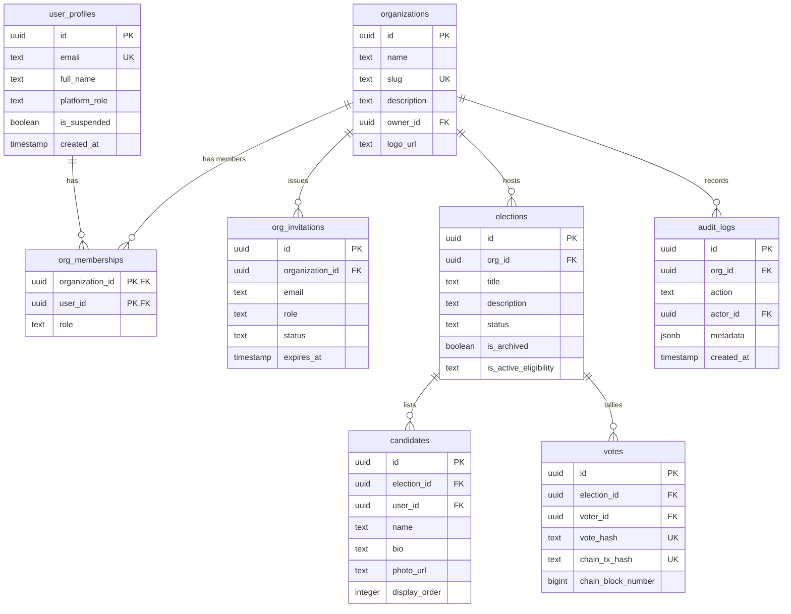
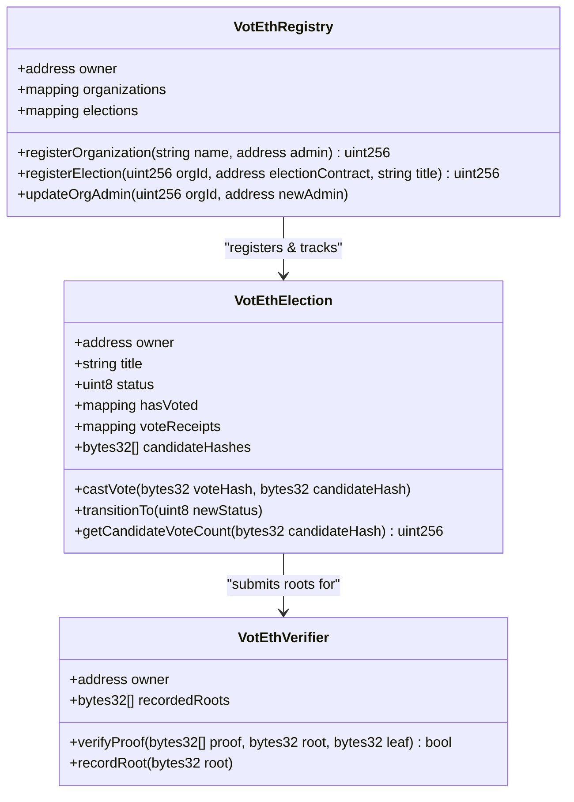

# VotEth 2.0 — Production Readiness & System Architecture Guide

This comprehensive guide serves as the production readiness playbook, deployment manual, and systems architecture directory for the VotEth 2.0 platform.

---

## 🏗️ 1. Database Schema & RLS Policy Matrix

The database is built on **Supabase (PostgreSQL)** with row-level security (RLS) policies fully auditing data scope boundary access:



### Row-Level Security (RLS) Policy Table

| Table | Policy Name | Permitted Roles / Conditions | Action |
| :--- | :--- | :--- | :--- |
| **user_profiles** | `Allow owner bypass / read all` | Platform Owners can select/update all profiles. | `SELECT`, `UPDATE` |
| | `Read public profiles` | Authenticated users can read other profiles. | `SELECT` |
| | `Voter manage self` | Profile owner (`id = auth.uid()`) can edit own name/avatar. | `UPDATE` |
| **organizations**| `Allow owner read/write` | Platform Owners bypass. | `ALL` |
| | `Org admins update` | Users with role `'admin'` in the org can update. | `UPDATE` |
| | `Public view active` | All authenticated users can view active organizations. | `SELECT` |
| **org_memberships** | `Admins write memberships` | Org admins can insert, update, or remove memberships. | `ALL` |
| | `Members select memberships` | Org members can view memberships of their active org. | `SELECT` |
| **org_invitations**| `Admins manage invitations` | Org admins can create/revoke invitations. | `ALL` |
| | `Voters view invited` | Users with matching email can read their invitations. | `SELECT` |
| **elections** | `Admins manage elections` | Org admins can create/update draft/published elections. | `ALL` |
| | `Voters view published` | Eligible voters can view open/closed/published elections. | `SELECT` |
| **votes** | `Voter cast vote` | Authenticated users can insert their own vote receipt. | `INSERT` |
| | `Voter read own receipt` | Users can select their own votes (`voter_id = auth.uid()`). | `SELECT` |
| | `No direct update/delete` | Strictly forbidden. All modifications are disabled. | `ALL` |

---

## 📜 2. Smart Contract Architecture

The decentralized components are written in Solidity, compiling against Hardhat, and deployed to the Polygon Amoy Testnet.

### Class Diagram


---

## 🛠️ 3. Installation & Local Development Setup

### Prerequisites
- Node.js (v18.x or later)
- Git
- MetaMask Extension installed in target browser

### Clone & Install Dependencies
```bash
git clone https://github.com/your-repo/voteth-2.0.git
cd voteth-2.0
npm install
```

### Environment Configurations

Create a local environment file in the `contracts` workspace:
`contracts/.env.local`
```ini
POLYGON_AMOY_RPC_URL="https://rpc-amoy.polygon.technology/"
PRIVATE_KEY="0x_your_private_deployer_key_here"
POLYGONSCAN_API_KEY="your_polygonscan_api_key_here"
```

Create a local environment file in the `frontend` workspace:
`frontend/.env.local`
```ini
VITE_SUPABASE_URL="https://your-supabase-project.supabase.co"
VITE_SUPABASE_ANON_KEY="your-supabase-anonymous-public-key"
VITE_REGISTRY_CONTRACT_ADDRESS="0x5fbdb2315678afecb367f032d93f642f64180aa3"
```

### Running Local Development Environment
1. **Spin up local Hardhat nodes**:
   ```bash
   npm run node --workspace=contracts
   ```
2. **Compile and Deploy smart contracts**:
   ```bash
   npm run deploy:local --workspace=contracts
   ```
3. **Start React Vite Server**:
   ```bash
   npm run dev --workspace=frontend
   ```
4. **Access web app**: Visit `http://localhost:5173`.

---

## 🚀 4. Deployment Playbook

### Smart Contract Deployment (Polygon Amoy Testnet)
Deploy contracts to the testnet using Hardhat:
```bash
npx hardhat run scripts/deploy.ts --network amoy --workspace=contracts
```
Once deployed, copy the Registry contract address and update `VITE_REGISTRY_CONTRACT_ADDRESS` inside your production hosting environment.

### Database Migration Deployment
Use Supabase CLI to apply database schema updates:
```bash
supabase db push
```

### Frontend Deployment (Vercel)
Install Vercel CLI and trigger deployment:
```bash
npm install -g vercel
vercel login
vercel --prod
```
Configure environment variables (`VITE_SUPABASE_URL`, `VITE_SUPABASE_ANON_KEY`, `VITE_REGISTRY_CONTRACT_ADDRESS`) within the Vercel project panel.

---

## 📈 5. Monitoring & Operational Safeguards

- **Performance Auditing**: Use standard telemetry tracking (Vercel Analytics or Sentry) to measure route changes and MetaMask load delay speeds.
- **Failed Transaction Handling**: If gas exhaustion or node drops cause transaction failures on MetaMask, the frontend intercepts the error stack, alerts the voter with visual hints, and aborts Supabase writes to prevent desynchronization.
- **Security Checklists**:
  - Always run `npm audit` to check dependency alerts.
  - Audit custom RLS changes regularly using `supabase db lint`.
  - Validate that HTML inputs use React JSX components to automatically strip standard script injections (XSS mitigation).
