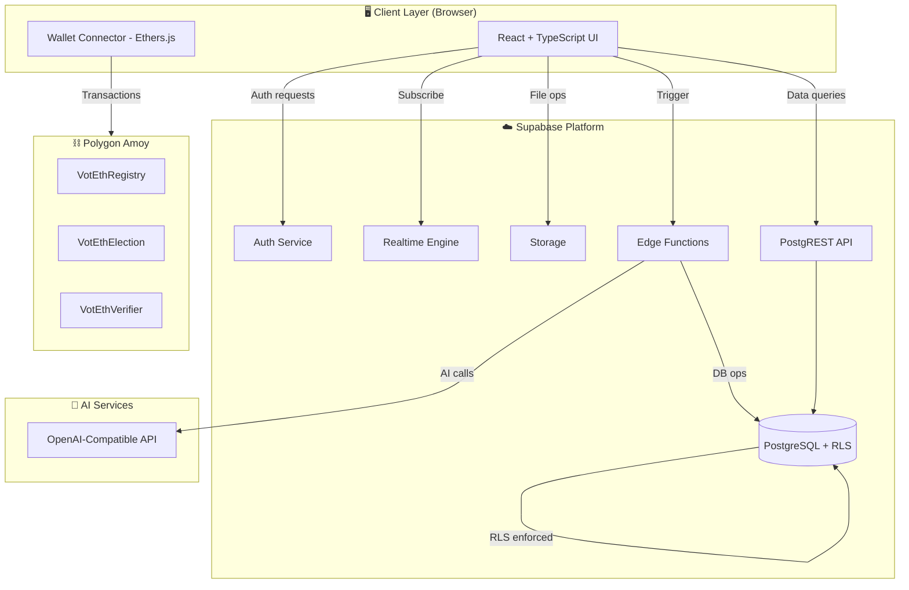
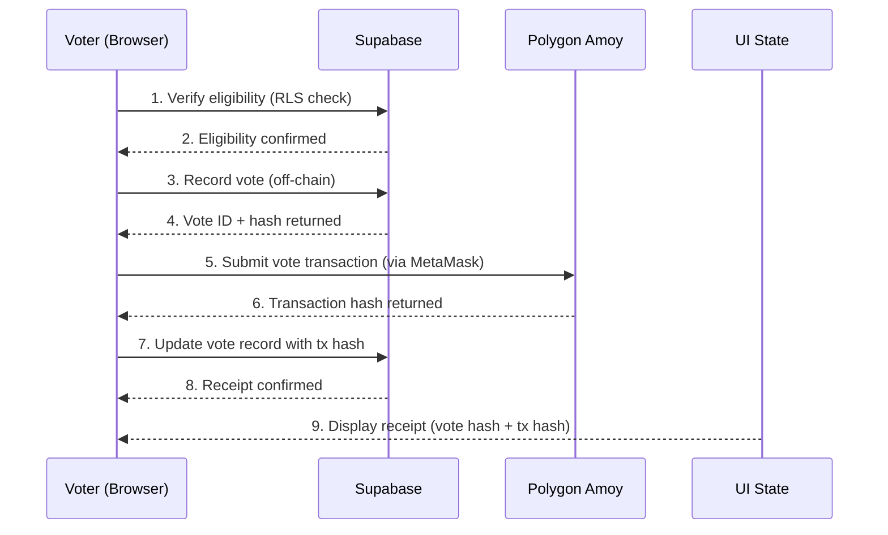
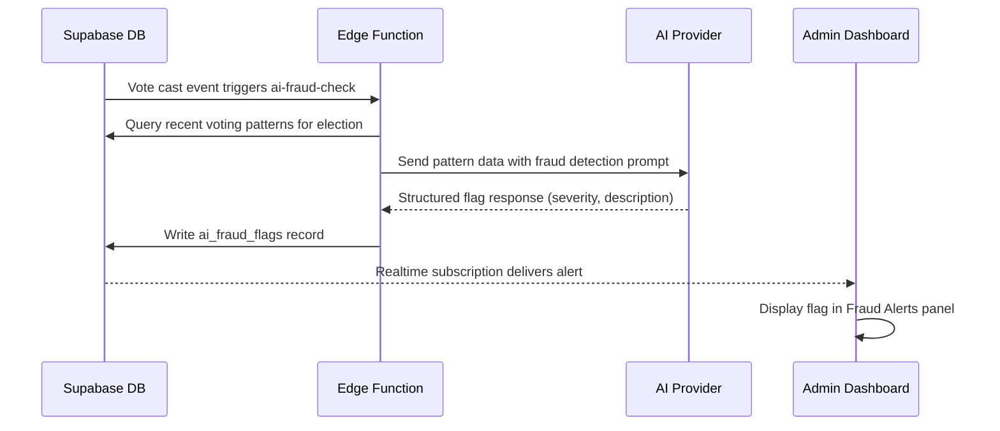
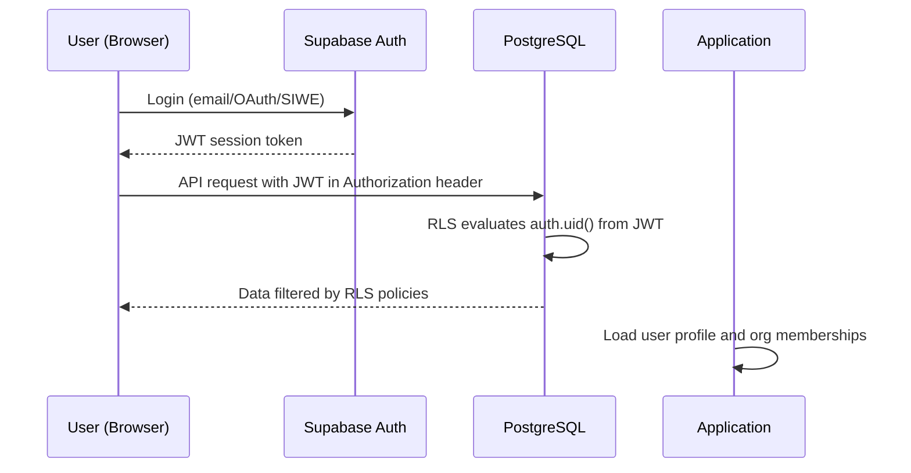
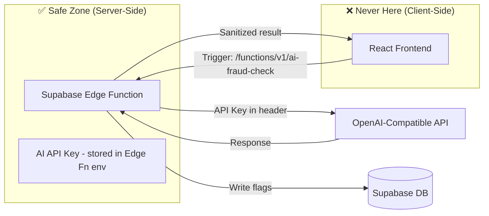

# VotEth 2.0 — System Architecture Overview

**Document Type:** Architecture Reference
**Volume:** I — Foundation & Vision
**Chapter:** 4 — System Architecture Overview
**Last Updated:** June 2026
**Status:** Living Document

---

## Table of Contents

1. [The Three-Layer Architecture](#1-the-three-layer-architecture)
2. [High-Level System Diagram](#2-high-level-system-diagram)
3. [Data Flow Architecture](#3-data-flow-architecture)
4. [Trust Model & Security Boundaries](#4-trust-model--security-boundaries)
5. [The Role of the Blockchain](#5-the-role-of-the-blockchain)
6. [The Role of Supabase](#6-the-role-of-supabase)
7. [AI Integration Architecture](#7-ai-integration-architecture)
8. [Architecture Trade-offs & Justifications](#8-architecture-trade-offs--justifications)

---

## 1. The Three-Layer Architecture

VotEth 2.0 is organized into three distinct layers with explicitly defined trust boundaries. Understanding these layers — and why each boundary exists — is foundational to working correctly on any part of this system.

```
┌─────────────────────────────────────────────────────────────┐
│                    PRESENTATION LAYER                        │
│              React + TypeScript + Tailwind                   │
│         (User's browser — ZERO trust environment)           │
└─────────────────────────┬───────────────────────────────────┘
                          │ HTTPS / WebSocket
┌─────────────────────────▼───────────────────────────────────┐
│                     SERVICE LAYER                            │
│                  Supabase Platform                           │
│   PostgreSQL │ Auth │ PostgREST │ Realtime │ Storage │ Edge  │
│         (Managed trust — RLS is the enforcement layer)       │
└──────────┬──────────────────────────────────────┬───────────┘
           │ JSON-RPC                              │ HTTPS (Edge Fn)
┌──────────▼──────────┐                ┌──────────▼───────────┐
│   BLOCKCHAIN LAYER  │                │      AI LAYER        │
│   Polygon Amoy      │                │  OpenAI-Compatible   │
│   Smart Contracts   │                │  API (via Edge Fn)   │
│  (Zero trust —      │                │  (Server-side only)  │
│  math is the law)   │                └──────────────────────┘
└─────────────────────┘
```

### Layer Responsibilities

| Layer | Technology | Responsibility | Trust Level |
|---|---|---|---|
| **Presentation** | React + TypeScript + Tailwind | User interface, form handling, wallet connection | **Zero trust** — treat as hostile |
| **Service** | Supabase (PostgreSQL, Auth, PostgREST, Realtime, Storage, Edge) | Operational data, authentication, real-time updates, secure AI calls | **Conditional trust** — JWT + RLS |
| **Blockchain** | Polygon Amoy, Solidity contracts | Immutable vote anchoring, cryptographic proofs, on-chain enforcement | **Mathematical trust** — code is law |
| **AI** | OpenAI-Compatible (via Edge Functions) | Fraud detection, election assistant, candidate summarization | **Server-side only** — never client-facing |

---

## 2. High-Level System Diagram



### Component Descriptions

| Component | Description |
|---|---|
| **React + TypeScript UI** | The entire user-facing application. Stateless from a trust perspective — all security enforced server-side. |
| **Wallet Connector (Ethers.js)** | Handles MetaMask connection, network switching, transaction signing. |
| **Auth Service** | Supabase Auth — manages sessions for email/password, OAuth, magic link, and SIWE. |
| **PostgreSQL + RLS** | The operational database. Row-Level Security policies enforce all data access control. |
| **Realtime Engine** | Supabase Realtime — WebSocket-based live updates for vote counts and fraud alerts. |
| **Storage** | Supabase Storage — candidate photos, campaign documents, QR code images. |
| **Edge Functions** | Deno-based serverless functions — the secure execution zone for AI calls and sensitive operations. |
| **PostgREST API** | Auto-generated REST API from the PostgreSQL schema. Enforces RLS on every request. |
| **VotEthRegistry** | On-chain registry of organizations and elections. |
| **VotEthElection** | Per-election contract handling vote submission, double-vote prevention, and result tallying. |
| **VotEthVerifier** | QR code verification and ZK-proof ready verification contract. |
| **OpenAI-Compatible API** | AI provider (GPT-4o-mini, Groq, etc.) accessed exclusively via Edge Functions. |

---

## 3. Data Flow Architecture

### 3.1 Vote Casting Flow (The Critical Path)

The vote casting flow is the most security-critical operation in the system. Every step is deliberate.



> 📐 **Architecture Decision: Off-Chain First**
> The off-chain record (step 3) is committed **before** the blockchain transaction (step 5). This ensures we always have a database record even if the blockchain call fails or the user closes the browser. A reconciliation job can re-submit failed transactions. This is a deliberate trade-off: slight consistency complexity in exchange for vote reliability.

### 3.2 AI Fraud Detection Flow



### 3.3 Authentication Flow



---

## 4. Trust Model & Security Boundaries

```
TRUST LEVEL    │  LAYER             │  ENFORCEMENT MECHANISM
───────────────┼────────────────────┼──────────────────────────
ZERO TRUST     │  Browser/Client    │  Treat as hostile. Never trust.
               │                    │  All validation server-side.
───────────────┼────────────────────┼──────────────────────────
CONDITIONAL    │  Supabase/PostgREST│  JWT auth + RLS policies.
TRUST          │                    │  Trust the token, enforce RLS.
───────────────┼────────────────────┼──────────────────────────
MATHEMATICAL   │  Smart Contracts   │  Trust no one.
TRUST          │                    │  Code is law. Math enforces.
───────────────┼────────────────────┼──────────────────────────
SERVER-SIDE    │  Edge Functions    │  Full trust zone.
ONLY           │                    │  Secrets live here only.
```

> 🔒 **Security Note:** The most common mistake in this architecture is trusting the client. A vote cannot be accepted just because the frontend says it is valid. Every vote submission goes through:
> 1. RLS check in Supabase (is this user in the allowlist for this election?)
> 2. `hasVoted` check in the smart contract (has this address already voted?)
>
> Neither check alone is sufficient. Both layers must enforce independently.

### What Each Layer Enforces

| Layer | What It Enforces |
|---|---|
| **Browser** | UX-level validation (form errors, disabled buttons) — **cosmetic only** |
| **PostgREST/RLS** | Data access control (who can read/write which rows) |
| **Edge Functions** | Server-side business logic, AI calls, sensitive operations |
| **Smart Contracts** | Immutable rules (one vote per address, election open state, candidate existence) |

---

## 5. The Role of the Blockchain

The blockchain serves **one primary function** in VotEth 2.0:

> **Immutable, tamper-evident anchoring of election results.**

### What the Blockchain Does NOT Do

- Store full vote data (gas cost prohibitive)
- Serve as the primary database
- Handle authentication
- Replace Supabase

### What the Blockchain DOES Do

- Record **vote hashes** on-chain (not the vote content — the hash of it)
- Enforce **one-vote-per-wallet** at the smart contract level
- Provide an **independently verifiable result tally**
- Emit events that create an **on-chain audit trail**

> 💡 **The Auditor's Test:** At any point, an independent auditor can ask: *"Does the on-chain tally match the Supabase tally?"* If yes, the system is operating honestly. If no, something has been tampered with — and the blockchain record is the ground truth. This is the core value of the hybrid architecture.

### Smart Contracts

| Contract | Address (Amoy) | Purpose |
|---|---|---|
| `VotEthRegistry` | TBD after deployment | Register organizations and elections on-chain |
| `VotEthElection` | TBD after deployment | Record vote hashes, enforce one-vote-per-wallet, tally results |
| `VotEthVerifier` | TBD after deployment | Verify QR codes and ZK proofs (ZK-ready architecture) |

---

## 6. The Role of Supabase

Supabase is the **operational backbone** of VotEth 2.0:

| Supabase Service | What VotEth Uses It For |
|---|---|
| **PostgreSQL** | All relational data: elections, votes, candidates, organizations, users |
| **Auth** | Email/password, magic link, Google OAuth, GitHub OAuth, SIWE sessions |
| **PostgREST** | Auto-generated REST API — all data access validated through RLS |
| **Realtime** | Live vote count updates, live fraud flag alerts in admin dashboard |
| **Storage** | Candidate photos, campaign documents, generated QR codes |
| **Edge Functions** | Server-side AI calls, webhook handlers, sensitive business logic |

### Supabase Free Tier Limits

| Resource | Free Tier | Expected Usage |
|---|---|---|
| Database storage | 500 MB | ~50 MB |
| Bandwidth | 5 GB/month | <1 GB/month |
| Monthly active users | 50,000 | Demo-scale |
| File storage | 1 GB | <200 MB |
| Edge Function invocations | 500,000/month | Dev-scale |

---

## 7. AI Integration Architecture



### AI Features and Triggers

| Feature | Trigger | Edge Function | Output |
|---|---|---|---|
| **Fraud Detection** | Vote cast event | `ai-fraud-check` | `ai_fraud_flags` record in DB |
| **Election Assistant** | Admin chat message | `ai-election-assistant` | Streamed natural language response |
| **Candidate Summarizer** | Candidate approval | `ai-candidate-summary` | Summary stored in `candidates.ai_summary` |

### AI Provider Abstraction

All AI calls go through a single `aiClient` abstraction in Edge Functions, supporting hot-swap between providers:

```typescript
// ai-engineering/context/ai-provider-strategy.md documents this pattern
// Provider selection via AI_MODEL environment variable
// Compatible providers: OpenAI, Groq, Together AI, Ollama (local)
```

---

## 8. Architecture Trade-offs & Justifications

Every significant architectural decision involves a trade-off. These are documented explicitly so future engineers understand the reasoning — not just the outcome.

| Decision | Trade-off Accepted | Justification |
|---|---|---|
| **Hybrid on/off-chain** | More complex than pure on-chain | Gas costs make pure on-chain prohibitive; hybrid delivers best UX + auditability |
| **Supabase over custom backend** | Vendor dependency | Free tier + RLS + Auth + Realtime saves ~200hrs of backend work; self-host path exists |
| **Vite over Next.js** | No SSR/SSG | Blockchain UX is client-heavy; SSR adds complexity with minimal benefit |
| **Off-chain vote first** | Slight consistency risk window | Ensures DB record exists; blockchain failure does not lose the vote |
| **RLS over application-level auth** | Steeper learning curve | RLS enforced at the database level — cannot be bypassed by application bugs |
| **Polygon Amoy over Ethereum** | Less brand prestige | Free, fast, EVM-identical; production upgrade path is straightforward |
| **OpenAI-compatible abstraction** | Slight indirection layer | Enables provider switching; Groq free tier available as zero-cost fallback |

---

## Cross-References

| Topic | Location |
|---|---|
| Full requirements (functional + non-functional) | [`docs/requirements/requirements.md`](../requirements/requirements.md) |
| Technology stack decisions (ADR) | [`docs/adr/ADR-001-technology-stack.md`](../adr/ADR-001-technology-stack.md) |
| Database schema and RLS design | `docs/architecture/database-schema.md` *(Volume III)* |
| Smart contract specifications | `docs/contracts/` *(Volume VIII)* |
| Volume I summary | [`docs/handbook/volume-i-summary.md`](../handbook/volume-i-summary.md) |
